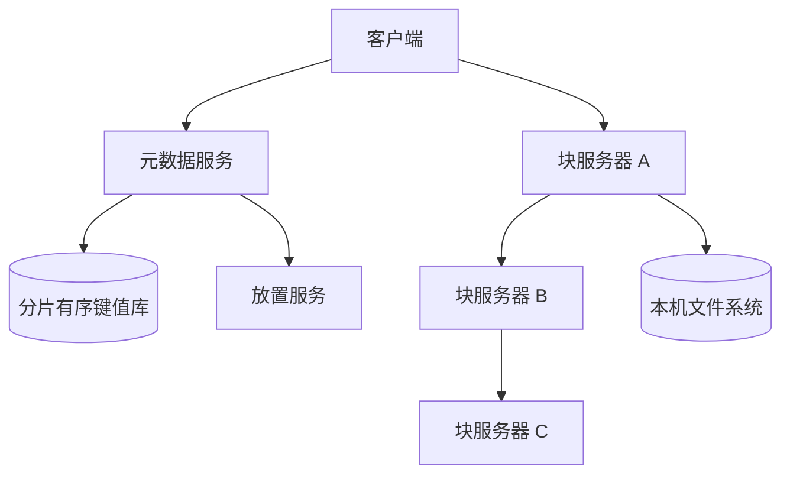

## Q
**设计分布式文件系统（不可变文件、可变目录）**｜系统设计

设计一个层级式的分布式文件系统：文件一旦写入就不可变（不能修改、不能追加），目录可变（可以增删文件和子目录）。接口为 `getFile(path, offset, length)`、`putFile(path, data)`、`createDirectory(path)`、`listDirectory(path)`、`delete(path)`。存储数百 PB 数据，服务数千个客户，只考虑单区域、单机房；不能直接使用 S3、GFS 这类现成的分布式存储，但可以使用单机文件系统、数据库和键值存储。面试官常追问：大文件和放置服务、复制与版本、数据损坏后怎么恢复、超大目录、删除怎么做。

给出完整解答：需求、核心实体与接口、整体设计、深入问题、取舍、不同级别的期望。

## A
**一句话。** 把"名字"和"字节"拆成两个系统：元数据服务管目录树和文件到数据块的映射，可变、要强一致、数据量小；数据服务存不可变的数据块，量大，只管复制、校验和修复。不可变让数据一侧不需要任何副本一致性协议，所有复杂度压到元数据一侧，写入的提交点就是一次目录项的原子写入。

**60 分钟路线。**

| 时间 | 做什么 |
|---|---|
| 0–6 分 | 问清范围，估算：200 PB、约 31 亿个文件、元数据约 625 GB |
| 6–11 分 | 实体（目录项、文件、数据块）和接口 |
| 11–25 分 | 整体设计：元数据分片、块服务器、放置服务、写读路径 |
| 25–50 分 | 必讲深入：元数据与数据分离加原子发布；分块与放置；耐久（校验、修复、回收） |
| 50–60 分 | 追问：路径解析缓存、小文件、大目录、纠删码与版本 |

**需求。**
- 功能：
  - `putFile` 创建不可变文件，路径已存在则拒绝，不覆盖；
  - `getFile` 支持范围读；
  - `createDirectory`、`listDirectory`；
  - `delete` 可删文件或目录（目录递归）。
- 非功能：
  - 耐久第一，数据不能丢；
  - 目录操作强一致：创建后立即可见，列目录不漏；
  - 范围读吞吐高；
  - 水平扩展到数百 PB；
  - 多租户，每个客户独立的命名空间和配额。
- **估算：200 PB 规模：** 估算（假设逻辑数据 200 PB、平均文件 64 MB、块服务器 24 块盘 × 20 TB）：
  - 三副本原始容量 600 PB；每台 24 × 20 TB = 480 TB，600 PB ÷ 480 TB = 1,250 台，按 75% 水位约 1,670 台；纠删码（6+3，开销 1.5 倍）原始 300 PB，约 830 台，用于冷数据；
  - 文件数 200 PB ÷ 64 MB ≈ 31 亿；每个目录项加块信息约 200 B（假设），31 亿 × 200 B ≈ 625 GB，分 32 片每片约 20 GB。若小文件占多数，平均 1 MB 就是 2,000 亿个文件、40 TB 元数据，瓶颈会从数据变成元数据；
  - 块大小 128 MB：2 GB 文件约 16 块；1 TB 文件 7,813 块，块列表约 7,813 × 16 B ≈ 125 KB，不适合内嵌在目录项里；
  - 耐久（独立失效的乐观估计）：磁盘年故障率 2%，修复窗口 1 小时，窗口内故障概率 0.02 ÷ 8,760 ≈ 2.3×10^-6；一个块三副本全丢的年概率 ≈ 0.06 × 2 × (2.3×10^-6)² ≈ 6×10^-13，乘 37.5 亿个块（31 亿文件 × 1.2 块）≈ 0.2%/年。现实中机架、电源的相关故障占主导，所以要跨机架放置。

**核心实体与接口。**
- 实体：
  - 目录项（`(tenantId, dirId, name)` → 类型、子目录 `dirId` 或 `fileId`、大小、创建时间）；
  - 文件（`fileId` → 大小、校验和、块列表）；
  - 数据块（`chunkId`、大小、每 64 KB 一个 CRC、副本位置）；
  - 块服务器（机架、容量、心跳）。
- 目录用稳定的 `dirId` 做键的一部分，而不是路径，改名只改父目录里的一个目录项。
- **内部多三个接口：** 接口除题给的五个外，内部还有：`BeginUpload → {fileId}`，`AllocateChunks(fileId, n) → 副本位置`，`Commit(fileId, path)`。

**整体设计。**

写入 `putFile`：
1. 客户端向元数据服务开始上传：校验父目录存在和配额，拿到全局唯一的 `fileId`。
2. 放置服务为每个块选 3 台块服务器，至少跨 2 个机架，优先剩余空间多、负载低的。
3. 客户端把块流式写给第一台，第一台边收边转发给第二台，第二台再转给第三台（流水线，复制流量不占客户端出口）。每 64 KB 带一个 CRC，三台都落盘后才确认这个块。
4. 所有块确认后，先写块列表（键为 `fileId`）。
5. 提交：在父目录所在分片的一个事务里写目录项，仅当名字不存在。这是唯一的提交点：之前任何一步失败，文件对外不可见，已写的块成为孤儿，之后被回收。

读取 `getFile`：逐级解析路径得到 `fileId` 和块列表；块序号 = `offset ÷ 128 MB`；对覆盖 `[offset, offset+length)` 的块，直接从最近、负载低的副本读，校验 CRC，失败就换下一个副本。元数据服务不在数据路径上。

`listDirectory` 是对 `(tenantId, dirId, *)` 的范围扫描，分页游标是最后一个名字。

**深入。**

1. 【必讲】元数据与数据分离，靠原子发布保证一致。
   - 为什么拆：数据 200 PB 且不可变，元数据 625 GB 且可变，规模和一致性要求相反。把强一致的部分做小，其余享受不可变的便利：副本之间没有写冲突，不需要锁和租约，缓存永不失效，修复就是拷贝。
   - 命名空间分片：键 `(tenantId, dirId, name)` 的有序键值库，做范围分区，每片三副本、用共识协议（Raft）复制。同一目录的目录项相邻，所以列目录是一次范围扫描，`putFile` 和 `createDirectory` 都是单片事务；分片按大小和负载自动分裂，百万子项的大目录会被拆到多片，不会压垮一片。
   - 为什么不按路径哈希：列目录要散射到所有分片；改目录名要改整棵子树的键。
   - 写入顺序是"先写不可变的东西，最后翻一个指针"：块、块列表、目录项。崩溃在任何一步，都不会出现半成品文件。

2. 【必讲】分块、放置与写流水线。
   - 块大小 128 MB（假设）：取 8 MB 则 1 TB 文件要 12.5 万个块，元数据膨胀；取太大则并行度低、修复粒度粗。
   - 放置服务根据心跳掌握各块服务器的容量、机架和负载。副本跨机架，是为了扛机架或交换机故障；优先空间多的机器，避免热点；同一文件的不同块分散到不同机器，读时并行。
   - 三个副本都落盘才确认：数据不可变，没有以后对账的机会。某台太慢，超时后换一台重写，这个块还没提交，没人看得见。
   - 大文件：客户端并行上传多个块，最后一次提交；断点续传就是询问哪些块已确认。

3. 【必讲】耐久：校验、修复、删除回收。
   - 校验：每 64 KB 一个 CRC，读时校验；块服务器后台周期性擦洗（scrub），读遍所有块校验，发现静默损坏（比特腐烂）上报元数据，不能等用户读到才发现。
   - 修复：心跳超时（如 10 分钟）或块损坏，使副本数少于 3，进修复队列。队列按"剩余好副本数少的优先"出队（优先队列），限速防止修复风暴占满网络，从好副本拷贝到新机架的机器。上面的耐久估算说明：修复窗口缩短一半，丢块概率降到四分之一。
   - 删除：一个事务摘掉目录项，数据异步回收：周期性比对块服务器上的块和元数据引用的块，差集在宽限期（如 7 天）后删除（标记清除）。宽限期留给误删恢复，也兜住未提交上传的孤儿块。
   - 递归删除：摘掉子树根的目录项那一刻整棵子树对外不可见（原子），后台任务再逐层回收，不阻塞用户。

4. 【追问再讲】路径解析与缓存。深度 d 的路径要 d 次目录项查找，可能跨片。网关缓存（租户、路径前缀）到 `dirId` 的映射；目录是可变的，所以缓存要能失效：带目录版本号或短过期（如 1 秒），删除和改名时按前缀清除。`fileId` 对应的块列表永不变，可永久缓存。

5. 【追问再讲】小文件。平均 1 MB 时元数据 40 TB。做法：把小文件打包进大"容器块"，目录项指向 `(containerId, offset, length)`。文件不可变，打包很简单；代价是删除要靠容器整理（compaction）回收空间。

6. 【追问再讲】版本与改名：文件不可变，所以"更新"就是写新 `fileId` 再把目录项指向它，旧版本保留一段时间；改名在同一分片内是一个事务，跨分片要先写新项再删旧项，需要键值库提供跨片事务才能原子。

7. 【加分】冷数据用纠删码（6+3）：200 PB 只需 300 PB 而不是 600 PB，省 300 PB；代价是修复要读 6 个块，小范围读可能要重建。多租户：键前缀加配额，每租户独立的加密密钥（信封加密）。

**取舍与追问。** 按被问到的可能性排，通常口述就够：
- 单机到分布式的对应：
  - 单进程的内存文件系统（[[design-in-memory-file-system]]、[[hi-low-level-design-problem-breakdowns-file-system]]）是目录节点里放"名字到子节点"的字典；分布式后变成有序键值库里 `(dirId, name)` 的键，目录项的互斥从一把锁变成分片内的事务；
  - 分配磁盘块的空闲链表变成放置服务；
  - 本地"先写临时文件再改名"的崩溃安全写法，变成"先写块和块列表，最后原子提交目录项"。
- **不学 GFS 的单主节点：** 为什么不学 GFS 把全部元数据放一台主节点内存里：625 GB 单机内存勉强放得下，但吞吐、故障恢复和小文件场景都放不下；分片加共识复制避免单点。
- 列目录必须强一致，从分片的领导者（或带读索引）读；文件数据可以读任何副本，因为不可变。
- 扩容：加块服务器后，放置服务优先往新机器写，旧数据在后台限速再均衡。
- 可观测性：欠副本块数、修复积压、擦洗发现的坏块率、分片热度、元数据 p99。

**级别期望。**
- 中级：元数据和数据分开，文件切块、多副本，路径逐级解析。
- 高级：原子提交点、元数据分片方式、放置跨机架、写流水线、校验与修复、延迟回收。
- 资深/专家：用数字说明元数据规模和小文件风险、耐久概率与修复窗口的关系、范围分区的好处、缓存失效边界、纠删码与副本的取舍。

**先修概念。**
- [[hi-system-design-patterns-large-blobs|大文件（Blob）处理]]
- [[hi-system-design-core-concepts-sharding|分片（Sharding）]]
- [[hi-system-design-core-concepts-cap-theorem|CAP 定理]]
- [[hi-system-design-core-concepts-data-modeling|数据建模]]

**同类题。**
- [[hi-system-design-problem-breakdowns-dropbox|文件存储（Dropbox）]]
- [[hi-low-level-design-problem-breakdowns-file-system|文件系统]]
- **相关题：** [[design-in-memory-file-system]]
- 分布式键值存储：同样用共识复制分片，并把大值拆块
