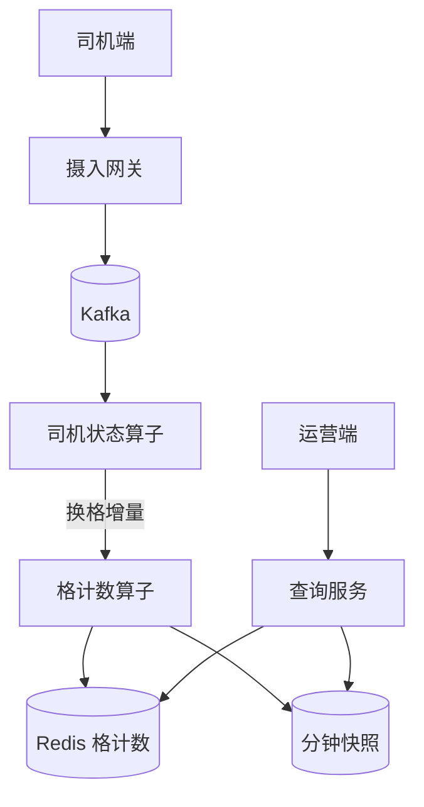

## Q
**设计司机实时热力图后端**｜系统设计

设计一个实时司机追踪系统：司机端持续上报位置和状态，系统生成热力图（heatmap），显示各个地理区域的在线司机密度，给运营团队缩放、平移查看。面试官常追问：位置更新怎么摄入、司机跨区时计数怎么不出错、司机失联怎么办、地图缩放时怎样出结果、"过去 20 分钟"这类时间窗口、热点区域。

给出完整解答：需求、核心实体与接口、整体设计、深入问题、取舍、不同级别的期望。

## A
**一句话。** 热力图就是"每个格子里现在有多少司机"的计数。把世界切成分层网格，司机只在换格子时才改计数（旧格减一、新格加一），失联靠超时补减。写入量大但状态很小，难点是计数不漂移，不是存储。

**60 分钟路线。**

| 时间 | 做什么 |
|---|---|
| 0–6 分 | 问清实时性、时间窗口和使用者，估算：250,000 次更新/秒，状态仅 24 MB |
| 6–10 分 | 实体（司机状态、格计数）和接口 |
| 10–25 分 | 整体设计：摄入 → 按司机分区的状态 → 换格增量 → 按格聚合 → 查询 |
| 25–50 分 | 必讲深入：网格与分层；换格增量与失联过期；计数不漂移 |
| 50–60 分 | 追问：读路径与瓦片缓存、时间窗口、隐私与多区域 |

**需求。**
- 功能：
  - 司机上报 `(driverId, lat, lng, status, ts)`；
  - 运营按视口（bbox）和缩放级别查看每个格子的在线司机数；
  - 可选：查看过去 20 分钟的窗口。
- 非功能：
  - 数据新鲜度在 10 秒内（假设）；
  - 司机失联后 30 秒内从图上消失；
  - 允许近似，但计数不能持续偏离真实值；
  - 读很少，写很多。
- **在线司机上报估算：** 估算（假设 100 万在线司机，每 4 秒上报一次，每条 100 B）：
  - 更新速率 10^6 ÷ 4 = 250,000 次/秒，约 25 MB/s；
  - 状态：每个司机 `driverId` 8 B + 所在格 8 B + 最后上报时间 8 B = 24 B，24 B × 10^6 = 24 MB，一台机器的内存就放得下。分片是为了吞吐和可用性，不是为了容量；
  - 格子：用 geohash（地理哈希，把经纬度编成字符串，前缀相同即在同一个更大的格里）。6 位格约 1.22 km × 0.61 km ≈ 0.74 km²。时速 30 km/h ≈ 8.3 m/s，直线穿过 1.2 km 约 144 秒；假设平均每 100 秒换一次格、60% 的司机在移动，换格速率 10^6 × 0.6 ÷ 100 = 6,000 次/秒，每次两条增量共 12,000 条/秒，比 250,000 次更新少约 20 倍；
  - 格数（假设司机分布在 500 个都市区，每个 1,000 km²，共 500,000 km²）：6 位格约 500,000 ÷ 0.74 ≈ 67 万个，5 位格（4.9 × 4.9 = 24 km²）约 2.1 万个，4 位格（39 × 19.5 = 760 km²）约 660 个；每格键加计数约 20 B，最细层约 13 MB，整张热力图放得进一台 Redis；
  - 视口：30 km × 30 km = 900 km² 的城市视口，6 位层要 1,200 个格，5 位层只要 38 个，所以按缩放选层，每次响应控制在约 1,000 个格（约 12 KB）以内。

**核心实体与接口。**
- 实体：
  - 司机状态（`driverId` → 所在格、`lastSeen`、`status`）；
  - 格计数（层级、格 → 在线司机数）；
  - 分钟快照（层级、格、分钟 → 计数），用于时间窗口。
- 接口：
  - 司机端 `POST /locations`（批量或长连接）；
  - 运营端 `GET /heatmap?bbox=&zoom=` → `[{cell, count}]`；
  - `GET /heatmap/stream?bbox=&zoom=`（SSE 只推变化的格）；
  - `GET /heatmap?bbox=&zoom=&window=20m`。

**整体设计。**

1. 网关校验经纬度，丢弃时间戳更旧的点，写 Kafka，按 `driverId` 分区，同一司机的点保持顺序。
2. **司机状态算子只发增量：** 司机状态算子（流处理引擎里按 `driverId` 分区的状态）：新点算出所在格，和旧格相同就只刷新 `lastSeen`，不输出；不同就输出（旧格，−1）和（新格，+1），三个层级各一对。
3. 失联：每个司机注册一个 `lastSeen + 30 s` 的定时器，触发时若没有新点，输出（所在格，−1）并删除状态。
4. **格计数按 geohash 前缀分区：** 格计数算子按 geohash 前 3 位分区（相邻格同分区，视口查询只碰少数分区），每秒汇总一次写 Redis。
5. 查询：视口 → 选层 → 枚举覆盖的格 → 管道批量读 Redis → 前端着色。
6. 每分钟把当前计数落一份快照到时序存储，用于时间窗口。

**深入。**

1. 【必讲】网格与分层分辨率。
   - 选择：geohash 前缀就是更粗的格，同时维护 4、5、6 位三层。
   - 为什么：只维护最细层，城市视口要 1,200 个格，全球视图要几十万个；预聚合分层让每次查询不超过约 1,000 个格。查询时现算（扫描 100 万个司机）更不可取。
   - geohash 对比 H3：geohash 是矩形，格形随纬度变化，相邻格的前缀可能完全不同；H3 的六边形邻居等距，做相邻平滑更合适。只做计数，geohash 足够。
   - 热力图是"格内"计数，不是"半径内"；找附近司机要查九宫格再精确过滤，那是派单的问题。

2. 【必讲】换格增量与失联过期。
   - 问题：每条更新都加一，一个司机会被算成无数次。
   - 选择：状态按 `driverId` 分区，记住所在格，只在换格时输出减一加一，输出量从 250,000 条/秒降到约 12,000 条/秒（最细层，粗层更少）。
   - 失联：司机关掉应用或没信号，不会再上报，旧格里的计数永远留着，所以要超时补减。30 秒约 7 个上报周期；太短，进隧道几秒无信号就闪烁消失，太长，图上有"幽灵"司机。
   - `status`：载客中的司机是否算密度，取决于产品；按状态分别计数，多一个维度，或只统计空闲司机。

3. 【必讲】计数不漂移：增量系统的通病。
   - 风险：至少一次投递会重复增量，计数永久偏大；减一和加一乱序会出现负数。
   - 措施：
     - 状态算子和计数算子放在同一个流处理引擎里，用检查点（checkpoint）得到恰好一次的状态效果，输出按"窗口号加格"幂等覆盖写；
     - 每分钟用司机状态全量重算一次格计数，覆盖掉残留误差；
     - 对账指标：所有格之和应约等于在线司机数，偏差超过 1% 告警。
   - 热点格（机场、散场的演唱会）不是瓶颈：增量只在越界时产生，5 万司机 10 分钟涌入一个格，平均 50,000 ÷ 600 ≈ 83 次/秒，一个 Redis 键就够。真正的压力是 250,000 次/秒的摄入，靠 64 个 Kafka 分区水平扩展（每分区约 3,900 条/秒）。

4. 【追问再讲】读路径：瓦片加缓存。视口按固定瓦片 `(zoom, x, y)` 请求，每个瓦片的响应缓存 5 秒。1,000 个运营看板每 5 秒刷新就是 200 次/秒，大家看同一座城市时命中同一批瓦片，后端压力不随观众增长。需要实时变化时用 SSE 按瓦片订阅，只推变化的格。

5. 【追问再讲】时间窗口（如过去 20 分钟）：每分钟存一份各层计数快照，窗口查询取 20 份聚合（平均或最大）。存储：(67 万 + 2.1 万 + 660) 个格 × 20 B ≈ 14 MB/分钟，一天 1,440 分钟约 20 GB，只存非零格更小。窗口内各分钟相加会把换格的司机重复计数，热力图可以接受；要精确去重才需要 HyperLogLog 这类近似去重结构。

6. 【追问再讲】隐私与多区域：格内司机少于 k（如 3）个就不显示，防止定位到个人。司机上报到就近区域，区域内独立计算，全球视图只汇总最粗一层（660 个格），数据量小，可以跨区同步。

7. 【加分】客户端：视口变化做防抖，离屏格不请求；颜色用对数刻度分级，避免一个超热格把其余格压成同一种颜色。

**取舍与追问。** 按被问到的可能性排，通常口述就够：
- **预聚合而非逐点数：** 为什么不把全部司机放 Redis 的地理索引再按视口数点：读一次要扫视口内所有点，100 万点太贵；这里要的是计数不是点位，所以提前聚合。
- 为什么先按司机分区再按格聚合：司机状态需要有序、单写者；计数需要按空间聚合，视口才局部。中间一次洗牌只传十几万以内的增量。
- 单机到分布式的对应：
  - 单进程是 `HashMap<driverId, cell>` 加一个计数数组，`count[old]--; count[new]++` 一个函数搞定，天然不会漂移；分布式后这一对操作落在两个分区，变成两条消息，于是出现重复和乱序，需要检查点和定期校正；
  - 失联超时：单机用按 `lastSeen` 排序的最小堆（或带过期时间的缓存，[[design-ttl-cache]]）；分布式变成流处理引擎的定时器，本质是延迟队列；
  - 20 分钟窗口：单机是按分钟分桶的环形计数器（[[design-hit-counter]]）；分布式是每分钟一份快照加窗口聚合。
- 吞吐翻 10 倍：Kafka 分区和算子并行度翻倍；状态 240 MB 仍小，计数层不变。
- 可观测性：端到端新鲜度（事件时间到图上可见）、各格之和与在线司机数的偏差、定时器积压、Kafka 消费延迟。

**级别期望。**
- 中级：司机上报进队列，按网格（geohash 或四叉树）聚合计数，查询返回各格数字。
- 高级：换格才改计数、失联超时、分层分辨率、按视口查询、流处理的分区方式。
- 资深/专家：用数字说明状态很小、写入才是瓶颈；增量漂移的成因和校正；瓦片缓存让读不随观众增长；时间窗口的存储；隐私和多区域。

**先修概念。**
- **邻近搜索：** [[hi-system-design-deep-dives-proximity-search|邻近搜索（Proximity Search）]]
- [[hi-system-design-deep-dives-kafka|Kafka]]
- [[hi-system-design-deep-dives-flink|Flink]]
- [[hi-system-design-deep-dives-time-series-databases|时序数据库]]
- [[hi-system-design-patterns-scaling-writes|扩展写]]

**同类题。**
- [[hi-system-design-problem-breakdowns-uber|网约车（Uber）]]
- [[hi-system-design-problem-breakdowns-ad-click-aggregator|广告点击聚合]]：同样是流式窗口聚合
- **相关题解：** [[design-ride-sharing]]
- 外卖平台（附近餐厅）：同样用网格做空间索引
