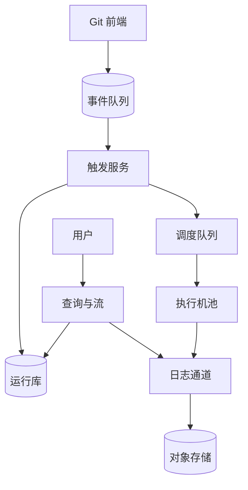

## Q
**设计 CI/CD 平台（类 GitHub Actions）**｜系统设计

设计一个多租户（multi-tenant）的 CI/CD 平台：用户把代码推送（push）到仓库后，系统读取仓库里的工作流文件，自动在隔离的机器上执行其中的任务，并让用户实时观察执行过程。规模约 1,000 万个仓库，平均每秒 10 次推送，有突发。面试官常追问：突发怎么吸收、任务怎么分给执行机、执行机崩了怎么办、日志怎么实时看、多租户怎么公平和隔离、怎么取消和重试。

给出完整解答：需求、核心实体与接口、整体设计、深入问题、取舍、不同级别的期望。

## A
**一句话。** 这是事件驱动的"推送 → 运行 → 任务依赖图 → 执行机"流水线：事件靠持久队列和幂等键恰好一次地变成运行；任务进按租户公平排队的队列，由执行机带租约地拉取；日志走独立的分块追加通道。难点不在吞吐（数字很小），在公平、失联恢复和不可信代码的隔离。

**60 分钟路线。**

| 时间 | 做什么 |
|---|---|
| 0–5 分 | 问清范围，估算：120 个任务/秒，约 36,000 个并发任务 |
| 5–10 分 | 实体（运行、任务、执行机、日志块）、状态和接口 |
| 10–25 分 | 整体设计：事件队列 → 触发服务 → 调度队列 → 执行机 → 日志通道 |
| 25–50 分 | 必讲深入：事件到运行的幂等；公平队列加租约；日志与实时观察 |
| 50–60 分 | 追问：突发扩容、隔离与安全、取消重跑、缓存 |

**需求。**
- 功能：
  - 推送触发：读取该提交下的 `.github/workflows/*.yml`，按 `on` 的分支、路径条件过滤；
  - 一个运行（run）含多个任务（job），任务之间有依赖（`needs`），每个任务含若干步骤；
  - 在隔离环境执行，并实时查看状态和日志；
  - 取消、重新运行。
- 非功能：
  - 触发延迟（推送到任务入队）p99 在 5 秒内（假设值，不含排队）；
  - 不丢事件、不重复触发；
  - 租户公平，一个租户的突发不饿死别人；
  - 执行的是不可信代码，必须隔离；执行机随时可能失联；
  - 日志延迟约 2 秒内。
- **构建量估算：** （假设每次推送触发 3 个工作流，每个 4 个任务，任务平均 5 分钟）：
  - 任务启动速率 10 × 3 × 4 = 120 个/秒，突发按 10 倍是 1,200 个/秒；每天 864,000 次推送、约 1,040 万个任务；
  - 并发任务（利特尔定律）= 120 × 300 s = 36,000，一个任务占一个执行槽；
  - 突发持续 1 分钟多出 (1,200 − 120) × 60 = 64,800 个任务；执行池设 50,000 槽（假设），空闲 14,000 槽每 300 s 周转一轮，只能额外消化约 47 个/秒，要 64,800 ÷ 47 ≈ 23 分钟，所以光靠余量不够，要靠扩容和租户并发上限；
  - 日志：每任务 2,000 行 × 100 B = 200 KB，120 × 200 KB = 24 MB/s，约 2 TB/天。

**核心实体与接口。**
- 实体：
  - 运行（Run：`runId`、`repoId`、`sha`、`eventId`、状态）；
  - 任务（Job：`jobId`、`runId`、`needs`、`labels`、状态、`leaseUntil`、`attempt`）；
  - 执行机（Runner：`labels`、最近心跳）；
  - 日志块（LogChunk：`jobId`、`seq`、字节）。
  - Job 状态：`BLOCKED → READY → RUNNING → SUCCESS | FAILURE | CANCELLED`。
- 面向用户：`GET /runs/{id}`；`GET /jobs/{id}/logs?from=seq`（SSE 流）；`POST /runs/{id}/cancel`；`POST /runs/{id}/rerun`。
- 面向执行机（执行机主动连出）：`POST /runners/poll`（长轮询，返回任务和租约）；`POST /jobs/{id}/heartbeat`；`POST /jobs/{id}/logs`（带 `seq` 的块）；`POST /jobs/{id}/complete`（带 `attempt`）。

**整体设计。**

1. Git 前端更新引用后，用事务发件箱（outbox）把 `PushEvent(repoId, sha, ref, eventId)` 写进 Kafka，按 `repoId` 分区。引用更新和发事件在同一个事务里，事件才不会丢。
2. 触发服务消费事件，按 `sha` 从 git 存储读工作流文件，解析、按 `on` 过滤、展开矩阵（matrix），在运行库的一个事务里创建 Run 和全部 Job。无依赖的 Job 标 `READY` 并进调度队列，其余 `BLOCKED`。
3. 调度队列按标签分池，池内按租户公平出队；执行机长轮询领任务，得到租约。
4. 执行机是一次性的 microVM 或容器：领任务、跑步骤、上传日志块、心跳续租、上报结果，然后销毁。
5. 任务完成上报后，用条件更新落状态，再检查依赖它的后继任务是否全部满足，满足的转 `READY`。
6. 状态库按 `repoId` 分片，一个运行的所有任务在同一片，状态流转是本地事务。

**深入。**

1. 【必讲】事件到运行：至少一次投递加幂等创建。
   - 队列的作用：推送峰值 100 个/秒数据库顶得住，但解析要读 git，慢且会失败；队列让触发服务按自己的速度消费和重试，突发只是积压。
   - 恰好一次：Kafka 至少一次，所以 Run 带唯一键 `(repoId, sha, workflow, eventId)`，重复消费插入失败即跳过。
   - 按 `sha` 读文件，不读分支最新：处理时分支可能已前进，读最新会让这次推送执行别人的代码。
   - 工作流文件有语法错误时，创建一个失败的运行并把错误展示给用户，不能静默丢弃。

2. 【必讲】任务分发：公平队列、拉取式执行机、租约。
   - 为什么拉取：执行机在内网或客户自托管，只能主动连出；控制平面不用知道谁空闲，背压是天然的。
   - 公平：每个租户一个子队列，用赤字轮转（deficit round robin）出队，再加每租户并发上限（假设免费 20、企业 500）。一个租户一次推 10 万个任务，只占自己的份额。
   - 租约：执行机领任务得到 `leaseUntil = now + 60 s`，每 20 s 心跳续租。租约过期说明执行机失联，调度器把任务重置为 `READY`、`attempt + 1`。旧执行机之后上报的结果带旧的 `attempt`，被拒绝（围栏）。
   - 重排还是判失败：步骤可能有副作用（部署），默认失联即失败，用户可配置重试。

3. 【必讲】日志与实时观察。
   - 日志是追加写的流：执行机每 2 秒把缓冲的行打成块 `(jobId, seq, bytes)` 上传。并发 36,000 个任务就是 18,000 块/秒的小写入，不能每块一次对象存储写，要先进 Kafka（按 `jobId` 分区），消费者批量落成对象存储里的分段文件，同时把块推给 Redis 发布订阅。
   - 观看：浏览器用 SSE，带 `from=seq` 重连续传。先读已落盘的段，再接实时尾部，用 `seq` 去重衔接；已结束的任务直接读对象存储。
   - 密钥脱敏在执行机端做，日志离开机器前就已经替换。

4. 【追问再讲】突发与扩容。上面算过空闲余量要 23 分钟才能清掉积压，措施：按"最老任务等待时间"扩容执行机（暖池加 Kubernetes 自动伸缩，冷启动约 30 秒，假设）；定时（cron）触发的任务优先级低于推送；租户并发上限保护其他人。排队时间是头号指标。

5. 【追问再讲】隔离与安全。每个任务一个新的 microVM 或带用户态内核的容器，跑完销毁，不复用；来自 fork 的拉取请求不给密钥；密钥由控制平面按任务签发短期令牌，运行时才注入；出站网络按策略限制；用配额和异常检测对付挖矿滥用。

6. 【追问再讲】取消与重跑。取消是对运行和任务做条件更新为 `CANCELLING`，执行机在心跳响应里收到取消信号，结束进程树，最终态由执行机上报或租约超时落定。同分支来了新推送时自动取消旧运行（并发组 `concurrency group`）。

7. 【加分】缓存与产物：依赖缓存按 `(repo, key)` 存对象存储，产物设保留期；执行镜像预热到暖池节点。

**取舍与追问。** 按被问到的可能性排，通常口述就够：
- **单机到分布式的对应**（面试官爱问"这和你写过的什么一样"）：
  - 线程池（[[design-thread-pool]]）里 worker 取任务，崩了整个进程一起崩；这里执行机会无声消失，所以锁变成租约，再加围栏号；
  - 按拓扑序执行依赖图（[[design-amz-dag-runner]]）变成"依赖表加完成事件触发后继就绪"；
  - 令牌桶限速变成每租户并发上限加赤字轮转；
  - 进程的标准输出管道变成带序号的分块追加日志。
- 是否用 Temporal 这类工作流引擎：每个运行一个工作流，重试和依赖开箱即用；但执行机租约、日志通道仍要自建，自建状态机加数据库更便宜、更可控；规模小或流程复杂时再选它。
- 热点仓库：单仓库每分钟上百次推送也只是每秒几十行任务写入，不构成瓶颈；超大矩阵（上千个任务）要限制展开数量。
- 可观测性：触发延迟、排队等待 p99、租约过期率、各池利用率、日志落盘延迟；租约过期率突增通常是执行机池出问题。
- 自托管执行机：同一套拉取协议，只是池由客户管理，调度器不关心机器在哪。

**级别期望。**
- 中级：画出推送触发、解析工作流、任务队列、执行机、日志存储的流程，知道要隔离执行环境。
- 高级：队列吸收突发加幂等创建、拉取式分发与租约、任务依赖图、日志的分块与重连续传、按租户公平。
- 资深/专家：用数字说明突发要靠扩容而不是余量、围栏防止旧执行机写入、公平算法与并发上限、隔离模型与密钥下发、与工作流引擎的取舍。

**先修概念。**
- [[hi-system-design-patterns-long-running-tasks|长时间运行的任务]]
- [[hi-system-design-patterns-multi-step-processes|多步骤流程]]
- [[hi-system-design-deep-dives-kafka|Kafka]]
- [[hi-system-design-patterns-realtime-updates|实时更新]]
- [[hi-system-design-patterns-dealing-with-contention|处理争用（Contention）]]

**同类题。**
- [[hi-system-design-problem-breakdowns-job-scheduler|分布式任务调度（Airflow）]]
- [[hi-system-design-problem-breakdowns-leetcode|在线判题平台（LeetCode）]]：同样要隔离执行不可信代码
- **任务调度器设计：** [[design-task-scheduler]]
- 延迟支付调度服务：同样靠租约抢占任务
