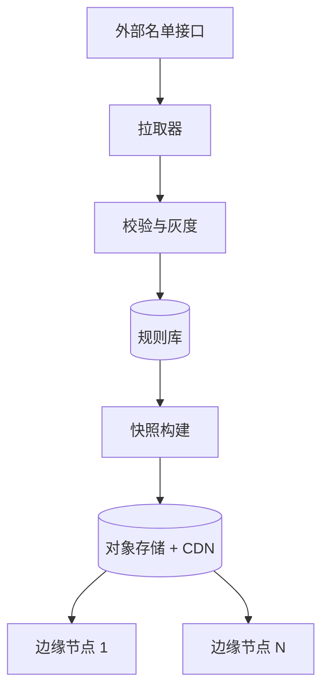

## Q
**设计全球分布式封禁（黑名单）系统**｜系统设计

一家全球互联网公司被要求按政府给出的名单封禁某些 IP（也可能是用户、邮箱等实体）。名单由外部接口提供：可能是一份可下载的列表，也可能只能逐个 IP 查询（单次延迟常超过 1 秒、有调用配额）。要求：同时支持 IPv4 和 IPv6，规则可以只对特定地区生效，请求（文本、音频等）在规则生效后要被拒绝，法规允许从发布起到强制执行有一个时间窗口（可能是 7 天，也可能要求近乎立即）。面试官常追问：每个请求都要查，延迟怎么压、规则怎么传到全球、规则出错封错人怎么办、单点故障、已经建立的长连接怎么处理。

给出完整解答：需求、核心实体与接口、整体设计、深入问题、取舍、不同级别的期望。

## A
**一句话。** 把"拿规则"和"拦请求"彻底分开：控制平面（control plane）拉取并校验规则，生成带版本号的不可变快照；数据平面（data plane）的每个节点把快照装进自己的内存，请求路径上只做本地查表，不依赖任何远程服务。

**60 分钟路线。**

| 时间 | 做什么 |
|---|---|
| 0–7 分 | 问清规则来源和时效，估算：规则量、请求量、内存、更新速率 |
| 7–12 分 | 实体（规则、快照、版本）和接口 |
| 12–25 分 | 整体设计：拉取 → 校验 → 快照 → 分发 → 本地查表 |
| 25–50 分 | 必讲深入：数据平面本地查表；快照分发与地区范围；上线安全 |
| 50–60 分 | 追问：只能逐个查询时的做法、长连接、审计与撤销、数据结构 |

**需求。**
- 功能：
  - 从外部接口获取封禁规则（IP、网段、用户、邮箱），支持 IPv4 和 IPv6；
  - 规则带地区范围（对哪些地区的流量生效）；
  - 数据平面在每个请求上判定放行或拒绝；
  - 规则解除后要能撤销。
- 非功能：
  - 查表延迟 µs 级，不能给每个请求加一次网络往返；
  - 规则生效延迟符合法规窗口：先确认是 7 天还是近乎立即，这里按"分钟级"设计，覆盖更严的一种；
  - 控制平面全挂时，数据平面仍用最后一份好规则继续工作；
  - 错封比漏封更可怕：规则变更必须可灰度、可回滚。
- 估算（假设）：
  - 规则 1,000 万条：500 万个 IPv4 精确地址（每个 4 B，约 20 MB）和 500 万个 IPv6 的 /64 前缀（每个 8 B，约 40 MB），加上索引，每个节点内存不到 200 MB；
  - 全球 100 万请求/秒，分布在 200 个边缘节点，每节点约 5,000 次/秒；对 1,000 万条有序数组做二分查找约 log2(1e7) ≈ 24 步，不到 1 µs，CPU 开销可忽略；
  - 规则变更按每天 10 万条（假设）算，平均约 1 条/秒，增量文件很小。

**核心实体与接口。**
- 实体：
  - 规则（Rule：`ruleId`、类型、值或网段、地区范围 `regions`、来源编号、`createdAt`、可选 `expiresAt`）；
  - 快照（Snapshot：`version`、校验和、规则数、文件位置；另有相对上一版的增量 Delta）；
  - 白名单（自家基础设施、健康检查、监控的地址，永远不被封）。
- 控制平面接口：
  - 拉取器调用外部接口；
  - `POST /rules/{id}/revoke`（带审批与来源编号）；
  - `GET /manifest/latest` → `{version, snapshotUrl, deltaUrls}`（缓存友好，边缘节点轮询）。
- 数据平面的库调用：`isBlocked(ip, userId, region)`，纯内存。

**整体设计。**

1. 拉取器定时拉取（间隔分钟级），与规则库比对出新增和撤销；规则库是真相，带版本和审计日志。
2. 校验：拦截异常变更（见深入 3），通过后进入灰度发布。
3. 快照构建：每次变更生成新版本，同时产出完整快照和相对上一版的增量，写入对象存储，经 CDN 分发。
4. **边缘每 10 秒轮询清单：** 边缘节点每 10 秒轮询清单（几个字节，CDN 命中）；版本变了就下载增量，在内存中构建新的只读结构，原子替换指针，旧结构被回收。
5. 请求到来时本地查表：精确地址用哈希或有序数组，网段用前缀树（trie）或区间数组；规则里的地区范围让每个边缘节点只加载自己地区适用的规则。

**深入。**

1. 【必讲】数据平面本地查表：为什么不把"是否封禁"做成中心服务。
   - 中心服务每次查询加一次网络往返，且成为全局单点；100 万请求/秒打过去要大量机器，故障会让所有流量要么全放要么全拒。
   - 本地内存方案：上面的数字显示规则不到 200 MB、查表不到 1 µs，完全放得下。无远程依赖，所以也没有热点分区：同一个被攻击的 IP 每秒打来几万次，只是命中节点本地的一次查找。
   - 持久化数据库放在控制平面，不进数据平面请求路径。数据平面只有"最后一份好快照"，重启时先从本地磁盘加载，再追增量。

2. 【必讲】规则怎么可靠、快速地传到全球。
   - 拉取优于推送：节点主动轮询版本清单，节点上线、掉线、网络分区后都能自己追上，不需要中心维护连接。需要更快（秒级）时，在轮询之上再加一条推送通知，只通知"有新版本"，丢了也无妨。
   - 版本化与增量：每个增量声明基于哪个版本，节点版本对不上就下载完整快照；快照带校验和，校验失败丢弃。
   - 生效延迟：轮询 10 秒 + 下载构建约几秒，p99 约 30 秒，覆盖"分钟级"目标；窗口是 7 天时，这个延迟远远绰绰有余，不需要更复杂的推送。
   - 地区范围：规则的 `regions` 决定哪些节点加载它，进一步缩小内存和变更频率。

3. 【必讲】上线安全：封错的代价是故障，所以发布像发代码一样对待。
   - 校验闸门：单次变更条数超过阈值（如超过总量的 1%）直接拒绝并人工确认；命中白名单（自家基础设施、健康检查）的规则拒绝；大型运营商出口地址或共享出口（很多用户共用一个公网 IP）的规则要人工复核，因为一条规则会误伤成千上万的人。
   - 灰度：先发 1 个数据中心，观察拦截率、业务错误率，再 10%，再全量；出问题自动回退到上一版本。
   - 熔断与开关：全局"全部放行"和单条规则的撤销开关，值班人员能一键操作。
   - 失败语义（fail-open 还是 fail-closed）：节点拿不到新快照时继续使用旧快照（静态稳定性）；快照从未加载成功的冷启动节点，默认放行还是拒绝由业务决定，通常放行并立刻报警。

4. **【追问再讲】逐个 IP 查询的外部接口：** 外部接口只能逐个 IP 查询（单次超过 1 秒、有配额）。
   - 无法枚举全部 IP，只能对"见过的"地址查询。边缘节点见到新地址时先放行并把它登记到异步队列（法规窗口允许延迟），检查结果回写规则库并随快照下发。
   - 窗口是 7 天，缓存有效期取 3 天（留出重试余量）。5,000 万个活跃 IP ÷ 259,200 秒 ≈ 193 次/秒，每次 1 秒，约 193 个并发调用，需要和对方协商配额。
   - 同一地址的并发检查合并成一次（singleflight）；结果为"未封禁"也缓存，避免反复查询；按流量大小排优先级，先查大流量地址。

5. 【追问再讲】长连接与音视频流：一次连接建立时查表还不够，规则生效后已建立的会话也要被切断。节点在应用新快照时，对当前节点上的活跃会话重新判定，命中则断开；这样"立即生效"的要求在秒级内成立。

6. 【追问再讲】数据结构：IPv4 精确地址用排序数组或哈希；网段用基数树（radix trie）做最长前缀匹配，或把网段转换成区间后排序、二分；IPv6 先按 /64 聚合，因为单个用户常占整个 /64。结构构建后只读，查询无锁。

7. 【加分】审计与合规：每条规则保留法规来源编号、操作人、时间，可导出；规则可设到期自动撤销。预过滤可加布隆过滤器，在内核层（eBPF）丢弃，进一步减少用户态开销。

**取舍与追问。** 按被问到的可能性排，通常口述就够：
- 内存快照还是查询缓存：规则总量小、变更少，快照完整可靠；查询缓存会在冷启动时漏封，且缓存失效时间要小于法规窗口。
- 控制平面挂了怎么办：数据平面继续用最后一份快照，规则只是暂时不更新，不影响现有拦截。
- 单个数据中心的简化版：去掉 CDN 和地区范围，保留"拉取器 + 校验 + 快照 + 本地查表 + 灰度"，边缘只用内存快照，真相只有规则库一份，不要再叠一层独立的持久库或缓存。
- 规则量翻 100 倍（10 亿条）：按平均 6 B/条是 6 GB，含索引约 20 GB，仍可放入大内存节点，或改为两级：热规则在内存，其余放本地磁盘上的有序文件。
- 监控：各节点当前版本与最新版本之差、拦截率、白名单命中、快照下载失败数；版本落后超过阈值报警。

**级别期望。**
- 中级：说出名单拉取、存储、请求时查表，知道要缓存。
- 高级：数据平面与控制平面分离、本地内存查表的容量推算、版本化快照与增量、IPv4/IPv6 的数据结构。
- 资深/专家：灰度、校验闸门与白名单、失败语义、静态稳定性、热点与单点的论证、长连接处理、只能逐个查询时的速率推算。

**先修概念。**
- [[hi-system-design-core-concepts-caching|缓存]]
- [[hi-system-design-patterns-scaling-reads|扩展读]]
- [[hi-system-design-deep-dives-api-gateway|API 网关]]
- [[hi-system-design-core-concepts-networking-essentials|网络基础]]
- [[hi-system-design-deep-dives-data-structures-for-big-data|大数据数据结构]]

**同类题。**
- [[hi-system-design-problem-breakdowns-distributed-rate-limiter|分布式限流器]]
- [[solution-rate-limiter|设计题解：限流器]]
- [[hi-system-design-problem-breakdowns-distributed-cache|分布式缓存（Redis）]]
- 功能开关服务：同样是"控制平面发布配置，数据平面本地读取"
