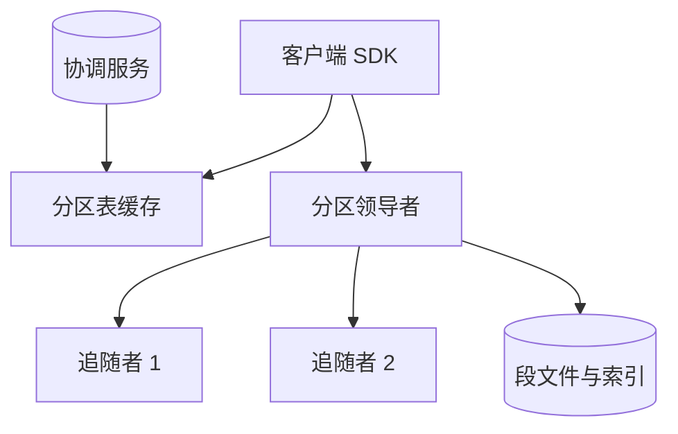

## Q
**设计分布式键值存储（持久化、强一致、大值）**｜系统设计

设计一个分布式键值存储：数据持久化到磁盘，文件只能追加写、可以随机读；负载读多写也多，读必须强一致；值最大 2 GB，装不进内存；总数据量约 100 TB。面试官常追问：单机怎么存、崩溃后怎么恢复、怎样分布到多台机器并找到键所在的机器、同步还是异步复制、大值怎么处理、事务。

给出完整解答：需求、核心实体与接口、整体设计、深入问题、取舍、不同级别的期望。

## A
**一句话。** 先把单机做对：追加写的日志加内存索引，崩溃后重放恢复；再用固定数量的分区，每个分区一个共识复制组，把它变成强一致的分布式存储，复制日志就是存储引擎的日志；大值拆成块先写，最后用一条小记录提交。

**60 分钟路线。**

| 时间 | 做什么 |
|---|---|
| 0–6 分 | 问清键值大小、读写比、一致性、要不要事务，估算：约 10^10 个键，50 台机器 |
| 6–12 分 | 接口和单机记录格式 |
| 12–25 分 | 整体设计：单机引擎、分区与路由、复制组 |
| 25–50 分 | 必讲深入：日志加索引的单机引擎；分区加共识复制的强一致；大值拆块 |
| 50–60 分 | 追问：事务、再平衡、与 LSM 的取舍、热点键 |

**需求。**
- 功能：
  - `put`、`get`、`delete`，`get` 支持对大值按范围读；
  - 值最大 2 GB；
  - 可选：多键事务。
- 非功能：
  - 持久：确认过的写，断电后不丢；
  - 读强一致：读到的是最新确认的写；
  - 读写都高吞吐；
  - 单机故障不影响可用；
  - 值装不进内存。
- **存储估算：** （假设平均值 10 KB，三副本，每台 10 TB 固态盘，峰值 10 万写/秒、40 万读/秒）：
  - 键数 100 TB ÷ 10 KB = 10^10；
  - 机器：三副本 300 TB ÷ 10 TB = 30 台，按 60% 水位取 50 台；
  - 索引内存：每个条目 24 B（键哈希 8 + 段号 4 + 偏移 8 + 长度 4），每台 10^10 × 3 ÷ 50 = 6×10^8 个条目 × 24 B ≈ 14 GB，放得下。若平均值只有 1 KB，则每台 144 GB，就要改用 LSM；
  - 分区：每片约 25 GB（假设），100 TB ÷ 25 GB = 4,000，取 4,096 = 2^12 个分区，三副本共 12,288 个副本，每台约 246 个；
  - 写流量：10 万 × 10 KB = 1 GB/s，三副本 3 GB/s，每台 60 MB/s；整理（compaction）重写按 3 倍放大是 180 MB/s，固态盘的顺序写足够；
  - 读：40 万 ÷ 50 台 = 每台 8,000 次/秒，每次一次随机读；
  - 大值：2 GB ÷ 8 MB = 250 块。

**核心实体与接口。**
- 记录：`[crc | 键长 | 值长 | 键 | 值]`；删除写一条墓碑。
- 段文件（segment）：活动段追加，满 1 GB（假设）封存为只读。
- 内存索引：`键 → (段, 偏移, 长度)`。
- 分区表：`partition = hash(key) mod 4096`，每个分区对应副本组、领导者和版本号。
- 大值清单（manifest）：`{valueId, 大小, 块数, 校验和}`。
- 接口：`put`、`get(key, offset?, length?)`、`delete`，以及 `batch(ops, 期望版本)`。每个键的版本号就是它最后一次写在复制日志里的序号。

**整体设计。**



1. 写：客户端算出分区，向本地缓存的分区表要领导者地址；领导者把命令追加到复制日志（同时就是该分区的段文件），多数副本落盘后提交，更新内存索引，再响应。
2. 读：领导者在租约有效期内直接查本地索引，一次随机读；租约过期没续上就拒绝，并让位给新领导者。
3. 路由：4,096 项的分区表约 4,096 × 50 B ≈ 200 KB，存在小型强一致的协调服务里，客户端缓存；发错节点会被拒绝，并带回新版本的表。

**深入。**

1. 【必讲】单机引擎：追加写日志加内存哈希索引（Bitcask 式）。
   - 写：把带校验的记录追加到活动段，成批 `fsync`（组提交：几毫秒内的多个写共用一次 `fsync`），再更新索引。全是顺序写，正好满足"只能追加"。
   - 读：查索引，一次 `pread`；值很大时只读需要的范围。
   - 覆盖和删除：追加新记录或墓碑，旧记录成为垃圾。
   - 恢复：重放日志重建索引，在第一条校验失败处截断，那是写到一半的撕裂尾部。重放 10 TB 太慢，所以后台周期性做索引快照：先写临时文件，`fsync`，再原子改名，并记下覆盖到的日志位置；恢复就是载入快照加重放其后的日志。先写临时文件再改名，保证任何时刻都有一份完整快照。
   - 整理：把垃圾占比高的封存段里仍有效的记录拷到新段，原子切换索引指针，等正在读旧段的请求结束（引用计数）再删旧段。

```python
import os, struct, zlib

HDR = struct.Struct("<III")  # crc, key_len, val_len


class Log:
    """追加写的段文件 + 内存哈希索引：key -> (值的偏移, 值的长度)。"""

    def __init__(self, path: str) -> None:
        self.f = open(path, "a+b")
        self.index: dict[bytes, tuple[int, int]] = {}
        self._recover()

    def _recover(self) -> None:  # 重放日志重建索引；第一条校验失败处就是撕裂的尾部
        good = 0
        self.f.seek(0)
        while len(h := self.f.read(12)) == 12:
            crc, kl, vl = HDR.unpack(h)
            body = self.f.read(kl + vl)
            if len(body) < kl + vl or zlib.crc32(h[4:] + body) != crc:
                break
            self.index[body[:kl]] = (good + 12 + kl, vl)
            good += 12 + kl + vl
        self.f.truncate(good)  # 丢掉写到一半的记录，之后永远从完整记录末尾继续追加
        self.f.seek(0, 2)

    def put(self, k: bytes, v: bytes) -> None:
        body = struct.pack("<II", len(k), len(v)) + k + v
        off = self.f.tell()
        self.f.write(struct.pack("<I", zlib.crc32(body)) + body)
        self.f.flush()
        os.fsync(self.f.fileno())  # 真实系统在这里做组提交：一批写共用一次 fsync
        self.index[k] = (off + 12 + len(k), len(v))

    def get(self, k: bytes) -> bytes:
        off, vl = self.index[k]
        return os.pread(self.f.fileno(), vl, off)  # 一次随机读，值再大也只读需要的范围
```

2. 【必讲】分布式：固定分区加共识复制组，得到强一致。
   - 路由：`hash(key) mod 4096` 得分区，分区表给出副本组。分区数固定、与机器数无关，加机器只是整片搬迁，不用重新哈希；这是带虚拟节点的一致性哈希的离散形式。
   - 为什么不用多数派读写（W + R > N，Dynamo 式）：并发写时读可能读到旧值，不是线性一致；强一致需要一个领导者来定序。
   - 每个分区一个 Raft 组：领导者定序，日志多数副本落盘才算提交。复制日志同时是存储引擎的日志，不写两遍。
   - 强一致读：领导者在租约内本地读。租约就是多数副本承诺这段时间内不选新领导者，时钟漂移要留余量；也可以读前确认自己仍是领导者（读索引，多一个往返）。追随者读会陈旧，只给明确允许陈旧的读。
   - 同步还是异步：多数副本同步确认，已确认的写在单机故障后不丢，代价是写延迟多一次副本往返（同机房约 1 ms，假设）；异步更快，但领导者故障会丢最近的写。跨区域副本用异步追随者，只提供陈旧读。
   - 领导者故障后选举要几秒，这段时间该分区不可写：这里选的是一致性而不是可用性。

3. 【必讲】大值（2 GB）：拆块，先写块，再提交清单。
   - 问题：2 GB 直接走复制日志，会阻塞该分区所有写，还撑爆内存。
   - 做法：客户端把值切成 8 MB 的块，共 250 块，并行直接写到分区三个副本的块存储（每块带校验）；全部确认后，才通过复制日志提交一条很小的清单记录。读：先取清单，再按 `offset ÷ 8 MB` 定位块、流式读取，天然支持范围读。
   - 中途崩溃：清单没提交，块是孤儿，后台按 `valueId` 在宽限期后回收。覆盖或删除大值：新清单提交后旧块成为垃圾，整理时回收。

4. 【追问再讲】事务。先问范围，多数情况单分区够。单分区：一条日志条目携带多个操作和每个键的期望版本（乐观并发控制），版本不符整条拒绝，原子且线性一致。跨分区：两阶段提交，协调者的决定写进它自己的复制组；准备阶段加的锁带超时，超时后由恢复流程查协调者状态再提交或回滚；代价是延迟和锁争用。

5. 【追问再讲】成员变更与再平衡。新节点加入后，协调服务把一部分分区的副本迁过去：先作为只追日志的旁观者拷快照、追日志，追上后加入成员集，再移除旧副本；一次只迁少量分区并限速。机器从 50 台扩到 100 台，12,288 个副本均摊，每台从约 246 个降到约 123 个。

6. 【追问再讲】与 LSM 树对比。日志加哈希索引要求全部键放内存（上面算的 14 GB/台可行）；键更多或要范围扫描，就改用 LSM 树（内存表、有序段文件、布隆过滤器）。大值可以键值分离：键在 LSM 里，值在追加的值日志里，索引只存指针，和这里拆块的思路一致。布隆过滤器的用处是读不存在的键时，避免逐个查多个段。

7. 【追问再讲】热点键：单键流量超过一个领导者的上限时，读可以在领导者前加缓存，允许短暂陈旧时读追随者；写只能把键拆开（如分片计数器）。

8. 【加分】过期时间（TTL）、二级索引、快照读：用版本号保留多个版本即可。

**取舍与追问。** 按被问到的可能性排，通常口述就够：
- 单机到分布式的对应：
  - 单进程键值存储（[[design-kv-store]]）里保护哈希表的互斥锁，变成分区领导者的租约加复制日志定序；
  - 写前日志（WAL）变成复制日志，是同一份；
  - 内存里的哈希表加淘汰（[[design-lru-cache]]），变成内存索引加磁盘上的值，值放不下内存；
  - "先写临时文件再改名"变成快照的原子替换，也变成大值"先写块、最后提交清单"。
- 为什么不用 Dynamo 式的一致性哈希加多数派：可用性更高，但不是线性一致，还要处理冲突版本；面试官接受最终一致时再讲它。
- 延迟与吞吐的主要旋钮是组提交窗口：一次 `fsync` 约 0.1–1 ms（假设），组提交把 10 万写/秒的代价摊薄。
- 可观测性：各分区领导者变更次数、复制延迟、整理积压和垃圾占比、索引内存占用、`fsync` p99。

**级别期望。**
- 中级：追加写日志加内存索引，崩溃后重放恢复，用一致性哈希把键分到多台机器，有副本的概念。
- 高级：组提交、校验与撕裂尾部、快照与整理、固定分区加路由、领导者复制与强一致读、大值拆块。
- 资深/专家：用数字说明索引内存是否放得下、租约读与时钟、同步异步的丢数据窗口、再平衡过程、事务的两种范围、与 LSM 的取舍。

**先修概念。**
- [[hi-system-design-core-concepts-consistent-hashing|一致性哈希]]
- [[hi-system-design-core-concepts-sharding|分片（Sharding）]]
- [[hi-system-design-core-concepts-cap-theorem|CAP 定理]]
- [[hi-system-design-patterns-large-blobs|大文件（Blob）处理]]
- [[hi-system-design-deep-dives-data-structures-for-big-data|大数据数据结构]]

**同类题。**
- [[hi-system-design-problem-breakdowns-distributed-cache|分布式缓存（Redis）]]
- **Meta 扩展到百万客户端：** [[hi-system-design-in-the-wild-meta-zgateway-zippydb|Meta 把数据库扩展到百万客户端的 5 个技巧]]
- [[design-kv-store]]
- 分布式文件系统：同样把大对象拆块，并用原子提交点发布
