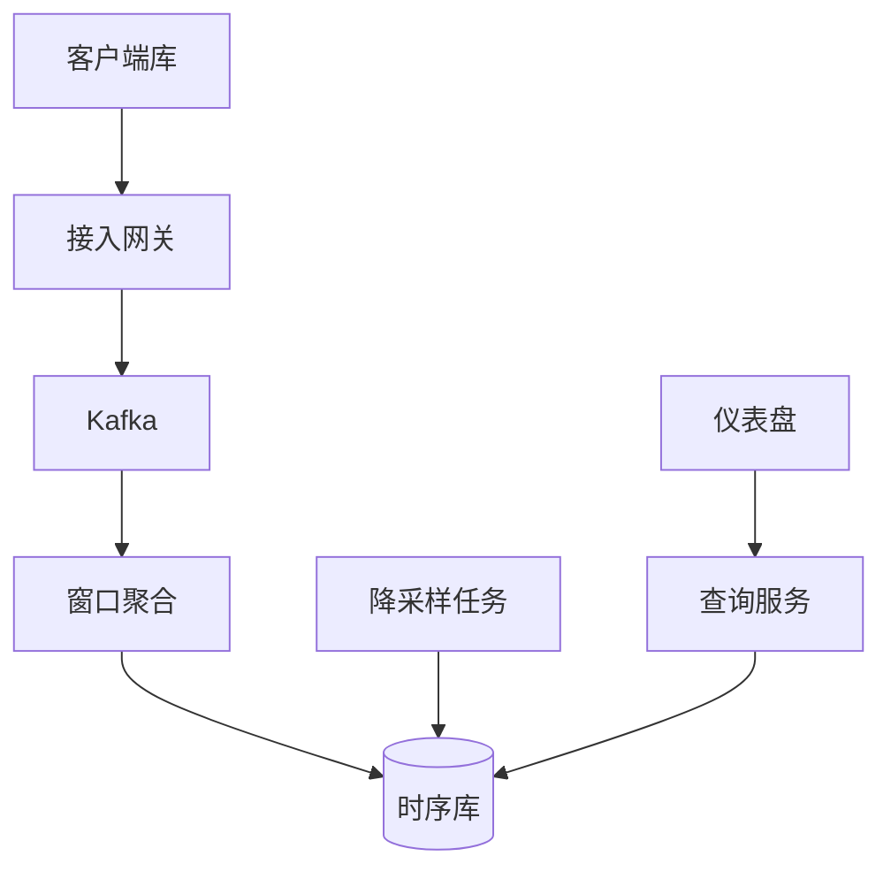

## Q
**设计指标聚合系统（计数指标 + 直方图仪表盘）**｜系统设计

设计一个指标聚合系统：各业务服务通过客户端库上报"计数型"指标（用户注册数、系统错误数、广告点击数等，可带标签如地区、服务名），系统聚合后在仪表盘上以直方图（按时间桶的计数柱状图）展示，并支持按指标名、标签和时间范围查询。面试官常追问：上报量很大时怎么扛、重复上报与丢失、迟到的数据、标签基数爆炸、查询为什么快、历史数据怎么存。

给出完整解答：需求、核心实体与接口、整体设计、深入问题、取舍、不同级别的期望。

## A
**一句话。** 计数指标可加、可再聚合，所以关键是"尽早聚合"：客户端先按时间桶求和，流处理按窗口再求和并写入分辨率分层的时序存储，查询按时间范围挑选合适的分辨率。

**60 分钟路线。**

| 时间 | 做什么 |
|---|---|
| 0–5 分 | 问清需求（只做计数？延迟？保留多久？），估算：约 10 万个数据点/秒 |
| 5–10 分 | 数据模型（指标名 + 标签 + 时间桶）和接口 |
| 10–25 分 | 整体设计：客户端库 → 接入网关 → Kafka → 窗口聚合 → 时序库 → 查询服务 |
| 25–50 分 | 必讲深入：客户端预聚合；窗口聚合与不重不漏；分辨率分层与查询 |
| 50–60 分 | 追问：基数爆炸、迟到数据、热点、告警、分位数 |

**需求。**
- 功能：
  - 客户端库：`counter.inc(name, tags, n)`，本地缓冲，定期批量上报；
  - 查询：指标名 + 标签过滤 + 时间范围 + 步长（可按某个标签分组），返回每个时间桶的计数；
  - 仪表盘展示直方图。
- 非功能：
  - 上报不能拖慢业务（异步、有界缓冲，宁可丢也不能阻塞）；
  - 数据新鲜度约 30 秒；
  - 计数允许少量误差，但不能系统性地重复或丢失；
  - 保留（假设）：10 秒粒度 6 小时，1 分钟粒度 7 天，1 小时粒度 90 天。
- 估算（假设）：
  - 5,000 个服务实例，每个约 100 次计数/秒，不聚合的话是 500,000 个事件/秒；
  - 客户端每 10 秒把同一（指标，标签）的计数合并成一个点，每实例约 200 个不同序列，所以是 5,000 × 200 ÷ 10 = 100,000 个点/秒，比原始事件少 5 倍；
  - 活跃序列（series）约 200 万；10 秒粒度 6 小时按 10 万点/秒 × 21,600 秒 × 10 B ≈ 22 GB；1 分钟粒度一天上界 200 万 × 1,440 ≈ 29 亿点，按 10 B/点约 29 GB/天，7 天约 200 GB；1 小时粒度 90 天 200 万 × 24 × 90 ≈ 43 亿点，约 43 GB。

**核心实体与接口。**
- 序列（Series）：`(指标名, 标签集合)` 的哈希，是时序数据的键。
- 数据点：`(seriesId, 时间桶起点, 计数)`。
- 上报批次：`{instanceId, batchSeq, points: [{name, tags, bucket, n}]}`，`(instanceId, batchSeq)` 用于去重。
- 接口：
  - `POST /ingest`（客户端库调用，批量，带服务凭证）；
  - `GET /query?metric=signups&tags=region:us&from=&to=&step=1m&groupBy=region` → `[{ts, value}]`（每个分组一条线）。

**整体设计。**

1. **客户端按桶累加再 POST：** 客户端库在内存里按 `(指标, 标签, 10 秒桶)` 累加，桶关闭后连同批次号一起 `POST` 到网关；失败重试，缓冲有上限，满了丢最旧的并计数"丢弃数"。
2. 网关做认证、校验、基数限制，然后写入 Kafka，按序列哈希分区，同一序列总在同一分区。
3. 窗口聚合器消费分区，在内存中按 `(序列, 10 秒桶)` 求和；水位线（watermark）越过桶末尾加宽限时间（如 60 秒）后，桶"关闭"，把最终值幂等地写入时序库（键相同则覆盖）。
4. **降采样直接累加：** 降采样任务把 10 秒数据累加成 1 分钟、1 小时，计数的累加天然成立。
5. 查询服务按范围选择分辨率，读时序库，必要时把多个序列按标签聚合。

**深入。**

1. 【必讲】客户端预聚合：吞吐由"实例数 × 序列数"决定，而不是事件数。
   - 把 50 万事件/秒压成 10 万点/秒，网关、Kafka、聚合器的容量都按这个数规划。
   - 最热的单个序列（如全站错误数）也只有 5,000 实例 ÷ 10 秒 = 500 点/秒，不会形成热点分区。
   - 代价：实例崩溃会丢最近不到 10 秒的数据；对计数指标可接受，对计费类要换成可靠日志。

2. 【必讲】窗口聚合与不重不漏。
   - 用事件时间（桶由数据点自带的时间决定），不用到达时间，否则重试和网络抖动会把数据挪到错误的桶。
   - 重复：批次 `(instanceId, batchSeq)` 在网关短期去重（缓存最近几分钟）；聚合器的状态随 Kafka 偏移一起做检查点，崩溃后从检查点重放。
   - 写入"关闭桶的最终值"而不是"+1"：写入是覆盖，重放不会让计数翻倍。这是整个设计里最关键的一点：把非幂等的累加转换成幂等的覆盖。
   - 迟到超过宽限时间的点走修正路径：单独的补偿主题，以"加上差值"写入，并计数展示给运维，数量应当很小。

3. 【必讲】分辨率分层与查询。
   - 分层：10 秒数据保留 6 小时，1 分钟 7 天，1 小时 90 天；越老越粗，成本随之下降。
   - 查询按范围选分辨率，使返回点数不超过约 1,000：最近 1 小时用 10 秒（360 点），1 天用 1 分钟（1,440 点，再按 2 分钟合并），30 天用 1 小时（720 点）。
   - 仪表盘热点查询按步长缓存（缓存时间等于步长），多人看同一面板只算一次。
   - 时序库的存储按（序列，时间）排布，按标签过滤靠倒排索引（标签值 → 序列 id 列表）。

4. 【追问再讲】标签基数爆炸：有人把 `userId` 当标签，序列数从 200 万炸到上亿。网关为每个指标设序列上限（如 1 万），超出的归并到 `other` 并报警；元数据里记录每个指标的当前序列数，作为治理依据。

5. 【追问再讲】热点与扩展：聚合器按分区水平扩展；活跃序列 200 万 × 每序列几十字节状态，单实例内存足够；加分区即可翻倍吞吐。查询侧靠读副本和缓存。

6. 【追问再讲】数据新鲜度：端到端约 10 秒（客户端桶）+ 60 秒（宽限）+ 处理，约 1 分钟；要"30 秒内可见"，就让最近未关闭的桶也可读：查询服务把聚合器的临时值与已落库的值合并，代价是该桶的值可能稍后微调。

7. 【加分】只做计数时分位数不在范围内；若要延迟分位数，每个桶存分位数草图（如 t-digest），因为分位数不能像计数那样直接相加，只能合并草图。

**取舍与追问。** 按被问到的可能性排，通常口述就够：
- 推（客户端上报）还是拉（采集器主动拉取实例）：业务事件型指标用推，天然支持短生命周期的进程；拉模型便于发现和统一，适合基础设施指标。
- 自建还是用现成时序库：这里讲清楚模型，实际落地用 ClickHouse / Druid 这类列式库或专用时序库，按需求选。
- 精确还是近似：计数要求准，但允许分钟级最终一致；仪表盘看趋势，不是账单。
- 告警：在窗口聚合后加一条规则评估路径，按桶值与阈值或环比比较，去抖后触发。
- 回填与重放：Kafka 保留 3–7 天，聚合逻辑有错时可重放；覆盖式写入保证重放安全。

**级别期望。**
- 中级：客户端上报 → 队列 → 聚合 → 存储 → 查询的主线，知道按时间桶聚合。
- 高级：客户端预聚合、事件时间与水位线、幂等写入、分辨率分层、按序列分区。
- 资深/专家：用数字推出容量、基数治理、迟到数据修正、新鲜度与精确度的权衡、分位数草图，并能说清每种故障（客户端崩溃、聚合器重放、网关重试）下计数的行为。

**先修概念。**
- [[hi-system-design-deep-dives-kafka|Kafka]]
- [[hi-system-design-deep-dives-flink|Flink]]
- [[hi-system-design-deep-dives-time-series-databases|时序数据库]]
- [[hi-system-design-patterns-scaling-writes|扩展写]]
- [[hi-system-design-deep-dives-data-structures-for-big-data|大数据数据结构]]

**同类题。**
- [[hi-system-design-problem-breakdowns-ad-click-aggregator|广告点击聚合]]
- [[hi-system-design-problem-breakdowns-metrics-monitoring|指标监控（Datadog）]]
- [[hi-system-design-problem-breakdowns-top-k|YouTube 热门 Top K]]
- [[solution-metrics-monitoring|设计题解：指标监控]]
