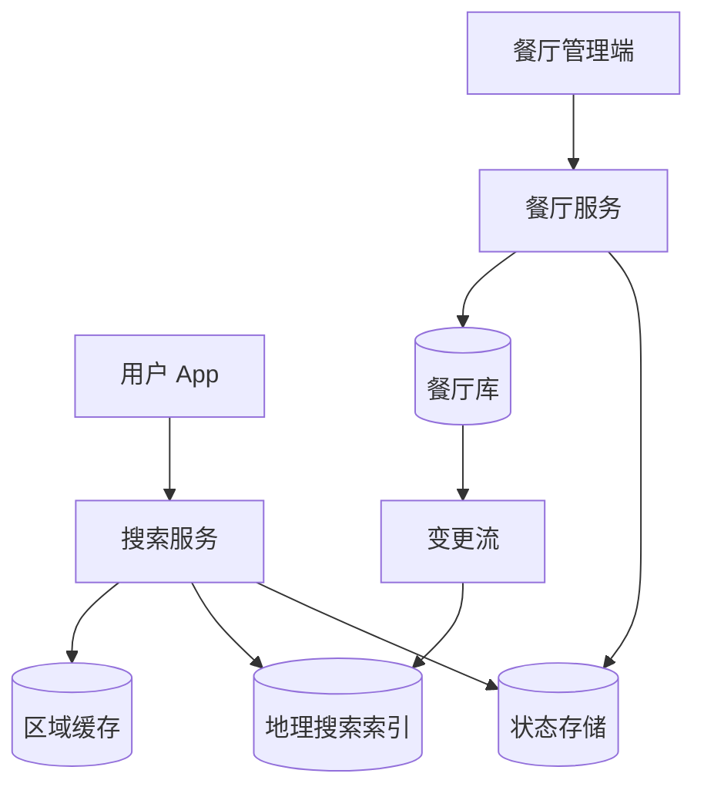

## Q
**设计外卖平台的附近餐厅发现（Uber Eats）**｜系统设计

设计类似 Uber Eats 的外卖平台中"附近餐厅"这一块：用户按位置、半径和菜系搜索附近的餐厅，首页展示一份餐厅列表；餐厅可以注册，并管理自己的店铺资料、营业状态和菜单。面试官常追问：营业与打烊状态怎么保持同步、按时段变化的菜单、排序、缓存和分页、配送范围，以及点单与派单的扩展（订单不能丢、没有骑手接单怎么办）。

给出完整解答：需求、核心实体与接口、整体设计、深入问题、取舍、不同级别的期望。

## A
**一句话。** 这是读多写少、数据量很小的地理搜索：把餐厅按网格（或搜索引擎的地理索引）建索引，查询就是"覆盖半径的格子 → 过滤菜系和营业 → 排序"；变化快的状态和几乎不变的资料分开存放；用户位置量化成格子后缓存整份候选。难点是新鲜度和边界，不是容量。

**60 分钟路线。**

| 时间 | 做什么 |
|---|---|
| 0–5 分 | 问清范围（首页发现，还是含下单），估算：峰值约 2,900 次/秒，地理索引仅 24 MB |
| 5–10 分 | 实体和接口 |
| 10–25 分 | 整体设计：写路径（餐厅库 → 变更流 → 索引）、读路径（缓存 → 索引 → 状态 → 排序） |
| 25–50 分 | 必讲深入：地理索引与查询；资料、状态、时段的新鲜度；缓存与分页 |
| 50–60 分 | 追问：排序、配送范围、区域化、下单与派单 |

**需求。**
- 功能：
  - 用户按位置、半径、菜系（可选）、关键词搜索餐厅，得到分页列表；
  - 餐厅注册、更新资料、设置营业时间、临时暂停接单、更新菜单和菜品可售状态；
  - 菜单可按时段（早餐、午餐）展示。
  - 下单、支付、配送放在追问里。
- 非功能：
  - 首页列表 p99 在 300 ms 内（假设）；
  - 可用性优先，列表允许短暂陈旧，但已打烊的店要在 60 秒内不再显示为可下单（假设）。
- **日活与存储估算：** 估算（假设 1,000 万日活，每人每天 5 次打开首页或搜索，100 万家餐厅，每家资料 2 KB）：
  - 读：10^7 × 5 ÷ 86,400 ≈ 579 次/秒，峰值按 5 倍约 2,900 次/秒；
  - 数据：资料 10^6 × 2 KB = 2 GB；地理索引每家 id 8 B + 经纬度 16 B = 24 B，24 B × 10^6 = 24 MB，一台机器的内存放得下。所以分片或分区域是为了延迟和故障隔离，不是为了容量；
  - 写：营业状态每店每天约切换 4 次，10^6 × 4 ÷ 86,400 ≈ 46 次/秒；菜单每店每天改一次约 12 次/秒；合计约 58 次/秒，可以忽略；
  - 网格：geohash（把经纬度编成字符串，前缀相同在同一个更大的格里）的 5 位格约 4.9 × 4.9 = 24 km²，6 位格约 1.22 × 0.61 ≈ 0.74 km²。假设市中心每 km² 有 100 家：5 位格里 2,400 家，6 位格里约 74 家。

**核心实体与接口。**
- 实体：
  - 餐厅（`restaurantId`、位置、菜系列表、每周营业时间与时区、评分、价格档、配送区）；
  - 菜品（`itemId`、`restaurantId`、价格、可售、所属时段）；
  - 状态（`restaurantId` → 开、暂停或繁忙，到期时间）。
- 用户：`GET /restaurants?lat=&lng=&radius=&cuisine=&q=&cursor=` → 列表（`id`、名称、距离、预计送达、评分、`openNow`）加下一页游标；`GET /restaurants/{id}`（含当前时段菜单）。
- 餐厅端：`POST /restaurants`；`PATCH /restaurants/{id}`；`PUT /restaurants/{id}/status`（开、暂停及到期时间）；`PUT /restaurants/{id}/menu`。

**整体设计。**

读路径：
1. **geohash 格作缓存键：** 把用户位置量化成 6 位 geohash 格（约 1.2 km × 0.6 km），缓存键是（格、半径档、菜系、营业时段）。命中则取缓存的候选，已按通用分排好，前 200 家。
2. 未命中：搜索服务查地理索引，得到半径内、菜系匹配、当前本地时间在营业时间内的候选。
3. 批量读状态存储，去掉暂停的店。
4. 打分排序：距离、评分、预计送达时间、促销等，取前 200 家放入缓存。
5. 个性化重排，按游标分页返回。

写路径：餐厅服务写餐厅库（真相源），变更数据捕获（CDC）把变更送进 Kafka，索引器几秒内更新搜索索引。营业状态不走索引，直接写状态存储，暂停一段时间就是一个带到期时间的键，到期自动恢复。

**深入。**

1. 【必讲】地理索引与查询：先取候选超集，再精确过滤。
   - 选项：geohash 倒排（格 → 餐厅列表）；四叉树、S2、H3 这类自适应网格；搜索引擎的地理字段（Elasticsearch，内部是 BKD 树）；PostGIS。100 万个点，任何一种都够。选搜索引擎：一个索引同时解决"半径、菜系、关键词、打分"，不用自己拼。
   - 原理：把圆形半径转换成覆盖它的格子，格子里的点是超集，再用球面距离（haversine）过滤，因为边界格子里有圈外的点。
   - 精度取舍：格子大，候选多，5 位格查 9 格是 9 × 2,400 = 21,600 家；格子小，要查的格多，3 km 半径面积 π × 3² ≈ 28 km²，6 位格约要 38 个，加边界约 50 个。市中心和郊区密度差很大，所以用自适应分裂（每个叶子不超过 100 家）。
   - 边界：用户在格边缘时，近处的店在相邻格，必须查周围一圈，不能只查自己所在的格。

2. 【必讲】新鲜度：资料、状态、时段分开处理。
   - 资料（名称、位置、菜系）极少变，进搜索索引，秒级最终一致。
   - 营业状态变得勤，且错了代价大（用户点了已打烊的店）：单独放状态存储，返回前一次批量读 200 个键；暂停带到期时间，自动恢复。缓存里只放静态候选，动态状态在出结果前再过滤，所以缓存可以放心地用较长的过期时间。
   - 营业时间和时段菜单：存每周计划加时区，查询时用"用户所在地当前时间"现算 `openNow` 和当前时段，不靠定时任务去翻转状态，否则整点有一百万家店同时要更新。
   - 为什么不把状态放进索引：每次翻转是一次文档重建，还有索引刷新延迟（约 1 秒），读时过滤则是零延迟。

3. 【必讲】缓存与分页。
   - 同一个格里的用户共享一份候选，这是命中率的来源。数字（假设）：峰值 2,900 次/秒 × 60 = 174,000 次/分钟，峰值时活跃的（格、筛选）组合约 3,000 个，TTL 60 秒，每分钟最多回源 3,000 次，命中率不低于 1 − 3,000 ÷ 174,000 ≈ 98%。
   - 热格同时过期会击穿：同键回源合并成一次（single-flight），TTL 加随机抖动。
   - 分页不用偏移量：翻页时数据会变，深翻页也贵。游标是上一条的（排序分，`restaurantId`），首次请求固定前 200 家，翻页读同一份，列表不会抖动。

4. 【追问再讲】排序与个性化：先召回（上面的候选），再用模型精排（距离、评分、预计送达、转化率、广告）；召回 200 家足够。个性化重排在用户级进行，不进共享缓存。

5. 【追问再讲】配送范围：实际的外卖并不是"用户在餐厅半径内"，而是"用户在餐厅的配送区内"（与骑手容量、路程有关）。把每家的配送区用覆盖它的格子建倒排：格 → 能送达这个格的餐厅。查询就是对用户所在格的一次点查，比半径搜索更直接；代价是配送区变化要重算覆盖格，写时多、读时快。

6. 【追问再讲】区域化：按城市群部署索引和缓存，请求按用户位置路由。理由是延迟和故障隔离，不是容量；交界处的餐厅在相邻两个区域里都存一份（带缓冲带）。

7. 【加分】下单与派单：订单创建幂等，状态机为已下单、商家确认、骑手取餐、送达；先持久化再确认，保证订单不丢；超时没有骑手就重新派单或通知取消。派单是另一类问题（按骑手位置匹配），和司机热力图用同一套网格，格内骑手与订单的比例可驱动动态定价。

**取舍与追问。** 按被问到的可能性排，通常口述就够：
- 单机到分布式的对应：
  - 单进程里是内存中的网格、k-d 树或四叉树；数据只有 24 MB，所以分布式形态直接是"每个区域都放一份完整索引，副本只为扛 QPS"，是复制而不是分片；
  - 最小堆取前 K 个：跨分片或跨区域查询时，每片返回有序的前 200，协调节点用堆归并；
  - 带过期时间的缓存（[[design-lru-cache]]）变成格子级共享缓存加单飞；
  - "暂停 30 分钟后自动恢复"，单机是延迟队列，分布式就是带到期时间的键。
- 为什么不只用 Redis 地理命令：按半径查没问题，但菜系过滤要拆成每菜系一个集合或事后过滤，排序也要自己做；只需要"半径加一个过滤"时，它是合理的简化方案。
- 菜品搜索：菜品名放进同一索引（嵌套文档），可售状态在结果返回前回查。
- 稀疏区域空结果：自动逐档扩大半径（3 km → 5 km → 10 km），配送费随距离。
- 可观测性：列表 p99、缓存命中率、资料更新到可见的延迟、"已打烊却被展示"的事件率、空结果率。

**级别期望。**
- 中级：餐厅表加地理索引（网格或搜索引擎），按半径和菜系查询，有缓存。
- 高级：候选加精确过滤、边界格、资料与状态分开、变更流更新索引、游标分页。
- 资深/专家：用数字说明索引很小、分区域的真正理由、缓存只放静态候选、配送区倒排、堆归并 Top-K、与下单派单的衔接。

**先修概念。**
- **邻近搜索：** [[hi-system-design-deep-dives-proximity-search|邻近搜索（Proximity Search）]]
- [[hi-system-design-deep-dives-elasticsearch|Elasticsearch]]
- [[hi-system-design-core-concepts-caching|缓存]]
- [[hi-system-design-patterns-scaling-reads|扩展读]]
- [[hi-system-design-deep-dives-change-data-capture|变更数据捕获（CDC）]]

**同类题。**
- [[hi-system-design-problem-breakdowns-yelp|商户点评（Yelp）]]
- [[hi-system-design-problem-breakdowns-gopuff|本地配送（Gopuff）]]
- [[hi-system-design-problem-breakdowns-uber|网约车（Uber）]]
- **相关题解：** [[design-food-delivery]]
- 司机实时热力图：同样用分层网格做空间索引
