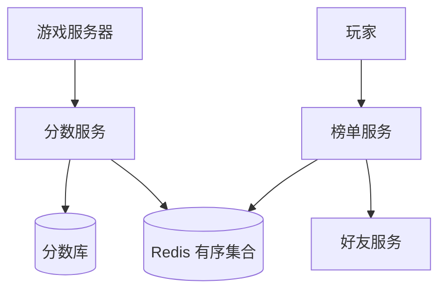

## Q
**设计在线游戏排行榜（全球榜 + 我的名次 + 好友榜）**｜系统设计

设计一个在线游戏的实时排行榜：玩家打完一局提交分数；系统要显示全球前 10 名、当前玩家自己的名次及前后各若干名（如上下各 5 名），以及好友之间的榜单。玩家总数约 1 亿，每天数以亿计的分数更新，打完一局后 1–2 秒内能看到更新后的榜。面试官常追问：为什么用有序集合、1 亿人排序要多少内存、一台机器不够怎么办、好友榜怎么算、日榜周榜、同分怎么排、数据丢了怎么恢复。

给出完整解答：需求、核心实体与接口、整体设计、深入问题、取舍、不同级别的期望。

## A
**一句话。** 排行榜的本质是"按分数有序的集合上的名次查询"：Redis 有序集合（sorted set）能在对数时间内更新和查名次，1 亿人也只需约 10 GB，一台就放得下；真正要讲清的是它放不下时按分数区间拆分、好友榜按读时计算，以及数据库作为真相来源。

**60 分钟路线。**

| 时间 | 做什么 |
|---|---|
| 0–5 分 | 问清需求（分数语义、榜的种类、一致性），估算：峰值约 1.2 万次提交/秒 |
| 5–10 分 | 实体和接口：提交分数、前 N、我的名次、好友榜 |
| 10–25 分 | 整体设计：数据库存真相，Redis 有序集合存榜，一局结束写两处 |
| 25–50 分 | 必讲深入：有序集合与容量；一台放不下时的拆分；好友榜 |
| 50–60 分 | 追问：日榜周榜、同分、恢复、热点缓存、防作弊 |

**需求。**
- 功能：
  - 提交分数；榜上保留每个玩家的最高分（先和面试官确认是"最高分"还是"累计分"，这里按最高分）；
  - 查全球前 10；
  - 查我的名次，以及前后各 5 名；
  - 查好友榜：好友中的前 10，我在好友中的名次。
- 非功能：
  - 打完一局后 1–2 秒内榜更新；
  - 读延迟 p99 约 100 ms；
  - 分数不能丢（玩家会投诉）；榜单可以由真相数据重建。
- 估算（假设）：
  - 1 亿玩家，日活 2,000 万，每人每天 10 局，即 2 亿次提交/天，平均 2 亿 ÷ 86,400 ≈ 2,300 次/秒，峰值按 5 倍约 1.2 万次/秒；
  - 每局结束要读一次榜，读也约 1.2 万次/秒；
  - 有序集合内存：按每个成员约 100 B（成员标识、分数、跳表指针和哈希表开销），1 亿 × 100 B = 10 GB，单机放得下。

**核心实体与接口。**
- 实体：玩家（`playerId`）、最高分表（`playerId, gameId → bestScore, achievedAt`，数据库）、榜（Redis 键 `lb:{game}:{period}`，成员为 `playerId`，分值为分数）、好友关系（`playerId → friendIds`，来自社交服务）。
- 接口：
  - `POST /scores`（由游戏服务器调用，不信任客户端）→ 204；
  - `GET /leaderboard/top?n=10`；
  - `GET /leaderboard/me?around=5` → 我的名次、分数、上下各 5 名；
  - `GET /leaderboard/friends?n=10` → 好友前 10 与我的名次。

**整体设计。**

1. **先写库再 ZADD GT：** 游戏服务器提交 `(playerId, score)`。分数服务先写数据库（真相：只在新分更高时更新最高分），再写 Redis：`ZADD lb:g:all GT score playerId`（`GT` 表示只在新分更高时更新）。数据库是同步写，Redis 失败可由重试或重建补上。
2. 榜单服务读 Redis：前 10 用 `ZREVRANGE 0 9 WITHSCORES`；名次用 `ZREVRANK`（从 0 开始，显示时加 1）；上下各 5 名用 `ZREVRANGE rank-5 rank+5`。三者都是 O(log n + k)。
3. 全球前 10 对所有人相同，榜单服务进程内缓存 1 秒，Redis 的读压力几乎不随用户数增长。

**深入。**

1. 【必讲】用有序集合，以及 1 亿人放得下一台。
   - 为什么不用数据库 `ORDER BY score DESC LIMIT 10` 加 `COUNT(*) WHERE score > x` 查名次：1 亿行即使有索引，名次查询（数索引区间）也是 O(n)，在 1.2 万次/秒下不可行。有序集合内部是跳表加哈希表，更新、查名次、取区间都是对数时间。
   - 容量：10 GB 单机放得下；写 1.2 万次/秒远低于单机约 10 万次/秒的能力。所以第一版就是"一个有序集合 + 一个从库 + 持久化（AOF）"。不要一上来分片。
   - 可用性：主从复制加自动故障转移；Redis 里的榜是派生数据，最坏情况下从数据库重建（扫描最高分表灌入，1 亿条按 10 万条/秒约需 1,000 秒）。

2. 【必讲】一台放不下时：按分数区间拆分，而不是按玩家哈希。
   - 哈希分片后每片只有局部顺序，名次要跨所有分片合并，代价很高。
   - 按分数区间分片（如 0–999 在一片，1,000–1,999 在下一片…）：全局名次 = 分数更高的各分片的成员总数之和 + 片内名次；各片的成员数（`ZCARD`）缓存起来，几秒更新一次。
   - 玩家分数跨区间时：先写入新片，再从旧片删除，读时按玩家去重，容忍短暂的重复。
   - 更务实的做法：前 1 万名要精确；中间的名次对玩家只需近似。用"分数直方图"（每个分数段的人数）估算百分位，例如显示"前 12%"。5,000 万名和 5,000 万零一百名的差别没有产品价值。

3. 【必讲】好友榜：读时计算，不要写时扩散。
   - 写时扩散：每次提交要写入每个好友的个人榜。若平均 500 个好友，1.2 万次/秒 × 500 = 600 万次写/秒，且大多数好友今天根本不会看，不可取。
   - 读时计算：取好友列表（缓存），对全球有序集合做一次批量查分 `ZMSCORE`（500 个成员），在应用里排序，得到前 10 和我的名次，复杂度 O(好友数)。
   - 成本：按一次约 0.1 ms（假设）、1.2 万次/秒算，约 1.2 个核秒/秒，超出单线程 Redis 的能力，所以把读分摊到 3–4 个只读从库，并对每个玩家的好友榜缓存 5 秒。
   - 好友上限（如 5,000）要在产品上定下来，否则读成本无界。

4. 【追问再讲】日榜、周榜、月榜、总榜：每次提交同时写 4 个有序集合（`lb:g:day:2026-11-03` 等），日榜、周榜设置过期时间。写入变为 1.2 万 × 4 ≈ 4.8 万次/秒，仍在单机能力内。周期切换靠键名里的日期，不需要清空操作。

5. 【追问再讲】同分的排序：有序集合同分按成员字典序排，不公平。想要"先达到者在前"：把分数和时间编码进一个双精度浮点数（`score × 2^23 + (封顶时间 − 达成时间)`）。双精度有 53 位尾数，分数上限若为 2^30（约 10.7 亿），剩下 23 位只能表示约 840 万秒（约 97 天）的时间，所以只适合按赛季编码。

6. 【追问再讲】防作弊与数据一致：分数只由游戏服务器提交且签名；异常分数（超过物理上限）进复核队列，复核后可从榜上删除（`ZREM` 并改库）。提交带幂等键（`gameId + matchId`），同一局重复提交不改变结果。

7. **【加分】赛季、分区榜、推送名次：** 赛季重置与归档、按地区或服务器分榜（键里加地区）、WebSocket 推送"你的名次变了"（榜单服务订阅变更，只对打开榜单页面的在线玩家推送）。

**取舍与追问。** 按被问到的可能性排，通常口述就够：
- 精确名次还是近似：前列精确，长尾近似，省掉分片的跨片合并。
- 为什么 Redis 不是真相：内存数据异步复制，主从切换可能丢最后几个写；真相放数据库，榜可重建。
- 写 Redis 同步还是异步：提交后先写库再投递到 Kafka 由消费者写 Redis，可在 Redis 故障时积压并回放，代价是多一跳；单榜规模小时直接同步写也可以。
- 读热点：全球前 10 进程内缓存；"我的名次"是个人请求，无法共享缓存，但每次只有一次对数时间查询。
- 规模翻 10 倍（10 亿玩家，100 GB）：按分数区间拆成约 10 片，名次由各片人数相加得到。

**级别期望。**
- 中级：用有序集合存榜，数据库存分数，说出前 N 与名次的查询方式。
- 高级：内存容量估算、最高分的条件更新、好友榜读时计算而非写时扩散、多周期榜、故障后重建。
- 资深/专家：按分数区间拆分与跨片名次、近似名次、同分编码的位宽限制、读副本与缓存的容量算账、防作弊和榜单一致性。

**先修概念。**
- [[hi-system-design-deep-dives-redis|Redis]]
- [[hi-system-design-patterns-scaling-reads|扩展读]]
- [[hi-system-design-patterns-scaling-writes|扩展写]]
- [[hi-system-design-core-concepts-sharding|分片（Sharding）]]
- [[hi-system-design-core-concepts-caching|缓存]]

**同类题。**
- [[hi-system-design-problem-breakdowns-top-k|YouTube 热门 Top K]]
- [[hi-system-design-problem-breakdowns-leetcode|在线判题平台（LeetCode）]]
- [[design-leaderboard|练习：设计排行榜]]
- [[hi-system-design-problem-breakdowns-online-auction|在线拍卖（eBay）]]
