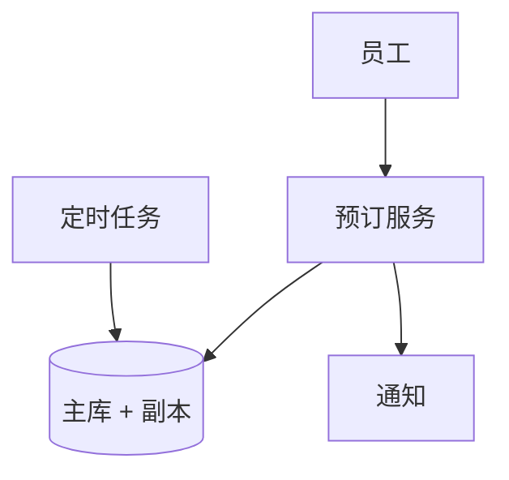

## Q
**设计会议室预订系统（3 个园区 × 10 栋楼 × 100 间会议室）**｜系统设计

为一家公司设计会议室预订系统：共 3 个园区，每个园区 10 栋办公楼，每栋楼 100 间会议室。员工可以按楼、时间段、人数和设备搜索空闲会议室，预订、取消、改期；同一间房的同一时间绝不能被两个人订到。面试官常追问：并发抢同一间房怎么防冲突、查空闲怎么做得快、重复会议怎么存、时区、预订了没人来怎么释放、多人会议要对齐大家的空闲时间，以及规模放大后怎么办。

给出完整解答：需求、核心实体与接口、整体设计、深入问题、取舍、不同级别的期望。

## A
**一句话。** 规模很小（3,000 间房、每秒个位数的预订），难点不在吞吐而在正确性：用数据库约束保证同一间房的时间段不重叠，搜索只是"建议"，最终以带约束的写入为准。

**60 分钟路线。**

| 时间 | 做什么 |
|---|---|
| 0–5 分 | 问清需求（人数、设备、重复会议、取消），估算：峰值约 6 次预订/秒 |
| 5–12 分 | 实体（房间、预订）、接口、状态 |
| 12–25 分 | 整体设计：单个主库 + 约束；搜索和预订两条路径 |
| 25–50 分 | 必讲深入：防重叠；搜索与自动选房；并发下的冲突处理 |
| 50–60 分 | 追问：重复会议、时区、未到场释放、多人会议、规模放大 |

**需求。**
- 功能：
  - 按楼、日期时间段、最少人数、设备（投影、视频会议）搜索空闲房间；
  - 预订（指定房间，或只给条件让系统自动选房）、取消、改期；
  - 查看我的预订、某间房某天的占用；
  - 预订者可看到冲突并得到替代建议。
- 非功能：
  - 同一房间的时间段永不重叠（强一致，不接受"最终一致"）；
  - 搜索 p99 在 200 ms 内；
  - 预订接口幂等（手机上点两次不会订两间）。
- 估算（假设）：
  - 房间数 3 × 10 × 100 = 3,000；
  - 每间房每天 8 小时可用、利用率 75%、平均每场 1 小时，即 3,000 × 0.75 × 8 = 18,000 场/天；
  - 集中在 8 小时内平均 18,000 ÷ 28,800 ≈ 0.6 次/秒，早高峰按 10 倍约 6 次/秒；
  - 3 万员工，每人每天搜 3 次，约 9 万次/天，高峰约 31 次/秒；
  - 一年约 657 万行预订，每行约 200 B，约 1.3 GB。一台数据库绰绰有余，不需要分片。

**核心实体与接口。**
- 实体：
  - 房间（Room：`roomId`、`buildingId`、容量、设备标签、`timezone`）；
  - 预订（Booking：`bookingId`、`roomId`、`organizerId`、`start`、`end`（UTC，半开区间 `[start, end)`）、`status`：`CONFIRMED | CANCELLED`、`requestId`）；
  - 楼、园区：只用于筛选，放在房间的字段里即可。
- 接口：
  - `GET /rooms/available?building=&start=&end=&minCapacity=&features=`；
  - `POST /bookings`（头 `Idempotency-Key`；体：`roomId` 或搜索条件、起止时间、标题）→ 201，或 409 `CONFLICT` 附带替代房间；
  - `DELETE /bookings/{id}`、`PATCH /bookings/{id}`（改期）、`GET /rooms/{id}/bookings?date=`。

**整体设计。**

1. 搜索：在一栋楼的约 100 间房里，找没有与目标时段重叠的 `CONFIRMED` 预订的房间，再按人数、设备过滤；读副本即可。
2. 预订：一条插入语句。数据库约束拒绝重叠，应用不先查再写。
3. 自动选房：搜索得到候选，按"最合适"排序，从最优开始依次尝试插入，遇冲突换下一间，最多试几次；全部失败返回 409 和下一批空闲时段。
4. 通知：预订成功后写发件箱（outbox）表，异步发邮件或日历邀请，避免因为通知失败而回滚预订。
5. 定时任务：开始后 10 分钟无人签到的预订释放（见深入 6）；每天为重复会议补齐未来实例。

**深入。**

1. 【必讲】不重叠必须由数据库保证，不能靠"先查后写"。
   - 先查再写的问题：两个请求同时查到空闲，都去写，都成功，房间被双订。
   - 首选：Postgres 的排除约束（exclusion constraint，gist 上的等值比较需要 btree_gist 扩展）：
     `EXCLUDE USING gist (room_id WITH =, tstzrange(start_ts, end_ts, '[)') WITH &&) WHERE (status = 'CONFIRMED')`。同一房间的时间区间重叠时，插入报错，数据库内部用锁保证并发安全；取消只是把状态改成 `CANCELLED`，不再参与约束。
   - 通用替代：时间槽表。把一天切成 15 分钟的槽，表 `(room_id, slot_start)` 设主键；一场 1 小时的会议插入 4 行，同一事务内有任何一行冲突就整体失败。每天可用 8 小时，即 32 个槽 × 3,000 间房 = 9.6 万行/天，数据量依然很小。它不依赖特定数据库，在只支持条件写入的存储里也能用，代价是预订粒度固定为 15 分钟。
   - 不推荐只靠行锁：对"房间行"加 `SELECT ... FOR UPDATE` 也行，但同一间房的预订被串行化，且依赖开发者在每处代码都记得加锁。
   - 区间用半开 `[start, end)`：10:00–11:00 和 11:00–12:00 可以相邻，不算冲突。

2. 【必讲】搜索与自动选房。
   - 搜索条件：`NOT EXISTS (SELECT 1 FROM bookings b WHERE b.room_id = r.id AND b.status = 'CONFIRMED' AND tstzrange(b.start_ts, b.end_ts) && tstzrange(:s, :e))`，在预订表上的 GiST 索引支持。每次只扫一栋楼的 100 间房，毫秒级。
   - 搜索结果只是建议：从搜索到点"预订"之间别人可能订走，所以最终以插入为准，冲突时返回替代建议，而不是让用户看到"系统错误"。
   - 选房策略（自动）：先满足人数和设备，在满足的房间里选容量最小的（最合适，best fit），避免用 20 人房开两人会；同等条件下选当天已有预订最少的，或选能和相邻预订"紧挨"的房间，避免把空闲时间切碎，给以后的长会议留出整段。
   - 幂等：`Idempotency-Key` 唯一约束，重复请求返回第一次的结果。

3. 【必讲】并发冲突怎么表现给用户：约束冲突是正常路径，不是异常。插入失败 → 重新搜索附近时间段和邻近房间 → 返回 409 和前 3 个替代方案。服务端对自动选房最多重试 3 次，每次换下一个候选。

4. **【追问再讲】重复会议：** 重复会议（每周一 10 点，持续半年）。
   - 存规则（RRULE）加物化的实例：创建时生成未来 90 天内的每一场，各自占一行并受约束保护；任何一场冲突，整个系列在一个事务里一起失败，并告诉用户具体哪几周冲突。
   - 定时任务每天补齐新的 90 天窗口。单次修改或取消是对某个实例的例外；"此场及以后"则把系列拆成两段。

5. 【追问再讲】时区与夏令时：数据库存 UTC；每间房有自己的时区，重复会议按房间所在地的本地时间展开，所以夏令时切换前后同一个"周一 10 点"对应的 UTC 不同，必须展开时才换算，不能按固定的 7 天间隔相加。

6. 【追问再讲】预订了不来：签到（扫码或会议室平板）；开始后 10 分钟无人签到，任务把预订改为取消并释放，同时通知组织者。任务靠 `start_ts` 上的索引扫描，按时间分片，数据量小。

7. 【加分】多人会议自动排时间：查每位参与者的忙闲，求大家共同的空闲段，再选房间；找不到时降级——先放"待确认"（`TENTATIVE`，带 15 分钟到期时间）占住候选时段，所有人确认后转 `CONFIRMED`，有人拒绝或超时就释放并尝试下一个候选时段。

**取舍与追问。** 按被问到的可能性排，通常口述就够：
- 为什么单库够用：峰值约 6 次预订/秒，一年 1.3 GB；高可用靠主从自动切换。
- 要不要缓存空闲状态：不需要，一栋楼 100 间房查询毫秒级；缓存反而带来失效与不一致的风险。
- 权限：只有组织者或管理员能取消、改期；部分房间（董事会议室）要审批，预订先进 `PENDING_APPROVAL`，审批通过才转 `CONFIRMED`，期间也占时段。
- 规模放大（全球 100 万间房）：按楼或园区分片（预订永远不跨房间，搜索也限定在一栋楼内，所以查询不跨片）；约束仍然在单片内成立。
- 改期：新时段插入成功后再取消旧的，放在同一个事务里，失败则原预订保持不变。

**级别期望。**
- 中级：房间表、预订表，按时间区间重叠查空闲房间，知道要处理并发。
- 高级：用约束或时间槽防双订、搜索只作建议、幂等预订、半开区间、取消与改期的语义。
- 资深/专家：自动选房减少碎片、重复会议的物化与跨时区展开、未到场释放、待确认占位与多人会议、规模放大后的分片边界。

**先修概念。**
- [[hi-system-design-patterns-dealing-with-contention|处理争用（Contention）]]
- [[hi-system-design-core-concepts-data-modeling|数据建模]]
- [[hi-system-design-core-concepts-db-indexing|数据库索引]]
- [[hi-system-design-deep-dives-postgres|PostgreSQL]]
- [[hi-system-design-core-concepts-api-design|API 设计]]

**同类题。**
- [[hi-system-design-problem-breakdowns-ticketmaster|票务预订（Ticketmaster）]]
- [[solution-meeting-scheduler|设计题解：会议调度]]
- [[design-calendar|练习：设计日历]]
- 酒店预订系统：同样是"同一资源的时间区间不重叠"
