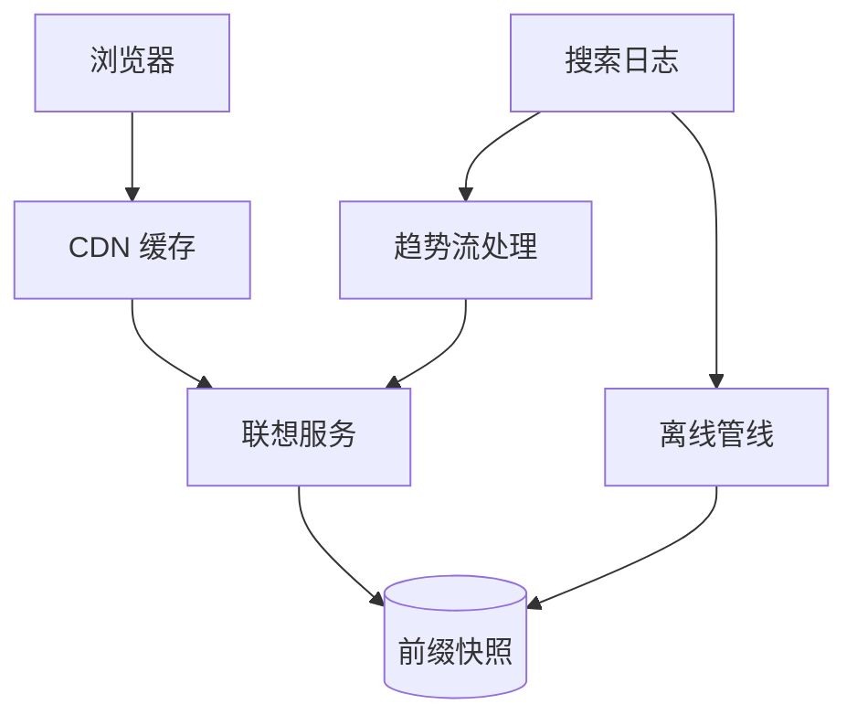

## Q
**设计搜索联想（Typeahead / 自动补全）**｜系统设计

设计搜索框的联想功能：用户每输入一个字符，在下方实时显示以当前前缀开头的热门搜索建议（只做非个性化的建议，重点是读路径）。要求响应足够快，用户几乎感觉不到延迟；建议要能反映近期的热门趋势。面试官常追问：怎么存才能按前缀快速取前 10、请求量怎么扛、缓存放在哪几层、建议怎么更新、敏感词怎么过滤、拼写错误怎么办、数据中心故障时怎么办。

给出完整解答：需求、核心实体与接口、整体设计、深入问题、取舍、不同级别的期望。

## A
**一句话。** 联想是"读多写少、可以容忍陈旧"的典型：把每个前缀对应的前 10 条建议离线算好，存成只读快照，在线只做一次键值查找，再叠几层缓存；热门趋势用一条小的实时旁路补充。

**60 分钟路线。**

| 时间 | 做什么 |
|---|---|
| 0–5 分 | 问清需求（延迟、新鲜度、语言、个性化范围），估算：峰值约 8.7 万次请求/秒 |
| 5–10 分 | 接口和数据：前缀 → 前 10 条建议 |
| 10–25 分 | 整体设计：离线管线生成快照；在线服务查表；多层缓存 |
| 25–50 分 | 必讲深入：存储结构与容量；缓存分层；管线与新鲜度 |
| 50–60 分 | 追问：过滤、拼写纠错、长尾前缀、故障降级 |

**需求。**
- 功能：
  - 输入前缀，返回最多 10 条建议，按热度排序；
  - 建议随时间更新，突发热点（新闻、赛事）要能在较短时间内出现；
  - 过滤不当内容。
- 非功能：
  - 端到端 p99 约 100 ms 以内，服务端 p99 约 20 ms；
  - 高可用；陈旧的建议比没有建议好；
  - 不要求强一致。
- 估算（假设）：
  - 1 亿日活，每人每天 5 次搜索，每次输入触发约 5 次联想请求（防抖之后）：1 亿 × 5 × 5 = 25 亿次/天；
  - 平均 25 亿 ÷ 86,400 ≈ 2.9 万次/秒，峰值按 3 倍约 8.7 万次/秒；
  - 缓存命中率 90% 时，源站约 8,700 次/秒；
  - 搜索日志每天 5 亿次 × 100 B = 50 GB；
  - 联想库：假设保留 1 亿条不同的查询，共约 3 亿个不同前缀，每个前缀存 10 个建议编号加键，约 100 B，合计 3 亿 × 100 B = 30 GB。

**核心实体与接口。**
- 接口：`GET /suggest?q=ab&limit=10&lang=zh` → `["ab 模型", "abc 新闻", …]`，响应带 `Cache-Control: max-age=60`。
- 数据：
  - 前缀表：`prefix → [suggestionId × 10]`；
  - 建议字典：`suggestionId → 文本、热度分`；
  - 查询日志：`(查询文本, 时间, 语言)`，只用于离线统计。
- 热度分：近 7 天的搜索次数，按时间衰减（如半衰期 1 天），再叠加突发趋势分。

**整体设计。**

1. **防抖、取消、本地缓存：** 客户端防抖（停顿 100–150 ms 才发请求）、取消过期请求，并把每个前缀的结果缓存在本地。
2. 请求先到 CDN：1–3 个字符的前缀数量有限、命中极高，缓存 1 分钟。
3. 未命中到联想服务：先看进程内的 LRU，再查前缀快照（内存键值），把结果和趋势旁路合并后返回。
4. 离线管线定时读取搜索日志，统计、衰减、过滤、计算每个前缀的前 10，生成新版本快照，联想服务整体切换。
5. 趋势流处理统计最近 15 分钟的突发查询，生成一份很小的"趋势表"，在线合并进结果。

**深入。**

1. 【必讲】怎么存、容量多大：预先算好的"前缀 → 前 10"键值表，而不是在线遍历前缀树。
   - 在线遍历：前缀树节点上取子树里的前 K 条要访问整棵子树，前缀越短子树越大，不可接受；改成每个节点缓存好前 10，查询就是沿着前缀走 O(前缀长度) 步。
   - 键值表更简单：键就是前缀本身，值是 10 个建议编号。查询是一次点查，容易分片、容易缓存。
   - 为什么离线算而不是搜索时在线更新：一次搜索要更新它所有前缀（约 20 个）的前 10 列表，5 亿次搜索/天即约 5,800 次/秒 × 20 ≈ 11.6 万次写/秒，而且 "a" 这样的短前缀是极热的写热点。离线批量重建把这些全部摊平。
   - 容量：上面算得 30 GB。内存里放得下，但新旧两个版本要同时存在（切换），所以分成 4 片，每片约 7.5 GB，切换时峰值约 15 GB。分片按前缀的哈希，每次查询只访问一片。
   - 压缩：若一个前缀的前 10 和它的子前缀完全相同，可以合并；长度超过 12 个字符的长尾前缀不预存，在线取它 12 个字符前缀的结果，再按完整前缀过滤。

2. 【必讲】缓存分层与延迟。
   - 第一层，客户端：防抖和本地缓存，省掉相当一部分请求（用户回退删除字符时直接命中）。
   - 第二层，CDN/边缘：短前缀的请求高度集中，命中率 90% 以上；峰值 8.7 万次/秒经 CDN 之后剩下约 8,700 次/秒。
   - 第三层，联想服务进程内 LRU：存最热的几十万个前缀。
   - 第四层，前缀快照（内存）：点查 1 ms 以内。
   - 缓存时间权衡：1 分钟意味着趋势最多延迟 1 分钟显现，换来数量级的流量下降；长尾前缀（低命中）不值得放 CDN，靠快照即可。

3. 【必讲】数据管线与新鲜度。
   - 管线：搜索日志（Kafka）→ 批处理（每小时或每天）统计每个查询的衰减热度 → 过滤（低于次数阈值的、包含敏感词的、疑似个人信息的丢弃）→ 为每个前缀选前 10 → 写出新快照文件 → 联想服务下载后原子切换指针；失败就保留旧版本。
   - 新鲜度：基础快照每小时更新；趋势旁路（流处理，滑动 15 分钟窗口）补上突发热点，在线把趋势表中前缀匹配的条目加权合并进基础结果。
   - 为什么不是纯实时：日志量大、更新放大严重；联想的价值在热门，不需要每次搜索都精确反映。

4. 【追问再讲】过滤与安全：黑名单在管线里剔除；在线再过一道（快速更新，不等快照）；对"建议"带来的法律风险（诽谤、个人信息）要有人工下线入口，生效时间要短于快照周期，所以在线过滤是必要的。

5. 【追问再讲】拼写纠错与模糊匹配：先做精确前缀匹配；结果过少时再用编辑距离 1 的候选补充（如 BK 树或对前缀做拼写归一化）。放在第二步，避免拖慢主路径。

6. 【追问再讲】多语言与地区：快照按语言和地区分别构建（`lang`、`region` 作为键的一部分），分词语言（中文、日文）用分词后的词首或者字符前缀，要先问清。

7. 【追问再讲】故障降级：联想服务不可用时，客户端静默不显示建议，不阻塞搜索框；数据中心故障流量切到其他区域；快照切换失败保留旧版本。

8. 【加分】个性化：在非个性化结果上叠加用户最近搜索（在客户端合并，成本最低）；排序可以引入点击反馈（联想的点击率）训练；数据量更大时也可以用倒排索引或搜索引擎的补全建议器代替自建键值表。

**取舍与追问。** 按被问到的可能性排，通常口述就够：
- 前缀树还是键值表：前缀树省空间、适合内存里的小库；键值表便于分片、缓存和整体切换。大规模下选键值表。
- 为什么用离线快照：写放大太大，且联想不需要强一致；代价是新鲜度由快照周期决定，用趋势旁路补足。
- 每个前缀只存 10 个够吗：存 10 个、返回 5–10 个；过滤后可能不足，所以存 15–20 个备用也可以。
- 缓存时间多长：热门前缀 1–5 分钟，趋势期间可以缩短。
- 流量翻 10 倍：CDN 命中率不变，源站约 8.7 万次/秒；联想服务按 CPU 横向扩展；快照仍可整体复制到更多副本。

**级别期望。**
- 中级：前缀树或"前缀 → 热门查询"表，知道要缓存，知道日志统计热度。
- 高级：离线预计算每个前缀的前 K、键值表加分片、四层缓存与命中率算账、快照原子切换。
- 资深/专家：写放大分析（在线更新为何不可行）、趋势旁路、过滤与下线的时效、多语言、降级策略、版本切换对内存的要求。

**先修概念。**
- [[hi-system-design-core-concepts-caching|缓存]]
- [[hi-system-design-patterns-scaling-reads|扩展读]]
- [[hi-system-design-core-concepts-sharding|分片（Sharding）]]
- [[hi-system-design-deep-dives-kafka|Kafka]]
- [[hi-system-design-deep-dives-redis|Redis]]

**同类题。**
- [[hi-system-design-problem-breakdowns-top-k|YouTube 热门 Top K]]
- [[hi-system-design-problem-breakdowns-fb-post-search|Facebook 帖子搜索]]
- [[solution-typeahead|设计题解：搜索联想]]
- [[design-search-autocomplete-system|练习：搜索自动补全]]
