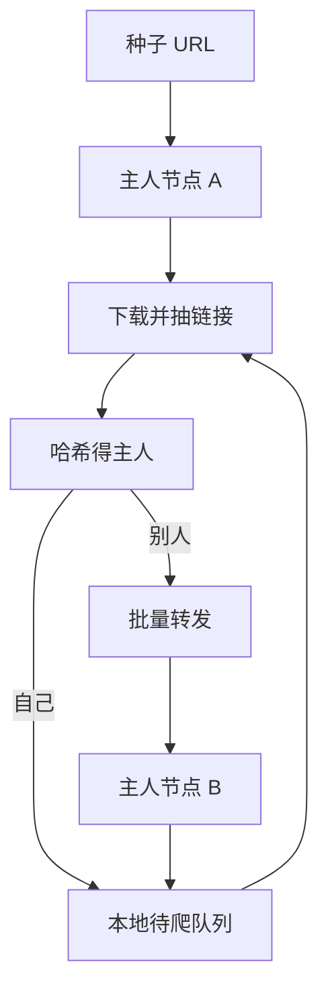

## Q
**设计无中心协调的分布式网络爬虫（节点间通信受限）**｜系统设计

你控制 10,000 台机器，单机带宽和 CPU 充足，但机器之间通信很受限；不能用主控节点、数据库、消息队列或任何云服务。目标站点有 10 亿个互相链接的 URL，从根页面递归跟链接能爬到全部。要求：下载全部页面；同一个 URL 绝不下载两次；任何单个节点的流量尽量小。面试官常追问：谁来去重、怎样保证所有机器都不闲着、节点宕机怎么办、没有主控怎么知道爬完了。

给出完整解答：需求、核心实体与接口、整体设计、深入问题、取舍、不同级别的期望。

## A
**一句话。** 用确定性的所有权（ownership）代替中心：对 URL 做哈希，每个 URL 有且只有一个"主人"节点，主人负责去重和下载，发现新链接的节点把它批量转给主人。去重的"检查并插入"从一把全局锁变成单一写者，通信量只和不同 URL 的数量成正比。

**60 分钟路线。**

| 时间 | 做什么 |
|---|---|
| 0–6 分 | 澄清"节点流量"的含义和故障假设，估算：每节点 10 万个 URL |
| 6–12 分 | 节点状态（成员表、待爬队列、已见集合）和消息 |
| 12–25 分 | 整体设计：规范化、哈希定主人、批量转发、本地爬取循环 |
| 25–50 分 | 必讲深入：所有权与去重；通信量；让所有机器都有活干 |
| 50–60 分 | 追问：宕机与成员、终止检测、礼貌与爬虫陷阱 |

**需求。**
- 功能：
  - 从种子 URL 出发下载全部页面并抽取链接；
  - 每个 URL 只下载一次；
  - 没有任何中心组件。
- 非功能：
  - 节点流量低且均衡：既可指对目标站点的请求速率，也可指节点间的通信量，先向面试官确认，这里两者都满足；
  - 所有节点都有活干，没有闲置机器；
  - 节点会宕机；
  - 无主控也能判定爬完。
- **页面与链接规模估算：** 估算（假设平均页面 100 KB，每页 50 个链接，URL 平均 80 B）：
  - 每节点负责 10^9 ÷ 10^4 = 100,000 个 URL；页面总量 100 TB，每节点 10 GB，页面先存在本机磁盘；
  - 速率：每节点 5 页/秒（假设），10,000 × 5 = 50,000 请求/秒打到目标站点，100,000 ÷ 5 = 20,000 s ≈ 5.6 小时；放到 50 页/秒只要 33 分钟，但总请求 50 万/秒等于攻击对方，所以速率是由站点承受力决定的调节项，不是容量瓶颈；
  - 已见集合：只存自己负责的 URL 的 8 B 指纹，100,000 × 8 B = 800 KB。64 位指纹的碰撞：每节点约 (10^5)² ÷ 2 对 × 2^-64 ≈ 2.7×10^-10，一万个节点合计约 2.7×10^-6 次误判，可忽略，所以精确集合就够，不需要布隆过滤器；
  - 链接：每节点 100,000 页 × 50 = 500 万次链接出现，× 80 B = 400 MB；发送端去重后（假设重复 5 倍，约 100 万个不同 URL）只发 80 MB，整个爬取期间平均每节点出站 80 MB ÷ 20,000 s ≈ 4 KB/s。

**核心实体与接口。**
- 每个节点持有：
  - 成员表：静态配置的 10,000 个地址，约 10,000 × 20 B = 200 KB，这是唯一的全局知识；
  - 待爬队列（frontier）：磁盘上的追加日志；
  - 已见集合 `seen`：自己负责的 URL 的指纹；
  - 已发集合 `sent`：已转发过的 URL 指纹，只是缓存；
  - 本机页面存储，页面按 URL 指纹命名。
- 消息：`Forward(urls[])` 批量转发；`Gossip(成员状态)`；`Steal(n)` 空闲节点向邻居要活。
- 主人：`owner(url) = ring.lookup(hash64(规范化(url)))`，环上每个节点放多个虚拟节点。

**整体设计。**

每个节点循环：
1. **规范化 URL 再哈希：** 规范化 URL（去片段、主机名小写、参数排序）再哈希。规范化不一致会让同一页面有两个主人，去重就破了。
2. 收到 `Forward` 的 URL：查 `seen`，没见过就记入并追加到待爬队列。
3. 从队列取 URL，用约 20 条并发连接下载，令牌桶限速，存本机，抽取链接。
4. 每个链接：主人是自己，同第 2 步；否则查 `sent`，没发过就放进发往主人的缓冲，满 1,000 条或过 1 秒发一批。
5. 开始时只有种子的主人有活。

**深入。**

1. 【必讲】所有权与去重：无中心也能保证不重复。
   - 选择：哈希分区，每个 URL 的"检查并插入"只在主人一处发生，是单一写者，不需要分布式锁，也不需要共识协议。
   - 为什么不用别的：广播已爬 URL，通信放大 10,000 倍；共享布隆过滤器，误判会漏爬，而"下载全部"是硬要求，同步量也大；按主机名哈希，这里只有一个主机，全部压到一个节点。
   - 必须按完整规范化 URL 哈希。成员表固定，所以所有节点对"谁是主人"的答案一致，不需要协商。

2. 【必讲】通信量：靠批量和发送端去重，没有局部性可挖。
   - 99.99% 的链接（(10,000 − 1) ÷ 10,000）指向别的节点，没法靠让链接留在本地来省流量。
   - 发送端用 `sent` 去重：不去重每节点发 400 MB，去重后 80 MB；每批 1,000 条约 80 KB，整个爬取每节点只发约 1,000 个包。
   - 只传 URL，页面留在本机。`sent` 只是缓存，丢了顶多多发，主人的 `seen` 仍然会拦住，正确性不依赖它。

3. 【必讲】让所有机器都不闲。
   - 启动扩散：每页 50 个链接，第 1 层 50 个节点有活，第 2 层最多 50² = 2,500 个，第 3 层 50³ = 125,000 > 10,000，约三层（几秒）全员有活。
   - 稳态不均：哈希让 URL 数均匀，但页面大小和响应速度不均，慢节点积压、快节点空闲。空闲节点向随机邻居发 `Steal`，邻居从待爬队列尾部让出一批"尚未开始"的 URL。
   - 关键：去重权仍在主人手里（`seen` 已记），只是把"下载"委托出去，被委托者抽出的链接照常按规则转发，页面存本机并告知主人位置。去重（主人）和执行（任意节点）分离。

4. 【追问再讲】宕机与成员。
   - 检测：节点间用 gossip（如 SWIM）周期互探，每节点每秒几个小包。
   - 接管：环上故障节点的槽位由后继接管；各节点对未确认的转发重发给新主人。
   - 状态不丢：主人的 `seen`（800 KB）和待爬日志异步复制给后继 2 个节点，否则死节点队列里的 URL 永远没人爬。
   - 崩溃时只有正在下载的约 20 个 URL 可能被重做；页面按指纹命名、覆盖写，所以结果上每个 URL 仍只有一份，请求上最多多一次。

5. 【追问再讲】终止检测：没有主控，就用计数。每个节点记 `Forward` 的发送和接收计数及是否空闲，沿 gossip 求和；全体空闲且全局发送数等于接收数，连续两轮不变才判完成。光看"空闲"不够，因为在途消息会让别人重新有活。

6. 【追问再讲】礼貌与陷阱：总速率上限按活跃节点数均分成每节点令牌桶，节点数变化时由 gossip 重算；每个节点本地读 `robots.txt`；无限日历这类陷阱靠 URL 深度、长度上限和页面内容指纹防。

7. 【加分】节点流量均衡：请求间隔加随机抖动，各节点速率相同；爬完后页面仍分散在 10,000 台机器，下游按指纹查位置即可。

**取舍与追问。** 按被问到的可能性排，通常口述就够：
- **单机爬虫的对应关系：** 单机爬虫是"广度优先队列加访问集合（HashSet）"（[[web-crawler-design]]）。对应关系：
  - 访问集合的"检查并插入"，单进程靠一把锁或单线程，分布式变成单一写者：谁拥有这个键，谁串行处理；
  - 队列变成每节点自己的待爬队列加批量转发；
  - 单机集合放不下内存才用布隆过滤器，这里每节点只有 800 KB，精确集合更好，URL 多 1,000 倍时才值得换。
- 和有队列、数据库的标准版的差别：标准版用队列做待爬队列、数据库做去重；没有它们，就用哈希分区把两者都嵌进每个节点，代价是要自己管成员和故障。
- 扩容：环上加节点，只迁移新节点接管的那部分键。
- 面试官允许一个协调者时：它也只该存成员表，仍然不要放在 URL 路径上。

**级别期望。**
- 中级：用一致性哈希把 URL 分给节点，知道要有已见集合防重复。
- 高级：所有权代替中心、批量转发、规范化、启动扩散和空闲节点的处理、节点宕机后的接管。
- 资深/专家：用数字说明通信量和已见集合大小、去重权与执行权分离、状态复制与崩溃语义、基于计数的终止检测、对目标站点的总速率约束。

**先修概念。**
- [[hi-system-design-core-concepts-consistent-hashing|一致性哈希]]
- [[hi-system-design-core-concepts-sharding|分片（Sharding）]]
- [[hi-system-design-deep-dives-data-structures-for-big-data|大数据数据结构]]
- [[hi-system-design-core-concepts-networking-essentials|网络基础]]

**同类题。**
- [[hi-system-design-problem-breakdowns-web-crawler|网络爬虫]]
- [[solution-web-crawler|设计题解：网络爬虫]]
- [[hi-system-design-problem-breakdowns-distributed-cache|分布式缓存（Redis）]]：同样靠一致性哈希定位数据
