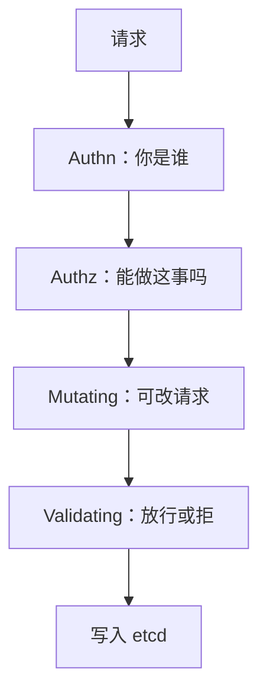

## Q
**API server request pipeline**｜摘要 · 必会

一个请求到达 API server，到对象被存进 etcd，要过哪几关？每一关能拒绝什么？

## A

| 关卡 | 问什么 | 拒绝时 |
|---|---|---|
| Authentication | 你是谁（证书、令牌等） | 401 |
| Authorization | 这个身份能不能对这个资源做这个动作（常用 RBAC，默认全部拒绝，规则才放行） | 403 |
| Admission：mutating | 请求合规吗，不合规能不能改成合规（例如补默认值、注入内容） | 拒绝或改写 |
| Admission：validating | 请求合规吗（不能改，只能放行或拒绝） | 拒绝 |
| Persistence | 存进 etcd | — |

- **顺序：** 认证 → 鉴权 → 准入（先 mutating，再 validating）→ 存储。准入在认证、鉴权之后马上执行，是关于「策略」的。
- **为什么 mutating 在前：** 先改完，validating 才能校验最终的样子。
- **RBAC：** Role/ClusterRole 授予权限，RoleBinding/ClusterRoleBinding 把权限绑给用户（第 6 部分详讲）。

出处

Poulton ch13「Admission control」、ch14「The API server」；kubernetes.io Reference › Controlling Access to the Kubernetes API

