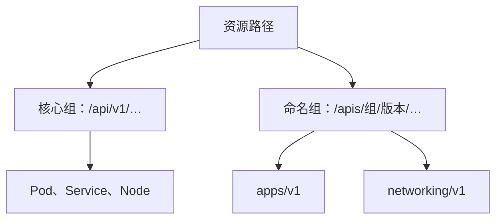

## Q
**API 的形状 · 摘要**｜摘要 · 必会

Kubernetes API 是 REST 风格的。一个 Pod 和一个 Deployment 的 URL 路径分别长什么样？`apiVersion: apps/v1` 里的 `apps` 和 `v1` 对应路径的哪一段？

## A
**规则：** 路径 = 前缀 + （命名空间）+ 资源名。核心组前缀是 `/api/v1`，命名组前缀是 `/apis/<组>/<版本>`。

| 资源 | 路径 |
|---|---|
| Pod | `/api/v1/namespaces/{ns}/pods/` |
| Node（不属于命名空间） | `/api/v1/nodes/` |
| Deployment | `/apis/apps/v1/namespaces/{ns}/deployments/` |
| StorageClass（描述「怎么自动创建存储卷」的对象，第 3 部分细讲） | `/apis/storage.k8s.io/v1/storageclasses/` |

- **`/api` 单数、`/apis` 复数：** 核心组是最早的对象，没有组名，有时写作 `""`；之后新增的资源都放进命名组。
- **GVR：** group（组）、version（版本）、resource（资源名）。
- **命名空间的对象路径多两段：** `namespaces/{ns}/`。
- **自己看：** `kubectl api-resources` 列出所有资源、简称和是否属于命名空间；`kubectl get --raw /api/v1/nodes` 直接发请求。

**出处：** Poulton ch14「The API」；kubernetes.io Reference › API Concepts
