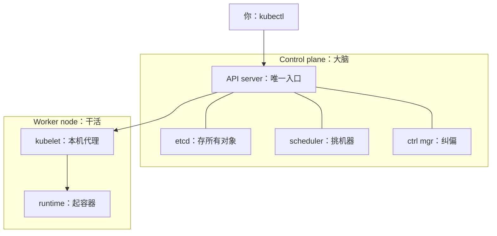

## Q
**Cluster architecture · 先修**｜先修 · 必会

一个 Kubernetes 集群里的机器，分成哪两类？各干什么？

## A
**一句话：** 一类机器当大脑（control plane），一类机器出力干活（worker node）。

| 位置 | 组件 | 一句话 |
|---|---|---|
| control plane | **API server** | 所有请求的唯一入口，control plane 内部也通过它说话 |
| | **etcd** | 存放集群里所有对象的数据库 |
| | **scheduler** | 为新的 Pod 挑一台 node |
| | **controller manager** | 跑着一批 controller，让现实对齐你写的期望 |
| worker node | **kubelet** | 本机的 agent，听 API server 的安排，汇报状态 |
| | **container runtime** | 真正拉镜像、启动容器（比如 containerd） |

- **规模：** 实验集群一个 control plane 节点就行；生产一般 3 或 5 个，分散在不同可用区。
- **用户应用：** 一般只放在 worker 上，让 control plane 专心管集群。

**出处：** Poulton《The Kubernetes Book 2026》ch2「Control plane and worker nodes」；KIA2 §1.2
