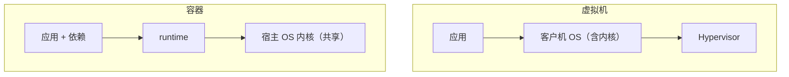

## Q
**Containers vs VMs · 先修**｜先修 · 必会

容器（container）到底是什么？和虚拟机（VM）比，是更小的虚拟机吗？

## A
**一句话：** 容器不是小虚拟机，它是机器上的一个普通进程，只是被限制了「能看到什么」和「能用多少」。

| | VM | Container |
|---|---|---|
| 内核 | 每个 VM 自带一个完整客户机 OS | 所有容器共用宿主内核 |
| 启动与体积 | 要启动一整个 OS，镜像大 | 只是起一个进程，镜像只带应用和依赖 |
| 隔离强度 | 强：隔着 hypervisor | 较弱：隔着内核的 namespace（Linux 给进程隔开「能看到什么」的机制，后面的卡细讲） 和 cgroup（Linux 限制一组进程能用多少 CPU、内存的机制） |
| 能跑什么 | 任何 OS | 必须和宿主内核兼容（Linux 容器要 Linux 内核） |

- **Image（镜像）：** 容器的「安装包」：应用和它需要的文件打成一个包。同一个镜像能在任何机器上起出一样的容器。
- **为什么 Kubernetes 用容器：** 同一台机器上能塞下更多隔离的应用，启动快，每份应用带着自己的依赖，不挤占彼此。

**出处：** KIA2 §2.1（Understanding containers）、§2.3
