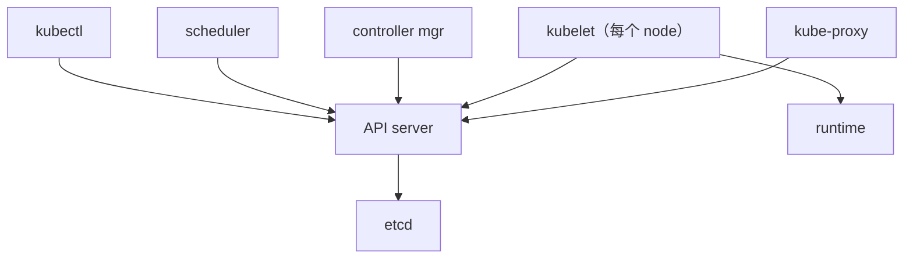

## Q
**Control plane 与 node 组件 · 摘要**｜摘要 · 必会

control plane 和 worker node 上各有哪些组件？谁和谁直接说话，谁又只能通过别人？

## A
**规则：** 所有组件只和 **API server** 说话；只有 API server 直接读写 **etcd**。

| 组件 | 在哪 | 管什么 |
|---|---|---|
| **API server** | control plane | 对外和对内的唯一入口；认证、鉴权后把对象存进 etcd |
| **etcd** | control plane | 集群的数据库，保存期望状态，唯一有状态的部分 |
| **scheduler** | control plane | 盯着还没分配机器的 Pod，挑一个合适的 node |
| **controller manager** | control plane | 把 Deployment、ReplicaSet、Node 等 controller 跑在一个进程里 |
| **cloud controller manager** | control plane（在云上时） | 对接云厂商：节点、负载均衡器、存储 |
| **kubelet** | 每个 node | 盯着分配给本机的 Pod，让 runtime 起容器，汇报状态 |
| **container runtime** | 每个 node | 拉镜像、启停容器，如 containerd |
| **kube-proxy** | 每个 node | 在本机写网络规则，让访问 Service 的流量转到后端 Pod（第 4 部分） |

- **为什么都经 API server：** 认证、校验、审计只需要做在一个地方；组件之间不直接依赖，坏一个不牵连别的。
- **etcd 高可用：** 副本数取奇数，才有多数派。

**出处：** Poulton《The Kubernetes Book 2026》ch2「Control plane and worker nodes」；kubernetes.io Concepts › Cluster Architecture
