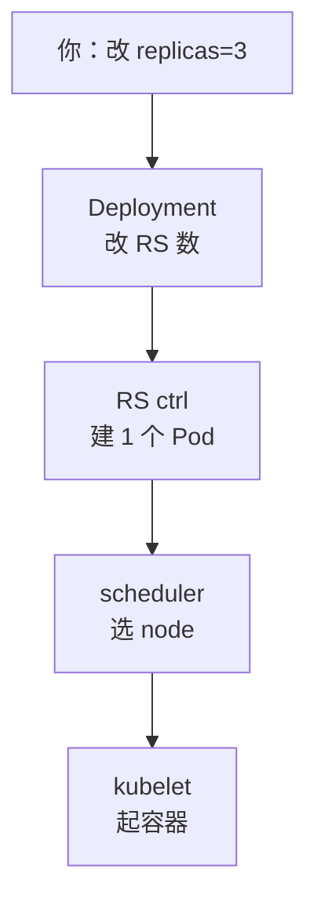

## Q
**Controller 是什么 · 考点**｜考点 · 必会

`kubectl scale deployment kiada --replicas=3` 之后，从 2 个 Pod 变成 3 个。按顺序，谁修改了什么对象？哪个环节不是 controller 做的？

## A

| 步骤 | 谁 | 做了什么 |
|---|---|---|
| 1 | 你（kubectl） | 修改 Deployment 的期望副本数 |
| 2 | Deployment controller | 发现 ReplicaSet 的数量要跟着变 |
| 3 | ReplicaSet controller | 发现只有 2 个 Pod，创建第 3 个 Pod **对象** |
| 4 | scheduler | 不是 controller 的活：挑 node |
| 5 | kubelet | 不是 controller 的活：在本机起容器 |

- **关键点：** controller 只创建和修改 **对象**，从不直接碰容器。每一环都只看自己负责的那一类对象，用 watch 得知变化。
- **推论：** 想知道「谁负责这件事」，问「它盯的是哪类对象」。

**出处：** Poulton ch2（Deployments、controller manager）；KIA2 §3.3
