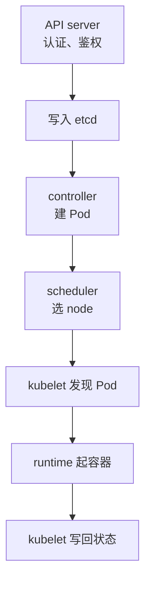

## Q
**End-to-end walk-through**｜摘要 · 必会

从你敲下 `kubectl apply -f kiada.yaml` 到容器在某台 node 上跑起来，中间经过哪些组件？每一步写了什么？

## A

| 步骤 | 组件 | 改变了什么 |
|---|---|---|
| 1 | kubectl | 把 YAML 变成 HTTP 请求 |
| 2 | API server | 认证、鉴权、准入通过后存进 etcd |
| 3 | controller | 看到新 Deployment，建 ReplicaSet，再建 Pod 对象（此时 Pod 没有 nodeName） |
| 4 | scheduler | 看到没有 nodeName 的 Pod，挑一台 node 写上去 |
| 5 | kubelet | 看到分配给自己的 Pod，调用 runtime |
| 6 | runtime | 拉镜像、启动容器 |
| 7 | kubelet | 把 Pod 的状态（Running、Ready）写回 API server |

- **没有「总指挥」：** 每个组件只看自己关心的对象，做完就写回 API server，下一个组件靠 watch 看到变化接着做。
- **所以 Pod 刚创建时是 Pending：** 步骤 4–6 还没走完。

出处

Poulton ch2；KIA2 §1.2.4（提交应用描述后集群里发生什么）

