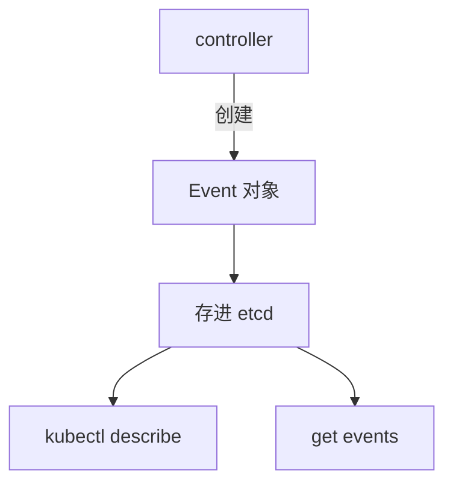

## Q
**Events 与 kubectl describe**｜摘要 · 必会

Pod 没起来，`kubectl describe pod` 底部有一段 Events。这些 Event 是什么、谁产生的、能留多久？

## A

- **Event 是独立的 API 对象**，不在被描述对象的 YAML 里。controller 和 kubelet 用它记录「我对这个对象做了什么、遇到了什么」。
- **两种 type：** `Normal`（例行）和 `Warning`（通常表示有东西阻止了 reconcile）。
- **保留时间：** 每个 Event 创建一小时后被删除（API server 参数可调），为了减轻 etcd 的负担；所以事发很久以后再看可能已经空了。
- **重复事件会合并**成一个对象，带计数，避免刷屏。

| 命令 | 看到什么 |
|---|---|
| `kubectl describe <对象>` | 只含和这个对象有关的 Events |
| `kubectl get events` | 整个 namespace 的所有 Events |
| `kubectl get events --field-selector type=Warning` | 只看 Warning |

出处

KIA2 §4.3「Observing cluster events via Event objects」

