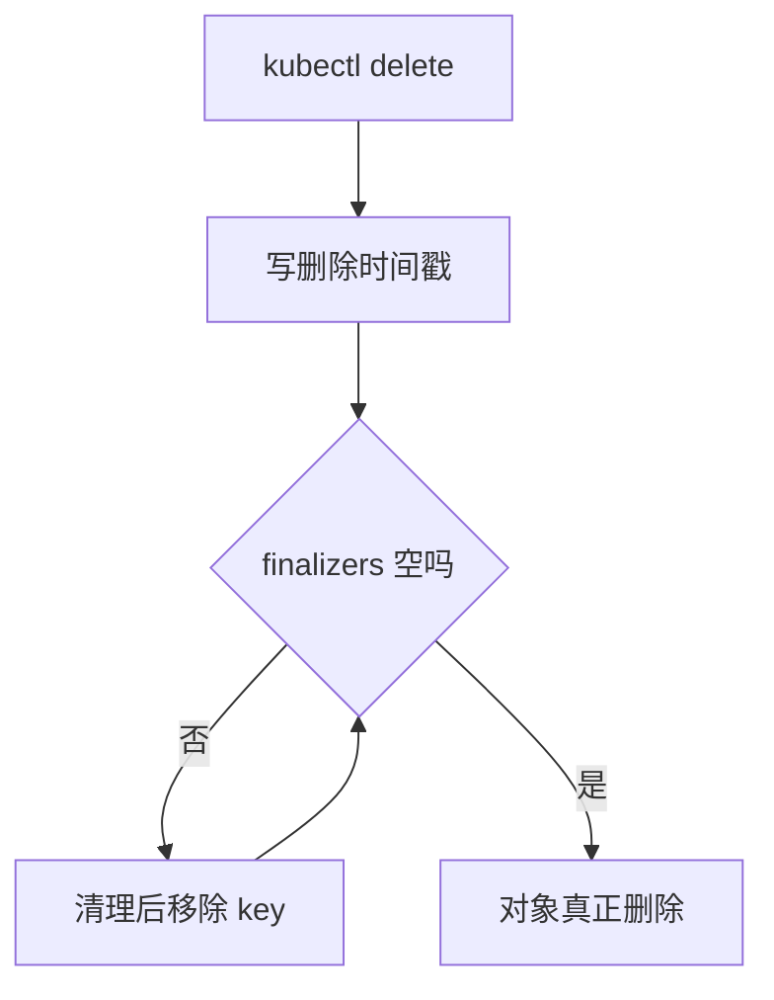

## Q
**Finalizers 与 ownerReferences**｜考点 · 必会

`kubectl delete pvc data` 一直卡着，状态是 `Terminating`；另一次，删了一个 Deployment，下面的 ReplicaSet 和 Pod 自动消失了。这两件事背后分别是什么机制？

## A
| | finalizers | ownerReferences |
|---|---|---|
| 作用 | 删除前**必须先做完**的清理，没做完就不让对象真正消失 | 记录「我是谁创建的」，owner 被删，依赖对象由 garbage collector 清理 |
| 字段 | `metadata.finalizers`（一串 key） | `metadata.ownerReferences`（指向 owner） |
| 谁处理 | 管这个 finalizer 的 controller | garbage collector |

- **卡在 Terminating：** 删除请求只是给对象写上 `deletionTimestamp`，只要 `finalizers` 还有一项，对象就留着。PVC 常见原因是仍有 Pod 在用它（保护用的 finalizer，如 PV 的 `kubernetes.io/pv-protection`），Pod 停掉后才会放行。
- **排查：** `kubectl get pvc data -o yaml` 看 finalizers，再看是谁该处理它。
- **不要随手清空 finalizers：** 清掉就跳过了清理，会留下孤儿资源。确认清理已用别的方式完成再做。
- **删除开始后：** 可以移除 finalizer，但不能再添加；对象不能「复活」。
- **Deployment 的例子：** ReplicaSet 的 ownerReferences 指向 Deployment，Pod 的指向 ReplicaSet；删顶端，GC 顺着链往下删。Job 找要清理的 Pod 也是靠 owner reference，不是 label。

出处

kubernetes.io Concepts › Finalizers（deletionTimestamp、pv-protection、owner references）

