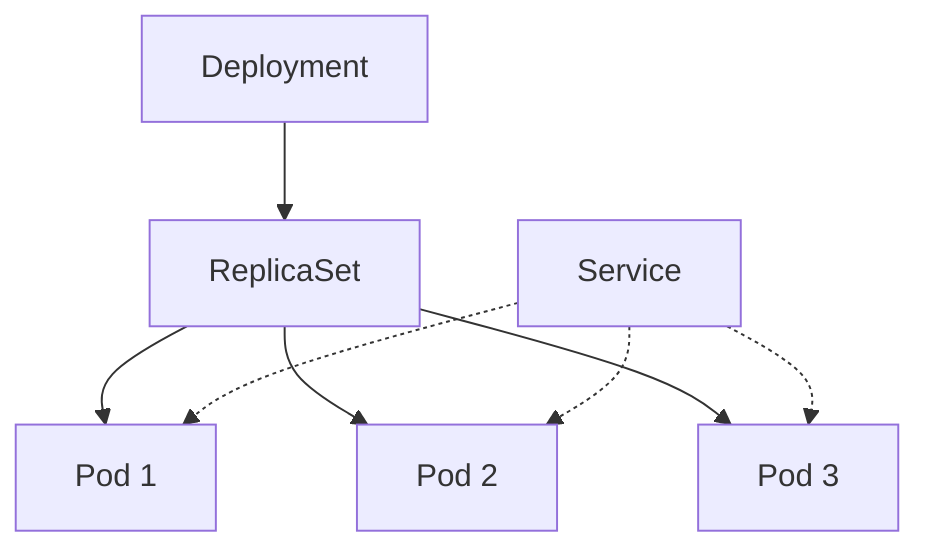

## Q
**First deployment**｜摘要 · 必会

你执行了 `kubectl create deployment kiada --image=luksa/kiada:0.1`，随后 `kubectl expose deployment kiada --type=LoadBalancer --port 8080`，再 `kubectl scale deployment kiada --replicas=3`。集群里依次出现了什么？

## A

| 命令 | 创建或修改了什么 |
|---|---|
| `create deployment` | 一个 Deployment；它又产生一个 ReplicaSet，ReplicaSet 产生 1 个 Pod |
| `expose deployment` | 一个 **Service**，类型 LoadBalancer，前面挂着这个 Deployment 的所有 Pod |
| `scale --replicas=3` | 只改 Deployment 里的期望副本数；新增 2 个 Pod |

- **Pod 名字：** `kiada-5d9c8-p449x` = Deployment 名 + ReplicaSet 的哈希 + 随机后缀。
- **刚创建时 Pod 状态是 Pending：** node 要先下载镜像，READY 显示 `0/1`，几秒后变 `Running`、`1/1`。
- **LoadBalancer：** Kubernetes 不自带负载均衡器，是向云基础设施申请一个。申请到之前 `EXTERNAL-IP` 显示 `<pending>`。
- **`kubectl get pods -o wide`：** 多出 IP 和 NODE 两列，能看到每个 Pod 被放到了哪台机器。

出处

KIA2 §3.3（Running your first application on Kubernetes）

