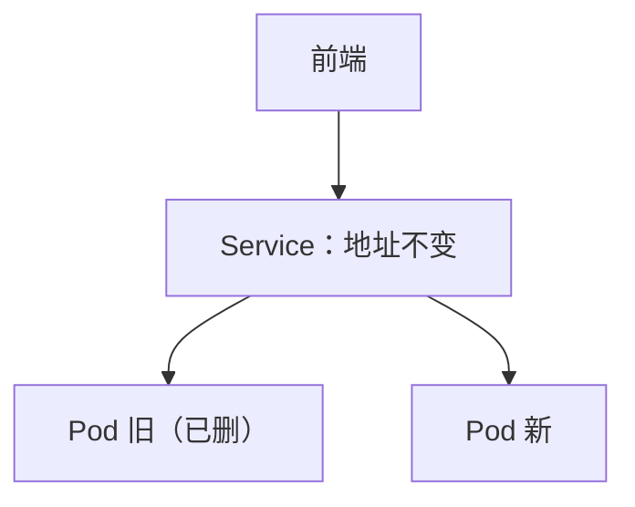

## Q
**五个基本名词**｜考点 · 必会

你的前端写死了后端 Pod 的 IP `10.1.0.5`。后端 Pod 被删掉重建后，前端报连接失败。为什么？应该改用哪个名词？另外：想把后端从 2 份改成 5 份，该改哪个名词？

## A
**原因：** 新 Pod 是一个全新的对象，会拿到新 IP（比如 `10.1.1.7`）。Pod 的 IP 只在这个 Pod 活着时有效。

| 你想做的事 | 找哪个名词 |
|---|---|
| 让调用方有一个不变的地址 | **Service**（前端连 Service 的地址，它转给当前活着的 Pod） |
| 把副本数 2 改成 5 | **Deployment**（改 `replicas`，不要手动创建 Pod） |
| 看有几台机器 | **Node**（`kubectl get nodes`） |
| 看有哪些 Pod 在哪台机器 | `kubectl get pods -o wide`（NODE 一列） |

- **常见误区：** 直接手工创建 Pod 并写死 IP。Pod 没人看护，死了没人补。
- **Service 怎么知道有哪些 Pod：** 靠标签选出来（第 2 部分）。

出处

KIA2 §3.3；Poulton ch2「Pods」「Service objects and stable networking」

