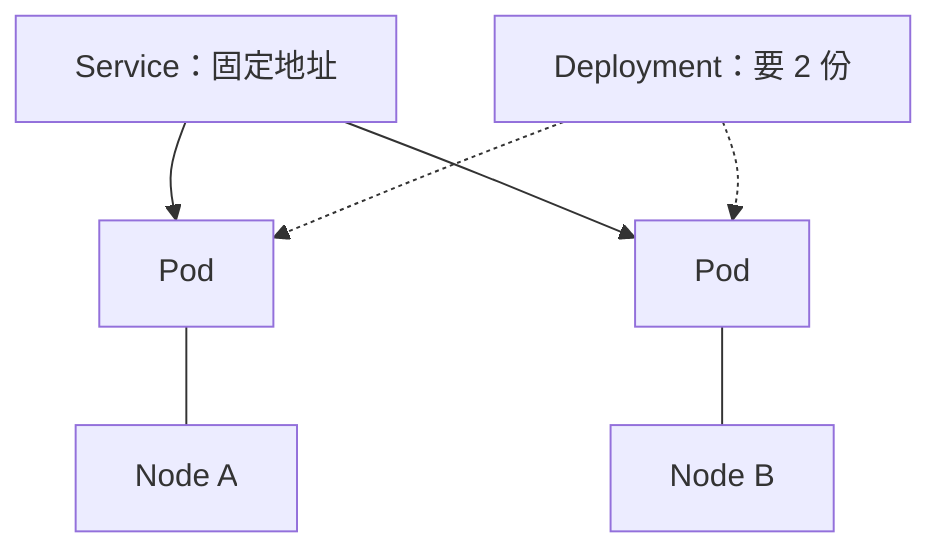

## Q
**五个基本名词 · 先修**｜先修 · 必会

第一次听人讲 Kubernetes，满嘴都是 Cluster、Node、Pod、Deployment、Service。各是什么？它们之间是什么关系？

## A
**一句话：** 你告诉 Kubernetes「要什么」，它在一群机器上替你把程序跑起来、看住、换掉坏的。

| 名词 | 是什么 | 打个比方 |
|---|---|---|
| **Cluster** | 一整套 Kubernetes：一个 control plane（大脑）加若干 node | 整个工厂 |
| **Node** | 一台跑程序的机器（虚拟机或物理机） | 一条生产线 |
| **Pod** | 最小的运行单位：一个或几个容器，共用一个 IP | 一个工位上的工人 |
| **Deployment** | 一份声明：「这个 Pod 要跑 N 份，升级时按这个节奏换」 | 排班表 |
| **Service** | 一组 Pod 前面的固定地址；Pod 换了，地址不变 | 前台总机号码 |

- **为什么不直接管容器：** Pod 会死、会被换、会换机器，IP 也跟着变。所以「要几份」交给 Deployment 管，「从哪访问」交给 Service 管。
- **容器（container）：** 一个打包好的、和别的进程隔离开的程序，后面的卡细讲。

**还会反复听到的三个词（后面各有一章细讲）：**
- **kubectl：** 你在终端里用来操作集群的命令行工具。
- **controller：** control plane 里一直在跑的程序，负责把现实对齐到你声明的样子，比如 Pod 少了就补。
- **replicas：** Deployment 里「要跑几份 Pod」的那个数字。

**出处：** KIA2 §1.2、§3.3；Poulton《The Kubernetes Book 2026》ch1
