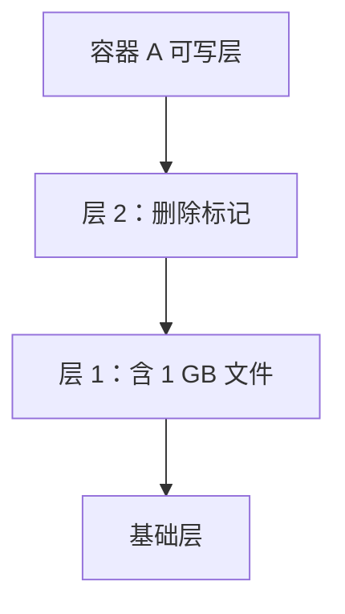

## Q
**镜像层 · 考点**｜考点 · 必会

Dockerfile 里先 `COPY` 一个 1 GB 的安装包进镜像，下一行又把它删掉。最终镜像会变小吗？容器运行时改了一个来自镜像的文件，别的容器看得到吗？

## A

| 问题 | 答案 | 原因 |
|---|---|---|
| 删除后镜像变小吗 | **不会** | 删除只是在上层打「已删除」标记，文件仍在下面的层里，照样要下载 |
| 容器改了镜像里的文件 | 别的容器看不到 | 整个文件先被复制进该容器自己的可写层再修改（copy-on-write） |

- **怎么做：** 把「下载、解压、删除」写在同一条指令里，这样中间产物不会留在任何一层。
- **注意：** 在可写层里做大量写入，尤其是改大文件，会先复制整个文件，既慢又占空间；要持久或大量写的数据应放进 volume（第 3 部分）。

**出处：** KIA2 §2.1.2「Understanding image layers」（删除只是标记；copy-on-write）
