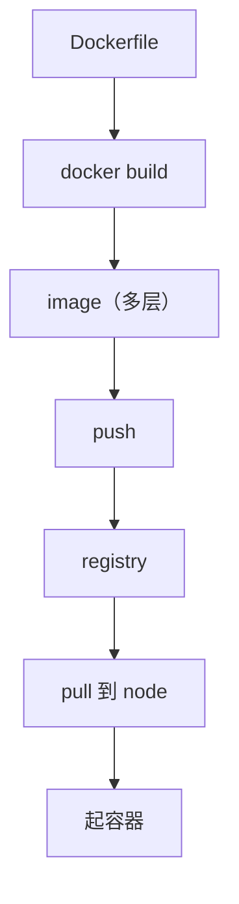

## Q
**Image、Dockerfile 与 registry · 摘要**｜摘要 · 必会

一个 container image 是怎么造出来的、怎么到另一台机器上运行的？为什么拉第二个镜像常常很快？

## A


**Dockerfile** 是一串指令，每条产生一层：

```dockerfile
FROM node:23-alpine        # 起点：基础镜像（带 tag 23-alpine）
COPY app.js /app.js        # 把本地文件放进镜像
COPY html/ /html
ENTRYPOINT ["node", "app.js"]  # 容器启动时执行的命令
```

| 概念 | 一句话 |
|---|---|
| **layer** | 镜像由只读的薄层叠成；相同的层在一台机器上只存一份，多个镜像共用 |
| **writable layer** | 每个容器在只读层之上有自己的可写层，改文件时整份复制到这一层（copy-on-write） |
| **registry** | 存放和分发镜像的仓库（Docker Hub、Quay.io 等）；先 push 再在别处 pull |
| **tag** | 同名镜像的版本标记，不写就是 `latest` |

- **拉得快的原因：** 新镜像只需下载本机还没有的层。
- **镜像里不是整台机器：** 只有应用和依赖，内核用宿主机的。

**出处：** KIA2 §2.1.2–2.1.3、§2.2.1（layers、registry、tag、Dockerfile 指令）
