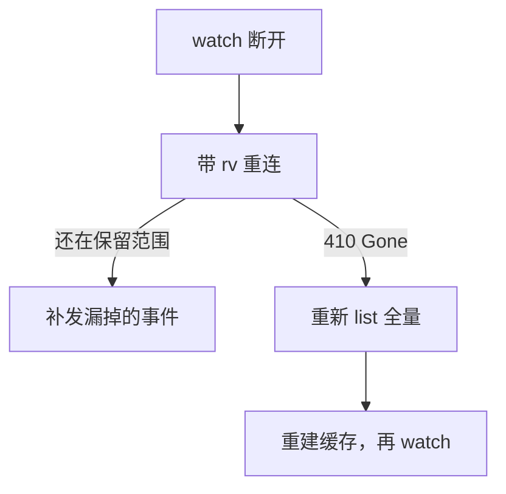

## Q
**Watch 断了怎么办**｜考点 · 必会

controller 的 watch 连接断了 5 分钟，重连时 API server 回复 `410 Gone`。这是什么意思？controller 接下来做什么？它的本地缓存这段时间是对的吗？

## A

| 步骤 | 说明 |
|---|---|
| 重连 | 带上最后收到的 resourceVersion 继续 watch，服务端补发之后的事件 |
| **410 Gone** | 那个版本太旧，服务端已经不保留这段历史，无法补发 |
| 处理 | 重新 **list** 拿全量，用它替换缓存，再从新 resourceVersion 开 watch |

- **缓存这 5 分钟里是旧的：** controller 在这段时间看不到新变化（这就是 staleness，前面讲过）。因为 reconcile 是 level-triggered，重新 list 之后，下一轮对账会把落下的差异补上，不需要重放历史事件。
- **bookmark：** 客户端可以请求 BOOKMARK 事件，服务端定期推一个只带最新 resourceVersion 的事件，这样重连时版本更新，减少 410 的概率。
- **为什么不每次都 list：** 全量 list 对 API server 和 etcd 都重，watch 是增量，只有断得太久才退回 list。

出处

kubernetes.io Reference › Kubernetes API Concepts（Semantics for watch、410 Gone responses、Watch bookmarks）

