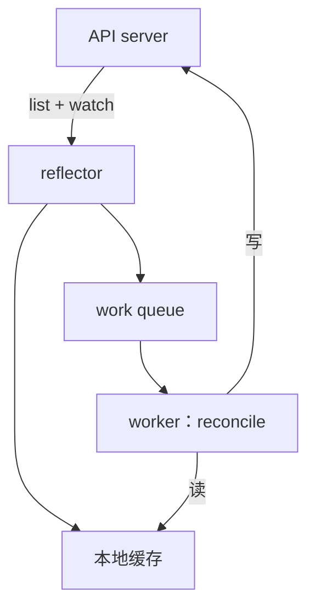

## Q
**Watch、informer 与 work queue**｜摘要 · 必会

几十个 controller 都要盯着成千上万个对象。如果每个都不停地向 API server 发 list 请求，API server 会被压垮。controller 实际是怎么拿到变化的？

## A
**从零说起：** API server 支持 **watch**：客户端发一次请求，连接保持打开，之后对象每有变化，服务端就推一条事件（ADDED / MODIFIED / DELETED）。controller 用 client 库里的 **informer** 把这件事包起来。

| 部件 | 做什么 |
|---|---|
| **reflector** | 先 list 一次拿全量，再 watch 接增量，记住最后收到的 resourceVersion |
| **本地缓存（store）** | 在 controller 进程内存里保存所有关心的对象，读它不用打 API server |
| **work queue** | 只放被改动对象的**名字（key）**，同一个 key 多次变化会合并成一次；失败时带退避重新入队 |
| **worker** | 从队列取一个 key，从缓存读当前对象，跑一轮 reconcile |

- **为什么队列里只放名字：** reconcile 是 level-triggered，只关心「现在是什么」，不关心经过了几次事件；合并之后既省力又不丢信息。
- **多个 controller 共用：** 同一进程里的 informer 可以共享缓存，对 API server 只开一路 watch。

出处

kubernetes.io Concepts › Controllers；Reference › API Concepts（watch）；client-go 的 informer / workqueue 设计

