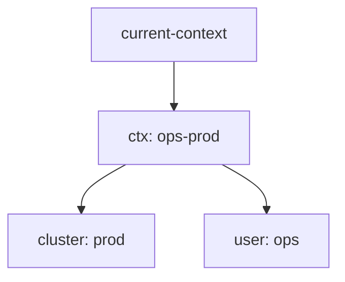

## Q
**kubeconfig**｜考点 · 必会

你同时管着 dev 和 prod 两个集群。早上直接执行 `kubectl delete deployment web`，才发现 current-context 还指向 prod。kubeconfig 里到底存了什么，怎么避免这种事？

## A

| 部分 | 内容 |
|---|---|
| **clusters** | 已知集群的列表（API server 地址、CA） |
| **users** | 凭证列表 |
| **contexts** | 把一个 cluster 和一个 user 配成一对，比如 `ops-prod` = `ops` 凭证 + `prod` 集群 |
| **current-context** | 默认用哪个 context |

- **每条 kubectl 命令：** 转成 HTTP REST 请求 → 发到 current-context 对应的集群 → 用同一 context 的凭证。所以 current-context 指错了，命令就打错集群。
- **习惯：** 动手前先看 `kubectl config current-context`；破坏性命令显式带 `--context`；用 `kubectl config use-context` 切换。
- **更保险：** 按环境拆成不同的 kubeconfig 文件，用 `KUBECONFIG` 选。

出处

Poulton ch3「More about kubectl and your kubeconfig file」；KIA2 §3.2.2

