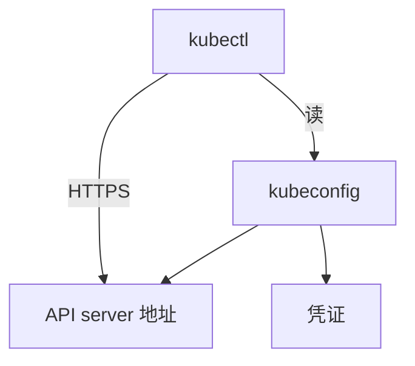

## Q
**Local cluster 与 kubectl**｜摘要 · 必会

想在自己电脑上练习 Kubernetes，有哪些办法？装好之后怎么确认 kubectl 连得上集群？

## A
| 工具 | 特点 |
|---|---|
| **Docker Desktop** | 在 macOS / Windows 上一键开一个单节点集群，适合练习大多数主题 |
| **minikube** | Kubernetes 社区维护的本地集群工具，`minikube start` |
| **kind**（Kubernetes in Docker） | 把节点跑在 Docker 容器里，资源占用小，书的作者开发时主要用它 |
| **托管集群** | 云上的 GKE 等，不用自己运维 |



```bash
kubectl cluster-info   # API server 是否在线，列出集群服务地址
kubectl get nodes      # 列出节点，STATUS 应为 Ready
```

- **kubeconfig 默认位置：** `~/.kube/config`。Docker Desktop、minikube、GKE 会替你创建；kind 之类可能写到别处。
- **指到别的文件：** `export KUBECONFIG=/path/to/custom/kubeconfig`，不用挪文件。
- **能列出 node，说明** kubectl、网络、凭证三者都通。

<details class="pt" markdown="1"><summary>出处</summary>

KIA2 §3.1、§3.2.2–3.2.3

</details>
