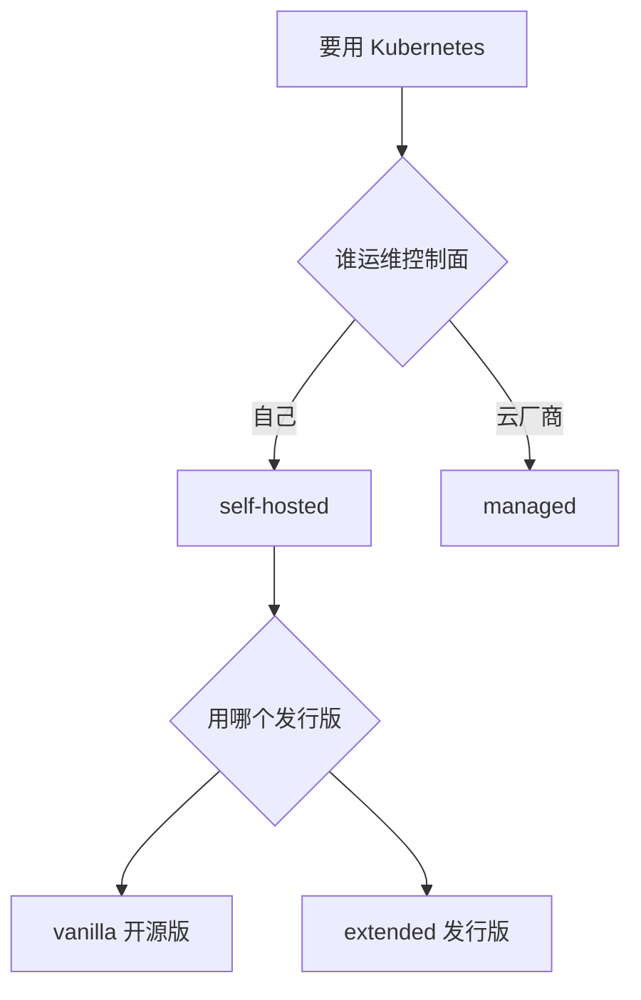

## Q
**自管 vs 托管 · 摘要**｜摘要 · 必会

团队决定上 Kubernetes。要先回答的两个选择是什么？每个选择各自的代价是什么？

## A

| 选择 | 代价 | 好处 |
|---|---|---|
| **self-hosted**（自己装自己运维） | 要精通内部原理，control plane 出问题全归你；书里的态度是「社区通常会说不要」 | 完全可控，可以放在自己机房 |
| **managed**（如 GKE、AKS、EKS） | 受厂商功能和更新节奏限制 | 厂商运维 control plane，你只用 API |
| **vanilla**（社区原版） | 默认配置要自己调到能上生产，安全默认值偏弱，可能不如发行版稳定 | 最新特性、不绑定厂商 |
| **extended 发行版**（如 OpenShift、Rancher） | 通常落后上游一两个版本 | 更好的默认安全和性能，多出一些对象类型（如代表集群用户的对象），附带运维工具 |

- **elasticity：** 在云上，集群缺资源时可以请云厂商加虚拟机，空闲时再退掉，这是上云的主要好处之一。
- **hybrid：** 平时跑自己机房，高峰时溢出到云上，少见但可行。
- **经验法则：** 试验和学习可以自建；生产优先托管或成熟发行版。

**出处：** KIA2 §1.3.1–1.3.3「To manage or not to manage Kubernetes yourself」「Using vanilla or extended Kubernetes」
