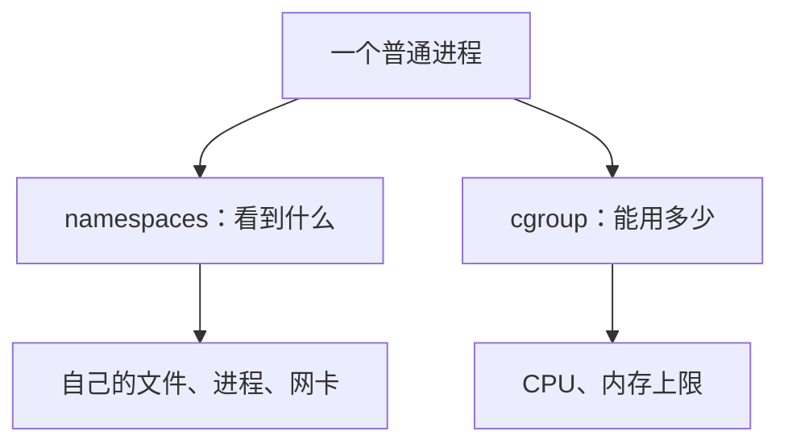

## Q
**Namespaces 与 cgroups · 摘要**｜摘要 · 必会

Linux 里没有「容器」这个内核对象。那一个进程怎么就变成了「容器」？

## A
**一句话：** 容器 = 一个进程 + 一组 **namespace**（决定它看到什么）+ 一个 **cgroup**（决定它能用多少）。

| namespace | 隔离的东西 |
|---|---|
| mnt | 挂载点（文件系统） |
| pid | 进程号 |
| net | 网卡、协议栈、端口 |
| ipc | 进程间通信（共享内存等） |
| uts | 主机名 |
| user | 用户和组 ID |
| time | 系统时钟的偏移 |
| cgroup | cgroup 的根目录 |

- **namespace 管「看到」：** 容器里 `ps` 只看见自己的进程，`hostname` 是自己的名字。
- **cgroup 管「用多少」：** 限制并统计 CPU、内存、磁盘和网络带宽。比如 `docker run --memory=100m` 其实就是在设置进程的 cgroup，由内核强制执行。
- **两者缺一不可：** 光有 namespace 看不到别人，但仍能把 CPU 吃光；光有 cgroup 能限量，但还看得到别人。
- **Pod 里的容器：** 同一个 Pod 的容器共享其中一部分 namespace（网络、IPC（进程间通信，比如共享内存） 等），所以它们用 localhost 互通（第 2 部分）。

**出处：** KIA2 §2.3.1（Kernel Namespaces）、§2.3.2（cgroups）
