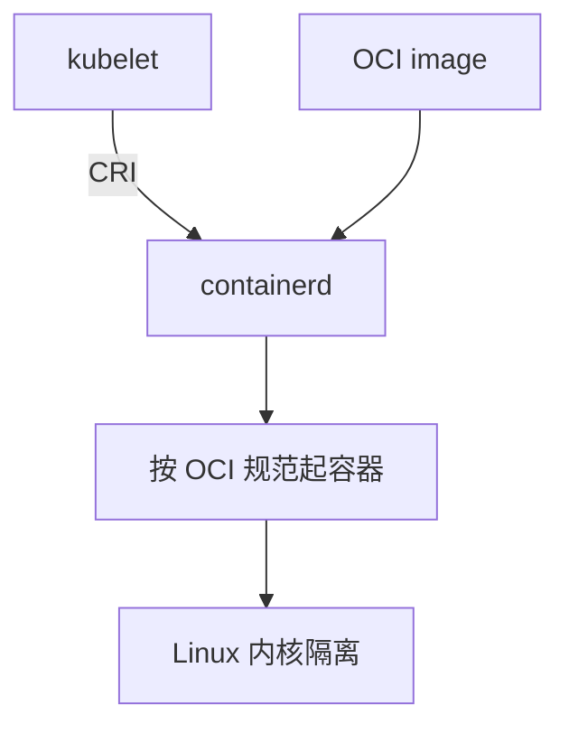

## Q
**OCI、CRI 与 container runtime**｜摘要 · 必会

用 Docker 构建的镜像，为什么能在用 containerd 或 CRI-O 的集群里直接运行？这几个缩写各管哪一段？

## A

| 缩写 | 规定什么 |
|---|---|
| **OCI**（Open Container Initiative） | 行业标准：**Image spec** 规定镜像格式，**Runtime spec** 规定 runtime 如何创建、配置、运行容器 |
| **CRI**（Container Runtime Interface） | Kubernetes 与 runtime 之间的接口：创建、启动、停止、管理容器 |
| **containerd** | 常用的 CRI 实现，高性能 runtime，最早由 Docker 开发 |
| **CRI-O** | 为 Kubernetes 优化的轻量 runtime，不依赖 Docker |

- **所以：** 镜像遵守 OCI 格式、runtime 遵守 CRI，两边都能换。构建工具和运行工具互不绑定。
- **隔离不是 Docker 提供的：** 真正的隔离由 Linux 内核（namespaces、cgroups）完成，Docker 和 runtime 只是用它们。
- **Kubernetes 早期** 把 Docker 当唯一 runtime，现在通过 CRI 支持多种。

出处

KIA2 §2.1.4「Introducing the Open Container Initiative and Docker alternatives」

