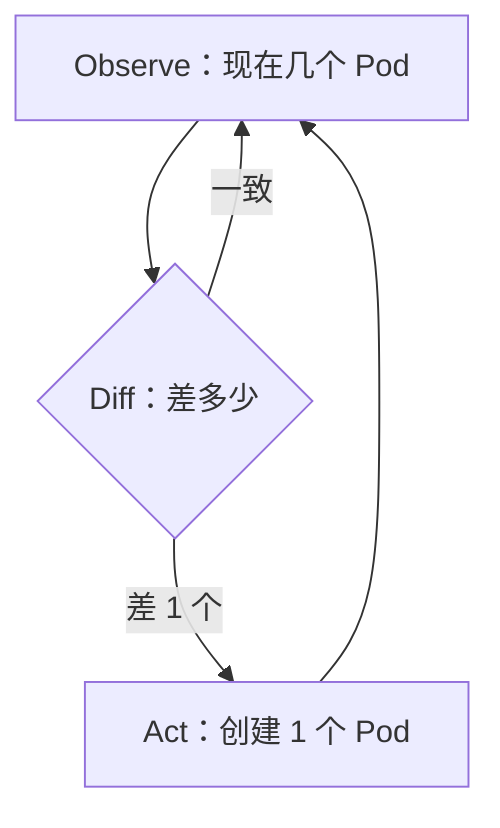

## Q
**Reconcile loop · 先修**｜先修 · 必会

你用 `kubectl apply` 交了一份 Deployment，写着 `replicas: 3`（要 3 个 Pod）。然后你手动删掉其中一个 Pod，几秒后 Pod 又变回 3 个。是谁、按什么规则把它补回来的？

## A
> 先修：五个基本名词、kubectl 与 declarative、Controller 是什么。

**一句话：** controller 不执行命令，它不停地把 **actual state** 拉向 **desired state**。

- **desired state：** 你写进 `spec` 的东西（`replicas: 3`），存在 etcd 里（etcd：control plane 里存放所有对象的数据库，只有 API server 直接读写它）。
- **actual state：** controller 从 API server watch 到的现状（只剩 2 个 Pod）。
- **为什么稳：** 它是 **level-triggered**，只看"现在差多少"，不靠记住"刚才发生了什么事件"。漏掉一个事件、controller 重启了，下一轮照样能补齐。
- **谁补的：** ReplicaSet controller（在 kube-controller-manager 里）。它只创建 Pod 对象；放到哪个节点是 scheduler 的事，真正起容器是 kubelet 的事。

**出处：** Poulton《The Kubernetes Book 2026》ch2「The declarative model and desired state」
