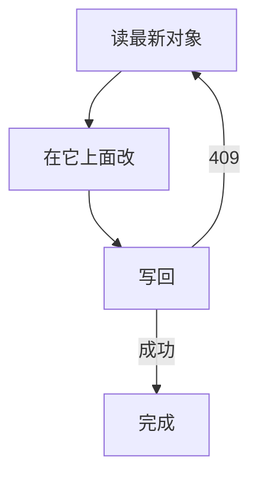

## Q
**Conflict**｜考点 · 必会

一个自己写的 controller 日志里不断出现 `the object has been modified; please apply your changes to the latest version and try again`。为什么会这样？写成「失败就原样重发同一个请求」行不行？

## A
**为什么：** 它读到对象后，别的组件（比如 scheduler 写 `nodeName`、kubelet 写 `status`、另一个 controller）先改了同一个对象，resourceVersion 变了，它拿旧版本写就得到 409。

| 做法 | 结果 |
|---|---|
| 原样重发同一个请求 | **还是 409**，因为它带的仍是旧 resourceVersion |
| 重新读 → 重新应用自己的改动 → 再写（retry on conflict） | 正确 |
| 去掉 resourceVersion 强行覆盖 | 会抹掉别人刚写的字段，不要 |
| 只改自己负责的字段，用 patch（server-side apply） | 减少冲突，下一张卡 |

- **偶尔 409 是正常的：** 多个组件共写一个对象时，冲突是设计内的信号，不是故障。只有持续的、重试也过不去的冲突才需要查。
- **减少冲突：** 缩小写入范围（只改自己的字段）、缩短「读→写」之间的时间。

出处

kubernetes.io Reference › Kubernetes API Concepts（resourceVersion、409 Conflict）

