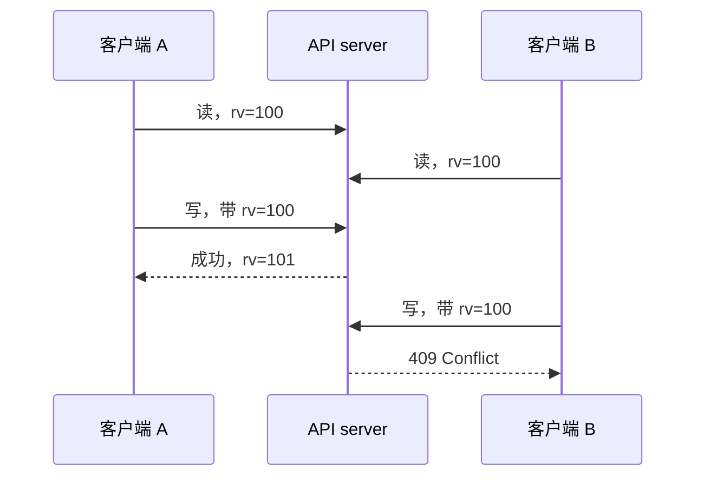

## Q
**etcd 与 resourceVersion · 摘要**｜摘要 · 必会

两个 controller 同时读了同一个对象、各自改完又写回去。Kubernetes 怎么保证后写的不会悄悄覆盖先写的？

## A
**从零说起：** etcd 是个键值数据库，每个对象存成一个 key。每次写入，etcd 里的全局版本号都会增加，对象带上自己最后一次被改动时的版本，就是 `metadata.resourceVersion`。

**optimistic concurrency（乐观并发）：** 不加锁，读的时候记下 resourceVersion，写回时带上；API server 发现存储里的版本已经变了，就拒绝这次写。

| 项 | 要点 |
|---|---|
| 状态码 | 带旧 resourceVersion 的更新得到 **409 Conflict** |
| 客户端该做什么 | 重新读最新对象，在它上面重新应用自己的修改，再写 |
| 为什么叫乐观 | 假设冲突少，冲突了再重试，比每次加锁便宜 |
| 怎么用这个值 | 当作不透明字符串，只比较是否相等，不要解析或比大小 |

- **etcd 的位置：** 只有 API server 读写它（第 1 部分前面讲过），所以所有写入都在 API server 这一道关口上串行判定冲突。
- **没带 resourceVersion 的更新**会无条件覆盖；`kubectl edit`、client 库默认都会带。

**出处：** kubernetes.io Reference › Kubernetes API Concepts（resourceVersion）；Poulton ch14「The API server」
