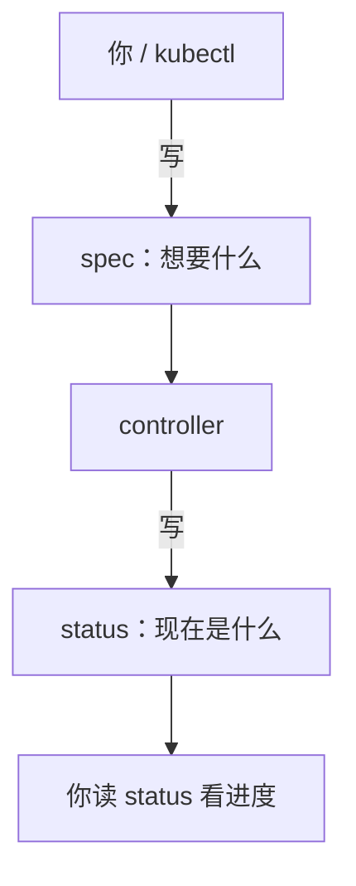

## Q
**spec vs status 与 conditions**｜摘要 · 必会

一个对象里的 `spec` 和 `status` 分别是谁写的？controller 的工作怎么体现在这两块上？

## A

| | spec | status |
|---|---|---|
| 含义 | 期望状态 | 观察到的实际状态 |
| 谁写 | 你（或你的工具） | 系统：controller、kubelet 等 |
| 例子（Deployment） | `replicas: 3` | `readyReplicas: 2` |

- **reconcile 的两端：** controller 读 `spec`（想要什么）和现实，行动之后把结果写进 `status`。
- **conditions：** `status.conditions` 是一个列表，每项有 `type`、`status`（True / False / Unknown）、`reason`、`message` 和最后变化时间。
  比如 Node 有 `Ready`、`MemoryPressure` 等条件。
- **为什么 conditions 比一个布尔值有用：** 一个「健康/不健康」说不清哪里出问题。conditions 能同时给出多个独立维度，并带上 reason 和 message，告诉你为什么，也不用靠猜。
- **`Unknown`：** 表示系统不知道，比如 node 失联后 kubelet 没法汇报。这和 `False` 不一样。

出处

KIA2 §4.2.3（spec、status、conditions）

