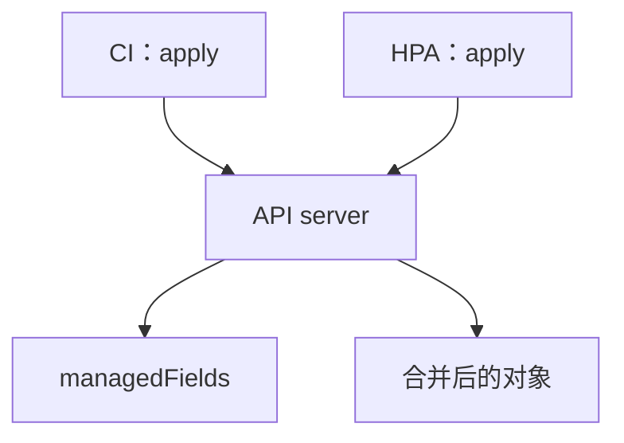

## Q
**Server-side apply · 摘要**｜摘要 · 必会

HPA 在改 Deployment 的 `replicas`，你的 CI 又在 `kubectl apply` 同一份 YAML。怎么让两方各管各的字段、不互相覆盖？

## A
**server-side apply（SSA）：** 把「合并」放到 API server 上做。每个字段记录**谁**（field manager）最后声明了它的值，存在 `metadata.managedFields` 里。



| 概念 | 要点 |
|---|---|
| **field manager** | 每个 SSA 请求必须报身份；最后改某字段的人是它的 owner |
| **conflict** | 你要改的字段别的 manager 也声明了，且值不同，请求被拒绝 |
| 解决冲突 | `--force-conflicts` 强行改并夺走所有权，或从自己的 YAML 里去掉这个字段，放弃所有权 |
| 删字段 | YAML 里去掉某字段再 apply：没人共同拥有就会从对象里删掉 |
| 看谁管什么 | `kubectl get <对象> -o yaml --show-managed-fields` |

```bash
kubectl apply --server-side -f deploy.yaml
kubectl apply --server-side --force-conflicts -f deploy.yaml
```

- **对比旧方式（client-side apply）：** 旧方式在对象上存一份 `last-applied-configuration` 注解，靠本地对比算差异；SSA 记录的是「字段归属」，多个控制方共管一个对象时更可靠。
- **稳定性：** SSA 自 v1.22 起稳定。

**出处：** kubernetes.io Reference › Server-Side Apply（managedFields、field manager、conflicts、stable since v1.22）
