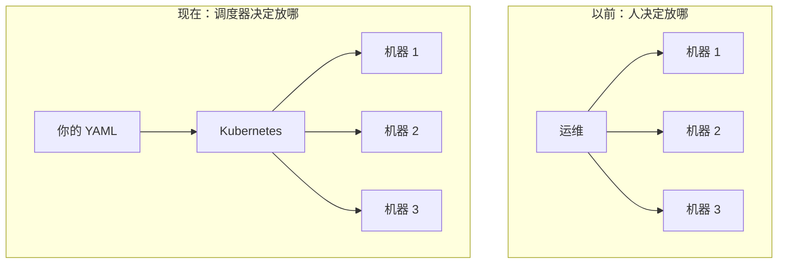

## Q
**为什么需要 Kubernetes · 摘要**｜摘要 · 必会

你的应用现在是一台服务器上的一个进程，流量涨了，要放到十台机器上跑。你会碰到哪些新问题？Kubernetes 的核心想法是什么？

## A
**一句话：** 把一堆机器当成一台大计算机用。你只说「我要什么」，由 Kubernetes 决定放在哪台机器、看住它、坏了换掉。

| 多机以后冒出来的问题 | Kubernetes 怎么处理 |
|---|---|
| 程序放到哪台机器？ | **scheduler** 看每台机器剩多少 CPU、内存，替你挑 |
| 机器或程序挂了？ | 发现实际份数少于你要的份数，就在别处补一个 |
| 流量涨了、落了？ | 改一个数字（副本数）就扩缩 |
| 程序换了地址，别人怎么找到？ | **Service** 给一组副本一个固定地址 |
| 升级时不能停服务？ | **Deployment** 一批一批换，新的就绪了才删旧的 |

- **容器（container）：** 打包好的程序，和机器上别的进程隔离开。Kubernetes 管的就是一批容器（下一章细讲）。
- **本质：** 书里的说法是，Kubernetes 就是一个 API 加一批简单的 controller，让容器化的应用一直跑着。

**出处：** KIA2 §1.1（Introducing Kubernetes）
