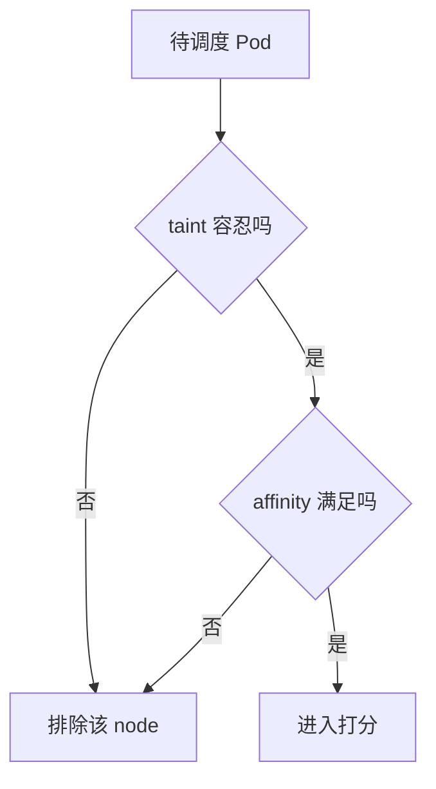

## Q
**Affinity、taints 与 topology spread**｜摘要 · 必会

想控制 Pod 落在哪些 node 上，有哪几类手段？各自是谁在表态，是 Pod 还是 node？

## A
| 手段 | 谁表态 | 做什么 |
|---|---|---|
| **nodeSelector** | Pod | 只放到有这些 label 的 node（最简单） |
| **node affinity** | Pod | 同上但更灵活：`required…`（必须满足）、`preferred…`（尽量，带 1–100 的权重）；运算符 `In / NotIn / Exists / DoesNotExist` |
| **pod affinity / anti-affinity** | Pod | 和某类 Pod 放一起或分开（按 `topologyKey` 划分的范围，如同一个 zone） |
| **taint + toleration** | **node** 先拒绝 | node 上的 taint 把 Pod 挡在外面，只有带匹配 toleration 的 Pod 才能进 |
| **topology spread** | Pod | 让同类 Pod 在 zone / node 之间均匀分布 |

**taint 三种 effect：**

| effect | 含义 |
|---|---|
| `NoSchedule` | 不容忍的新 Pod 不放进来，已在的不受影响 |
| `PreferNoSchedule` | 尽量不放，软限制 |
| `NoExecute` | 不容忍的 Pod 立刻被驱逐；有 `tolerationSeconds` 的待够时间再驱逐 |

```bash
kubectl taint nodes node1 key1=value1:NoSchedule    # 加
kubectl taint nodes node1 key1=value1:NoSchedule-   # 末尾 - 表示去掉
```



- **名字里的 `IgnoredDuringExecution`：** 调度之后 node 的 label 变了，已运行的 Pod 不会被赶走。
- **两者配合：** 独占节点池时，给 node 加 taint（挡住别人）并加 label，Pod 同时写 toleration（允许进入）和 nodeSelector/affinity（指定要去）；taint 只拒绝，不负责把 Pod 吸引过去。

<details class="pt" markdown="1"><summary>出处</summary>

kubernetes.io Concepts › Assigning Pods to Nodes；Taints and Tolerations

</details>
