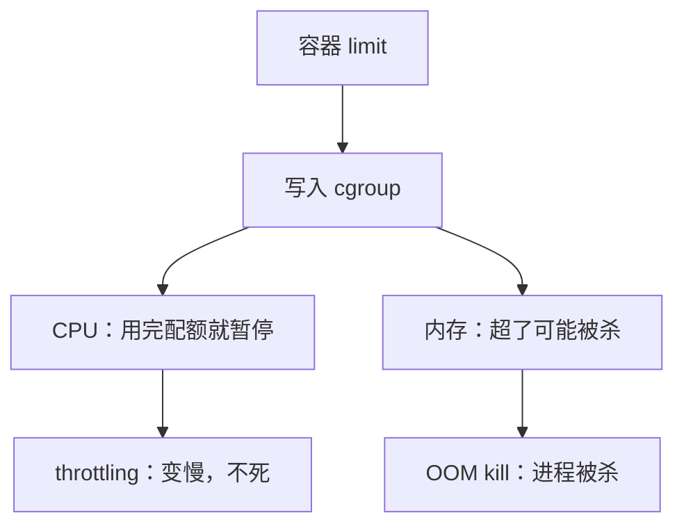

## Q
**CPU throttling 与 OOM kill · 摘要**｜摘要 · 必会

同样是 limit，超出 CPU limit 和超出 memory limit 的后果为什么完全不同？内核是怎么执行它们的？

## A
**从零说起：** limit 由 kubelet 和 container runtime 写进 Linux 的 **cgroup**（第 1 部分讲过），真正执行的是内核。CPU 能「让你慢一点」，内存拿走就没法「还回去」，所以处理方式不同。

| | CPU limit | memory limit |
|---|---|---|
| 超出时 | **throttling**：内核限制它继续使用 CPU，是硬上限 | 内核**可能杀掉**容器（OOM kill） |
| 容器会死吗 | 不会，只是变慢 | 会，状态 `OOMKilled`，再按 restart policy 重启 |
| 何时执行 | 随时，用到配额就限 | **被动**：只在内核发现内存紧张时才动手，超限的容器未必立刻被杀 |

- **CPU 配额是按时间片给的：** 内核按固定周期（默认 100 毫秒）发放，limit 0.5 CPU 约等于每周期 50 毫秒的 CPU 时间；多线程同时跑会很快用完，剩下的时间被暂停。所以**平均 CPU 使用率不高，延迟照样会飙**。
- **request 的作用：** scheduler 用它挑 node，kubelet 为容器预留至少这么多；只设 limit 不设 request 时，request 取 limit 的值。
- **所以：** CPU limit 过紧 → 延迟抖动；memory limit 过紧 → 重启。

**出处：** kubernetes.io Concepts › Resource Management for Pods and Containers（limits 由 kernel 执行；CPU throttling；memory OOM kill 被动执行）；周期数值为 Linux CFS 默认
