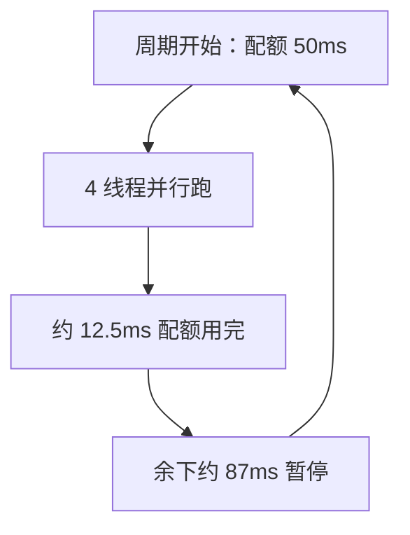

## Q
**延迟毛刺**｜考点 · 必会

一个 4 线程的服务设了 `limits.cpu: 500m`。监控显示 CPU 使用率才 30%，但 p99 延迟周期性出现约 90 毫秒的毛刺。怎么解释？怎么验证、怎么修？

## A
**算一下（以 100 毫秒周期为例）：** limit 500m = 每周期 50 毫秒 CPU 时间。4 个线程同时跑，每 1 毫秒的真实时间消耗 4 毫秒 CPU 时间，约 **12.5 毫秒**就花完这个周期的配额，剩下约 **87.5 毫秒**被 throttle——正好对上毛刺。平均下来只用了 30%，是因为多数周期并没有这样的突发。

| 验证 | 看什么 |
|---|---|
| cgroup 统计 | `cpu.stat` 里 `nr_throttled`、`throttled_usec` 持续增长 |
| 监控指标 | 容器被 throttle 的周期占比（cAdvisor 的 `container_cpu_cfs_throttled_periods_total` 一类） |

| 修法 | 说明 |
|---|---|
| 提高或去掉 CPU limit，保留 request | request 保证份额，limit 不再卡突发（是否去掉取决于集群策略） |
| 减少线程数或让运行时按 limit 调整并行度 | 并发数超过 limit 的时间片，注定被 throttle |

- **不要把「CPU 使用率低」当作没有 throttling。**
- **memory 与此不同：** 限不住就被杀，所以 memory 的 request 和 limit 常设成同样的值。

出处

kubernetes.io Concepts › Resource Management（CPU limit 由 throttling 执行）；CFS bandwidth 的 100 ms 周期与 `cpu.stat` 字段为内核文档常识，指标名为 cAdvisor 惯例

