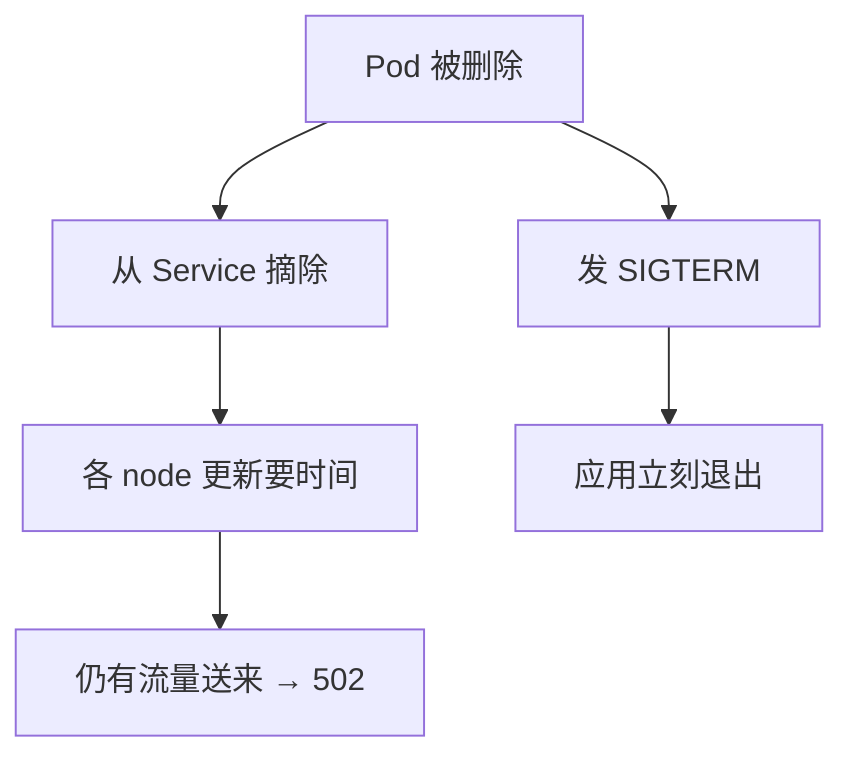

## Q
**Graceful termination · 考点**｜考点 · 必会

滚动发布时，用户偶尔看到 502。日志显示：旧 Pod 收到 SIGTERM 后立刻退出了，但那一刻仍有请求被转发给它。为什么会这样？怎么修？

## A
**原因：** 删除 Pod 之后，两件事是**同时**发生的，互相不等：

应用退出得比「所有 node 都不再转发给它」更快，中间这段时间进来的请求就失败了。

| 修法 | 做法 |
|---|---|
| preStop sleep | `lifecycle.preStop.exec.command: ["sleep","10"]`，让应用在 SIGTERM 之前多活几秒，等 Service 摘除传开 |
| 应用收到 SIGTERM 后先继续处理一会儿 | 不要立刻退出，处理完在途请求再退 |
| 宽限期要够长 | `terminationGracePeriodSeconds` 要大于 preStop 时间加应用收尾时间，默认 30 秒，不够就加 |

- **宽限期是总预算：** preStop 用掉的时间也算在里面；超时直接 SIGKILL。
- **要点：** 优雅关闭不是应用单方面的事，要给「流量摘除」留出时间。

**出处：** kubernetes.io Concepts › Pod Lifecycle（Termination of Pods）；KIA2 §6.4（宽限期，preStop 在 SIGTERM 之前）
