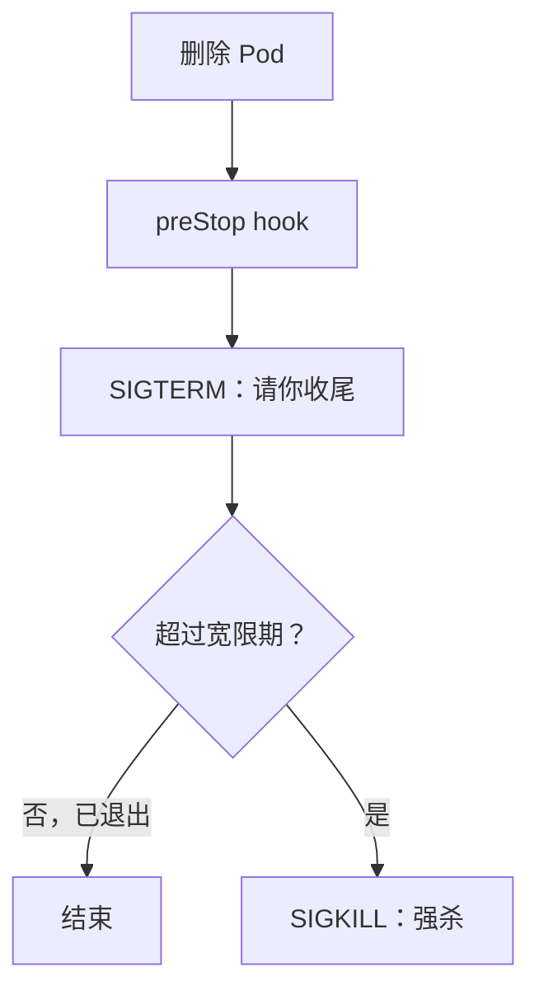

## Q
**Graceful termination · 摘要**｜摘要 · 必会

删除一个 Pod 时，容器会经历什么？`terminationGracePeriodSeconds` 管的是哪一段？

## A

| 阶段 | 发生什么 |
|---|---|
| 1 | Pod 进入 Terminating |
| 2 | 如果配置了 preStop hook，先执行它 |
| 3 | 向主进程发 SIGTERM，通知应用优雅关闭 |
| 4 | 宽限期内等待退出；到期还没退出，发 SIGKILL 强杀 |

- **宽限期：** `spec.terminationGracePeriodSeconds`，默认 **30 秒**。计时从 preStop hook 开始（没有 hook 就从 SIGTERM 开始）。
- **preStop hook：** 在 SIGTERM 之前跑的一段命令或 HTTP 调用。
- **SIGTERM 收不到：** 常见原因是容器启动命令是 shell 脚本，SIGTERM 被 shell 收了，没传给应用。用 `exec` 启动应用，别在 preStop 里手工发信号。
- **应用要做的：** 收到 SIGTERM 后停止接新请求、把手头的请求处理完、再退出。

**出处：** KIA2 §6.3–6.4（lifecycle hooks、termination grace period）
