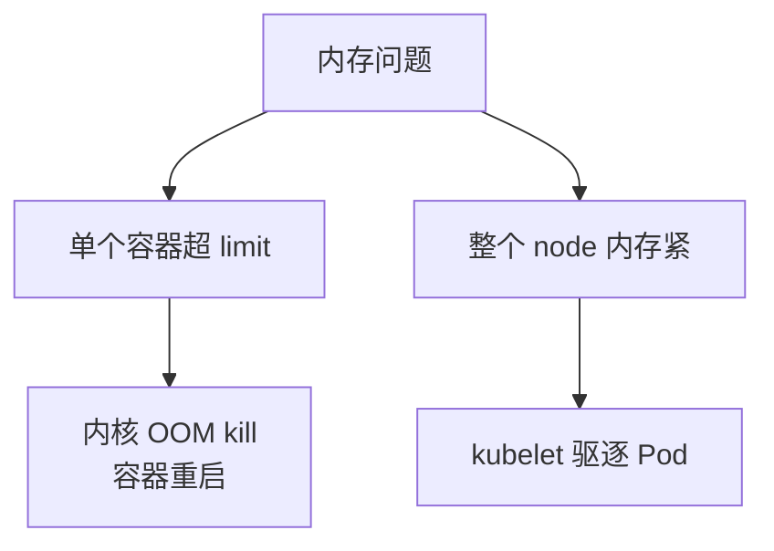

## Q
**node-pressure eviction**｜考点 · 必会

有两个现象：
1. 一个容器的内存超过了自己的 limit，`describe` 里 Last State 写着 `OOMKilled`，容器被重启，Pod 还在原来的 node 上。
2. 一个 node 上内存紧张，若干 Pod 被标成 `Evicted`，状态是 Failed。

各是谁、按什么规则动的手？

## A
| | 现象 1 | 现象 2 |
|---|---|---|
| 谁动手 | Linux 内核的 cgroup（OOM killer） | **kubelet**（node-pressure eviction） |
| 触发条件 | 这个容器超过了**自己的** limit | **整个 node** 的资源低于阈值 |
| 对象 | 超限的那个容器 | 选中的 Pod（BestEffort 与超出 requests 的 Burstable 优先） |
| 之后 | 容器被原地重启（Pod 对象还在） | Pod 被终止并标为 Failed；Deployment 会在别处补一个新的 |

- **怎么区分：** `OOMKilled` 在容器状态里；`Evicted` 是 Pod 状态，原因里写着 node 的资源压力。
- **对策不同：** 现象 1 是调大这个容器的 limit 或修内存泄漏；现象 2 是给 Pod 设合理 requests、用 Guaranteed 保护关键 Pod、或加 node。

出处

kubernetes.io Concepts › Node-pressure Eviction、Pod Quality of Service Classes；KIA2 §2.3.2

