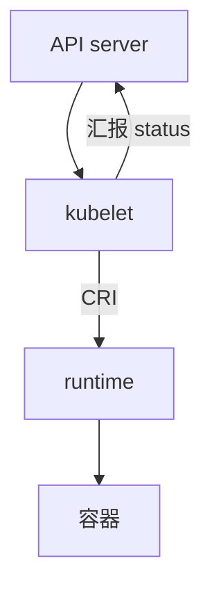

## Q
**kubelet、CRI 与 node-pressure eviction · 摘要**｜摘要 · 必会

kubelet 怎么让容器跑起来？node 内存快用完时，是 kubelet 在驱逐 Pod，还是内核在杀进程？

## A

- **kubelet：** 每个 node 的 agent。watch API server 里分配给本机的 Pod，通过 **CRI**（Container Runtime Interface，kubelet 和运行时之间的标准接口）让 runtime 拉镜像、启停容器，并把状态汇报回去。因为接口是标准的，runtime 可以是 containerd 或 CRI-O。
- **同步循环：** kubelet 持续对比「应该跑的 Pod」和「实际在跑的」，补齐差异，思路和 controller 一样。

| | node-pressure eviction | 内核 OOM killer |
|---|---|---|
| 谁来做 | **kubelet** | Linux 内核 |
| 什么时候 | 监控到 node 资源（如 `memory.available`）低于阈值时，**提前**行动 | 内存已经真的耗尽时，**事后**行动 |
| 怎么做 | 把选中的 Pod 标成 Failed，并终止 | 直接杀进程 |
| 阈值 | **soft**：超过阈值并持续一段宽限期才驱逐，受 `evictionMaxPodGracePeriod` 限制；**hard**：超过即刻驱逐，宽限期是 0 | 无阈值 |

- **kubelet 驱逐时：** 不遵守 PodDisruptionBudget，也不遵守 Pod 的 `terminationGracePeriodSeconds`。
- **先回收再驱逐：** 先清理 node 级的资源（如未使用的镜像），不够再驱逐 Pod。
- **监控的信号：** `memory.available`、`nodefs.available`、`pid.available` 等。

**出处：** kubernetes.io Concepts › Node-pressure Eviction；Poulton ch2（kubelet、runtime）
