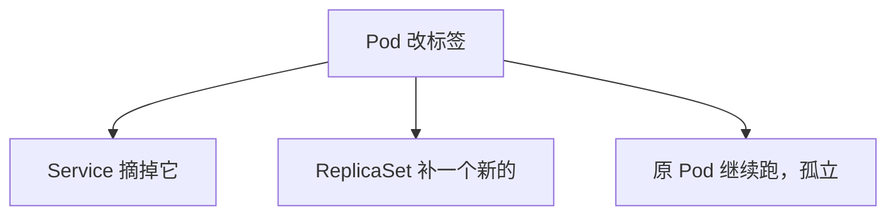

## Q
**Labels 与 selectors**｜考点 · 必会

一个 Service 的 selector 是 `app=kiada`，后面有 3 个 Pod。你对其中一个执行 `kubectl label pod kiada-x1 app=debug --overwrite`。会发生什么？Deployment 和 Service 各有什么反应？

## A
| 谁 | 反应 |
|---|---|
| **Service** | 这个 Pod 不再匹配 `app=kiada`，被移出后端，流量不再送给它 |
| **Deployment（ReplicaSet）** | 通过 selector 数自己的 Pod，现在只剩 2 个匹配，于是新建一个 Pod 补到 3 个 |
| 被改标签的 Pod | 还在运行，但不再被任何人管：不属于那个 Deployment，也不接 Service 流量 |

- **用途：** 这是一个排障技巧：把可疑 Pod 的标签改掉，它脱离流量，保留现场供你查，同时系统自动补一个新的顶上。
- **要点：** 控制器和 Service 靠 selector 认领，不靠名字，也不靠谁创建的。
- **风险：** 手误改了标签，Pod 会被「孤立」或被别的对象错误认领；selector 要写得足够具体。

出处

KIA2 §7.2–7.3；kubernetes.io Concepts › Labels and Selectors

