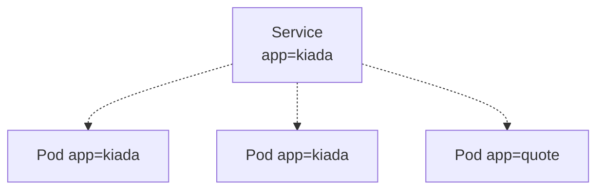

## Q
**Labels 与 selectors**｜摘要 · 必会

Service 怎么知道哪些 Pod 归它转发？Deployment 怎么知道哪些 Pod 是自己的？

## A
**一句话：** 都靠 **label**（对象上的键值标签）和 **selector**（按标签挑对象的条件）。



（Service 只选中带 `app=kiada` 的两个 Pod，`app=quote` 的不会被选中。）

```yaml
metadata:
  labels:
    app: kiada
    rel: stable
```

| 选择方式 | 例子 | 含义 |
|---|---|---|
| 等值 | `app=kiada` | 标签值等于 |
| 不等 | `rel!=canary` | 值不等于 |
| 集合 | `app in (kiada, quote)` | 值在集合里 |
| 存在 | `rel` | 有这个标签 |

```bash
kubectl get pods -l app=kiada                 # 按标签筛选
kubectl get pods -L app,rel                   # 把标签列出来
kubectl label pod mypod rel=canary            # 加标签
```

- **谁用它：** Service 用 selector 选后端；Deployment 的 `selector.matchLabels` 认领 Pod；调度、策略等也靠它。
- **标签是松耦合：** 对象之间没有硬引用，改一个 Pod 的标签，它就会被移出或加入某个 Service。
- **推荐标签：** 官方有一组标准键（如 `app.kubernetes.io/name`），方便工具识别。

<details class="pt" markdown="1"><summary>出处</summary>

KIA2 §7.2–7.3（Labels、label selectors）

</details>
