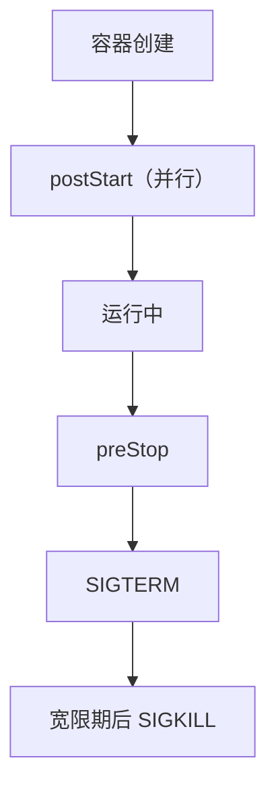

## Q
**postStart 与 preStop · 摘要**｜摘要 · 必会

postStart 和 preStop 两个 lifecycle hook 分别在什么时刻执行？支持哪些动作？失败了会怎样？

## A


| | postStart | preStop |
|---|---|---|
| 时刻 | 容器**创建后立刻**，和主进程差不多同时开始（并不是等主进程完全起好） | 容器**被要求终止前**，先于 SIGTERM |
| 动作 | `exec`、`httpGet` | `exec`、`httpGet`、`sleep`（睡几秒） |
| 失败 | 容器被杀并按 restart policy 重启，状态 `PostStartHookError`，事件 `FailedPostStartHook` | **不阻止终止**，只留一个 `FailedPreStopHook` 警告事件 |
| 期间 | 容器停在 Waiting（`ContainerCreating`），hook 完成才进入 Running | 宽限期的计时从这里开始 |

```yaml
lifecycle:
  preStop:
    exec:
      command: ["nginx", "-s", "quit"]   # 让 nginx 处理完在途请求再退出
```

- **hook 属于容器，不属于 Pod：** 容器每次被终止（包括 liveness 失败重启）都会跑 preStop，不是只在 Pod 关闭时。
- **只用于普通容器**，init 容器不支持；也不支持 `tcpSocket`。
- **preStop 只在「被要求终止」时调用**，进程自己退出时不调用。
- **要靠 preStop 做关键动作：** 要确认它真的跑成功了，失败时只有一条警告事件。

**出处：** KIA2 §6.3.1–6.3.2、§6.4（hooks 与终止顺序）
