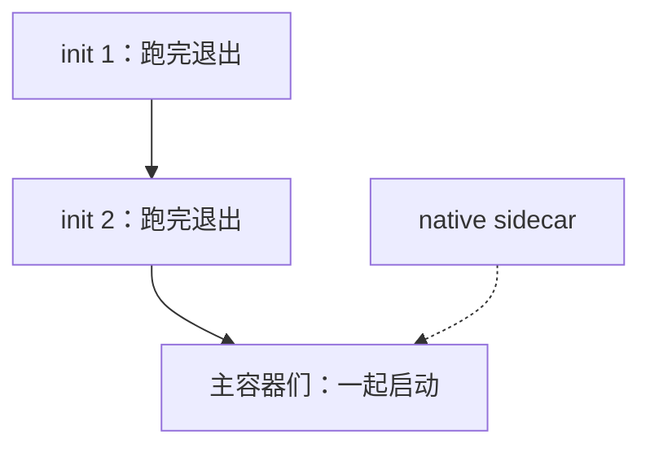

## Q
**Init containers 与 native sidecars**｜摘要 · 必会

一个 Pod 里有多个容器时，启动顺序是怎样的？init container 和普通容器有什么不同？native sidecar 是怎么回事？

## A


| 种类 | 在哪定义 | 行为 |
|---|---|---|
| **init container** | `initContainers` | 按顺序一个个跑，每个必须成功退出，下一个才开始；全部完成才启动主容器 |
| 普通容器 | `containers` | 一起启动，没有顺序保证 |
| **native sidecar** | `initContainers` 里加 `restartPolicy: Always` | 像 init 一样先于主容器启动，但不退出，一直跑到 Pod 结束 |

```yaml
spec:
  initContainers:
  - name: wait-for-db          # 普通 init：跑完退出
    image: busybox:1.36
    command: ["sh", "-c", "until nslookup db; do sleep 2; done"]
  - name: log-shipper          # native sidecar
    image: log-shipper:1.0
    restartPolicy: Always      # 这一行让它成为 sidecar
  containers:
  - name: app
    image: kiada:1.0
```

- **init 的用途：** 初始化：等依赖就绪、下载配置、准备目录。
- **native sidecar 的好处：** 先于主容器（以及排在它后面的 init）启动；崩了会被重启；Pod 关闭时，先通知普通容器退出，再通知 sidecar，所以日志收集器不会比应用先死。
- **普通 sidecar（放在 `containers` 里）的毛病：** 启动无序，关闭时可能先于主容器退出。

<details class="pt" markdown="1"><summary>出处</summary>

KIA2 §5.4–5.5（init containers、native sidecar containers）

</details>
