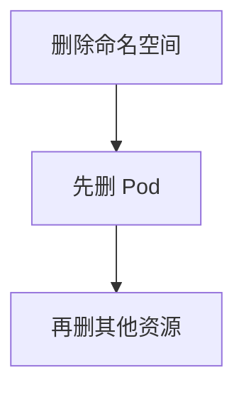

## Q
**Namespace 删除顺序 · 2026 实践**｜拓展 · v1.34 GA

以前删除一个命名空间时，里面的资源是「半随机」的顺序被删的。这会带来什么安全问题？v1.34 改了什么？

## A
**问题：** 删除顺序不确定，可能出现 **NetworkPolicy 先被删掉，而它保护的 Pod 还在**：这一小段时间里，Pod 没有了网络限制。

| | 以前 | v1.34 |
|---|---|---|
| 删除顺序 | 半随机 | 有结构：遵循逻辑和安全依赖，**Pod 先于其他资源被删除** |
| 风险 | Pod 在策略已删后仍在运行 | 去掉这个窗口 |

- **版本：** v1.33 引入，**v1.34 GA**。
- **相关：** 官方提到这个改进缓解了 CVE-2024-7598 描述的漏洞。
- **对你的影响：** 不用改任何配置，升级后自动生效。

**出处：** kubernetes.io 发布博客 v1.34（Ordered Namespace deletion 毕业为 stable）
